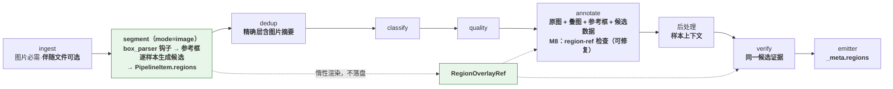
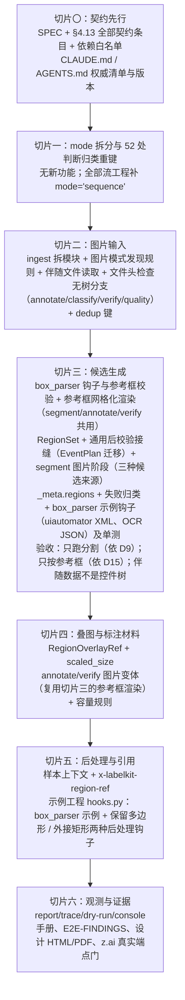

# 提案：独立图片候选区域分割与基于候选的标注（segment 图片模式）

> 2026-10-30。需求来源：[issue #5「扩展设计：segment 支持独立图片分割，annotate 基于候选区域标注」](https://github.com/HoldThatThgt/LabelKit/issues/5)，源码核对基线 `d0afd60`（与 issue 同一基线；本地 main 与 origin/main 一致）。
> **状态：提案，待需求方裁决（§6）。**2026-10-30 需求方已裁决 D1（叠图不落盘）与 D7（不授权本地视觉端点证据），均为「否」，正文已按此改写。裁决闭合后先转写为 `docs/dev/SPEC-image-region-segmentation.md`，并按 §4.13 逐项修订 `docs/CONTRACTS.md`、`spec/*.md` 与相关开发规格，再进入实现（CLAUDE.md：先改权威契约，再实现不同行为）。
> 问题验证：九路独立侦察（输入与配对、segment 配置与编排、annotate 输入与容量、M9 与 M8、后处理、verify、冻结契约与输出通道、spec 与证据纪律、外部调研）加一路完整性复核；初稿又经七路对抗审查（事实核对三路、设计反驳、规则合规、issue 覆盖、文字一致性）与逐条复核，114 条成立意见已并入本稿。
> 记号：下文 **SPEC** 指待写的 `docs/dev/SPEC-image-region-segmentation.md`；**spec §x** 指 `spec/*.md` 章节；**CONTRACTS §x** 指 `docs/CONTRACTS.md` 章节；「rule N」指 CONTRACTS §6.3 的 M1 规则编号。

---

## 1. 结论先行

**可行，推荐按 issue 的分工落地：segment 决定几何，annotate 只按 region_id 选择与标注，后处理做确定性的引用解析与格式转换。**这与 v1.8 已采纳的「定位与描述分立」（`spec/10-ch1-overview.md:129`）同构，只是把时间轴上的定位换成平面上的定位；Set-of-Mark、OmniParser 等「先给候选、再按编号选择」的工作给出了强证据（§3）。

issue 没有覆盖、实现前必须先定下来的事项分八类，推荐处置如下：

1. **`segment.enabled` 不再等于流模式。**它在 `labelkit/` 的 13 个文件中出现 69 次，其中 12 个文件的 52 处是代码判断，其余 17 处是注释、docstring 与报错文本。新增必填 `segment.mode = "image" | "sequence"`（启用时必填，无默认、无别名），52 处判断按含义分三类改写：流语义改用新解析产物 `segment.sequence_resolved`；「阶段在链」保持 `enabled`；profile 引用、视觉与修复集合按 `enabled` 加 `mode` 分别求值（§4.10）。
2. **模型侧坐标统一用 0–1000 整数网格。**LabelKit 会缩图却不记录比例，服务端还可能再缩一次，绝对像素坐标无法保证落回原图。框架按原图宽高把网格坐标投影成原图像素浮点几何，投影不取整。EXIF 方向标签取值不为 1 的图片（缺失视为 1）在图片模式下明确拒收（§4.3，§6 D4）。
3. **候选挂在 `PipelineItem.regions`；随请求发送的叠图不落盘。**新增一个惰性渲染的图片载体，在 M9 编码请求时按与原图相同的逐轴缩放渲染轮廓叠图，字节用完即弃，满足「中间态只在内存」。需求方已裁决叠图不作为运行证据落盘（D1）。
4. **几何校验进入可修复链路。**M8 现有的请求级后校验接缝只服务 EventPlan，提案把它泛化为通用接缝（EventPlan 迁到同一入口，不并存两套）。Shapely 只在 segment 族的一个模块导入，做闭环、合法性与锚点计算。坐标范围、整数类型与顶点数由内部 Schema 在 L2 判定，沿用现有违规措辞；几何后校验与引用检查的违规不回显坐标或模型给出的值。
5. **annotate / verify 增加冻结的图片变体提示词**（原图、候选轮廓叠图、可选参考框、候选区域数据，顺序见 §4.6）。候选块与参考框块都不按预算裁剪；图片模式要求所有被引用 profile 声明正的 `context_window`，首轮超限以 `context_overflow` 明确失败。任何情况下都不静默删减候选、原图或叠图。修复轮溢出沿用 `d0afd60` 刚确立的归因，是否改为 `context_overflow` 是 D11。
6. **后处理拿得到候选。**图片模式下，后处理函数与 `output.validator` 的第二入参从 `None` 改为框架绑定的样本上下文。新增 Schema 注解 `x-labelkit-region-ref`，在后处理之前做可修复的引用存在性检查。
7. **伴随数据由 box_parser 钩子转换，LabelKit 不判断它是不是控件树**（2026-10-30 需求方指示，§4.15）。LabelKit 是通用数据处理工具，图片旁边的字符串可能是控件树，也可能是 OCR 结果、说明文字或任意格式，框架无法也不应按内容猜测，也不引入正则。图片模式下 LabelKit 不解析控件树；工程在 `[segment]` 注册 `box_parser` 钩子，把伴随数据转换成统一的参考框数组（`id`、`bbox`、`text`），框架只严格校验这个数组；钩子判定数据无法解析时返回 `None`，样本以 `companion_invalid` 明确失败。不注册钩子就不读伴随文件。参考框可以作为模型的提示与可原样复用的候选，也可以不经模型直接成为候选。
8. **输入与旁路算子补齐。**图片模式下图片必需、伴随文件可选。dedup 精确层改用图片与伴随文件的内容摘要：今天开着默认 dedup 时，无树样本会被并成一个精确重复簇，侦察已实测复现。annotate、classify、verify 的无保护树调用加保护，quality 改用不渲染空树段的变体。

§6 共十五项裁决：D1、D7 已裁决为「否」，因此本特性不新增输出通道，也不使用本地视觉端点证据；其余十三项待裁决（D14、D15 随 §4.15 新增）。§2.5 列出本提案对 issue 原文的全部偏离与收窄。

数据流（新增部分加粗）：



## 2. 需求拆解与现状

### 2.1 issue「与现有实现的衔接」逐行核对

| 位置 | issue 的判断 | 核对结论 | 关键证据 |
|---|---|---|---|
| 图片输入 | UI 输入主要按截图与控件树配对 | **比 issue 说的更严格**：不是「主要」而是「只能」。只有图片的序号记为缺对（`missing_pair` + `bad_input`）；只有图片的目录以 `no valid records` 退出；零字节、`[]` 或全坏行的树文件是坏样本。任意一行 JSON 对象都能通过解析：`{}` 注入一个 `unknown [0,0,0,0]` 假节点，`{"visible": false}` 注入一个序列化为空串的不可见节点。不符合 `image_<n>` / `uitree_<n>` 命名的文件被静默忽略，不计数也不告警 | `labelkit/operators/ingest.py:55-56, 697-712, 1537-1566, 1612-1622, 1720-1758` |
| segment 配置与调度 | 开关与时序流处理绑定 | **确认，且影响远超调度**：52 处代码判断同时决定会话路由、证据完整性、默认 rubric、报表块、`_meta.stream`、控制台徽标、profile 引用集合。issue 的示例配置今天会以两条「未知键」警告通过，然后静默跑完整会话流程 | `labelkit/common/config/model.py:207-208`；`labelkit/orchestration/process_workflow.py:709-712`；`labelkit/common/config/_collect.py:286-290` |
| 单样本数据 | 已有图片引用和 UI 树 | **确认，但缺宽高**：`ImageRef` 只有 `path / format / size_bytes`；摄取只查魔数与字节数，从不读像素尺寸 | `labelkit/common/contracts/types.py:41-71`；`ingest.py:1675-1701` |
| 模型消息 | 已有有序文本和图片片段，可复用多图载体 | **部分成立**：流标注、pairwise quality 已在用多图请求；但 `Part.image` 只接受磁盘路径型 `ImageRef`，叠图没有合法载体；Anthropic 构造器会丢弃 system 消息里的图片 | `labelkit/common/inference/llm_client.py:147-159, 644-648` |
| annotate | 已有用户指令、按类 schema 与修复 | **确认**：普通 UI 记录的提示词是冻结的三段式（截图、控件树），没有叠图与候选槽；新增材料必须是新的冻结变体 | `labelkit/operators/annotate.py:79-106, 423-443`；`docs/CONTRACTS.md:8026-8071` |
| 后处理 | 已有代码负责字段；UI 的 raw 当前为空 | **确认，精确值是 `None`**：后处理与 `output.validator` 的第二入参都是 `Record.raw` 的深拷贝，UI 记录为 `None`；契约明文禁止框架虚构原始行字段；后处理异常是终局程序错误，从不进入模型修复 | `labelkit/operators/annotation_finalization.py:150-156`；`docs/dev/SPEC-annotation-postprocessing.md:82-91, 192-205` |
| 运行证据 | 已有输出目录、trace 与 report | **不成立**：没有「输出目录」，只有由输出路径派生的固定文件；没有任何通道写图片；trace 在任何档位都不带图片（`full` 档位也只记路径）；report 只有计数 | `spec/20-ch2-overall-design.md:163`；`docs/CONTRACTS.md:7207, 9394-9398`；`llm_client.py:847-864` |
| 依赖 | 复用 Pillow；Shapely 需新增 | **确认**：Pillow 锁定 12.3.0，但生产代码没有任何绘图调用；CONTRACTS 总则的依赖白名单写明「Nothing else」 | `pyproject.toml:6-18`；`docs/CONTRACTS.md:122-128` |

### 2.2 issue 未覆盖的冲突与缺口

| # | 冲突或缺口 | 证据 | 严重度 | 处置 |
|---|---|---|---|---|
| C1 | `segment.enabled` 是契约原文里的「流模式总开关」。只加 `mode` 而不改写，图片样本会进入会话编排、完整证据门、`default:trajectory` rubric、`report.stream` 等全部流语义；反过来，一刀切替换又会把图片阶段踢出链序、把 `segment.llm` 移出引用集合 | `docs/CONTRACTS.md:1677`；`process_workflow.py:1074`；`labelkit/orchestration/factory.py:26`；`labelkit/common/inference/credentials.py:75` | 阻断 | §4.10 |
| C2 | 模型输出坐标的空间未定义。`load_base64` 按长边缩放、逐轴各自取整、不返回比例；服务端可能二次缩放（Claude 标准档长边 1568，Qwen 28/32 像素块）；各家模型约定不一（绝对像素、0–1000、0–1） | `types.py:57-71`；`llm_client.py:569-580`；§3 第 5 条 | 阻断 | §4.3 |
| C3 | 叠图没有合法载体：写临时文件违反「无声明通道以外的临时文件」；常驻字节违反「图像字节懒加载、用后即弃」 | `docs/CONTRACTS.md:9394-9398`（§11 第 5 条）、`450-459, 3422-3433`；`spec/20-ch2-overall-design.md:165` | 阻断 | §4.2、§4.5 |
| C4 | 内部 Schema 调用没有可修复的语义校验接缝：L2.5 只服务用户 Schema；`complete_post_validated` 的唯一成功形状要求非空 `EventExecution`；finalizer 失败是终局。几何非法因此只能终局失败 | `labelkit/common/inference/schema_engine.py:852-900, 1014-1057, 1203-1237, 1309-1376`；`labelkit/common/contracts/generation.py:501-509` | 阻断 | §4.4 |
| C5 | 后处理拿不到候选（第二入参为 `None`）。未知 region_id 若在后处理里抛错，是终局程序错误，不会修复；而 `output.validator` 在后处理之后才运行 | `annotation_finalization.py:150-156`；`schema_engine.py:1203-1237` | 主要 | §4.7 |
| C6 | dedup 精确层对 UI 只看量化后的树，不含图片字节。无树样本的去重文本全是空串，开着默认 dedup 时 N 张图片只剩 1 张；外壳树相同的不同截图也会被判为精确重复（侦察已实测）。近重复层里，无树样本的 MinHash 也完全相同 | `labelkit/operators/dedup.py:91-93, 324-351`；`model.py:170-176` | 主要 | §4.9 |
| C7 | annotate、classify、verify 有无保护的 `record.ui_tree.serialize()` 调用，无树样本会抛 `AttributeError`。quality 已能处理 `None`，但会渲染一个空的 `[UI 控件树]` 段 | `annotate.py:434, 1026-1028`；`classify.py:351`；`verify.py:601, 749`；`labelkit/operators/quality.py:635` | 主要 | §4.9 |
| C8 | 冻结提示词 CONTRACTS §10.1 / §10.5 没有叠图与候选槽；标签「[屏幕截图]」不适用于照片与文档图片 | `docs/CONTRACTS.md:8026-8071, 8155-8167` | 主要 | §4.6、§4.8 |
| C9 | 容量：普通 UI 标注按预算份额从尾部裁树（图片模式不构造树，参考框块与候选块都不可裁剪，只能首轮预检明确失败）；`input.ui_tree_max_chars`（默认 30000）另有硬截断；`context_window = 0` 时完全不预检；verify 只按一张图计费。普通记录修复轮溢出归 `schema_violation` 是 `d0afd60` 的有意决定，与 issue「超限明确失败」存在张力 | `annotate.py:554-567`；`verify.py:605-608, 647-650`；`docs/dev/REVIEW-common-inference-repair.md:14, 21-23` | 主要 | §4.6、§4.8、D11 |
| C10 | EXIF 方向不一致：未缩放的 JPEG 原样发送、保留方向标签；缩放后重新编码、标签丢失；全仓没有 `exif_transpose`。同一张照片因工作点不同会以不同方向呈现给模型，叠图也会与原图错位 | `types.py:57-70`（侦察实测 Orientation=6 在 4000 档保留、2048 档丢失） | 主要 | §4.3、D4 |
| C11 | 真实端点证据缺口。DeepSeek anthropic 路由曾于 2026-08-12 观察到不接受图片块（E2E-FINDINGS 标为历史观察，不能当现状），且 CLAUDE.md 只让 DeepSeek 承担序列生成门。z.ai glm-5.2 声明支持视觉，但仓内没有「只有看懂像素才能答对」的断言。本地 Qwen3.5-4B-Q6_K 已有像素级证据，但 CLAUDE.md 只授权它用于四道指定的门，需求方也已裁决不为本特性授权（D7），所以 z.ai 是唯一证据来源 | `docs/dev/E2E-FINDINGS.md:63-71, 846-849`；`tests/integration/test_budget_llm.py:302-370`；`examples/config.toml:8-33` | 阻断（证据） | §5、D7 |
| C12 | 文件规模：`ingest.py` 1985 行（离上限 15 行）、`quality.py` 1991 行、`process_workflow.py` 1890 行、`llm_client.py` 1876 行；新逻辑必须进新模块 | `wc -l` | 主要（实现） | §4.9、§4.13 |
| C13 | 链序：segment 固定在链首，早于 dedup、classify、quality；图片分割的视觉调用会花在之后被判重或低质剔除的样本上 | `process_workflow.py:81-82` | 次要（成本） | D2 |
| C14 | 默认 UI rubric 含权重 1.5 的 `tree_screen_consistency`，对无树样本没有意义；空 rubric 在 UI 模态下解析为它 | `labelkit/data/rubrics/default_ui.toml:15-18`；`labelkit/common/config/_constraints.py:579-582` | 次要 | §4.9、D10 |
| C15 | classify 多标签扇出按显式字段清单克隆信封，新字段不进清单就会在兄弟行上丢失 | `labelkit/operators/classify.py:1488-1506` | 次要 | §4.2 |
| C16 | `validate --probe` 只发 1 token 文本，不验证视觉；不收图的端点能通过探测，运行时才以 `provider_fatal` 失败并计入熔断 | `llm_client.py:1027-1049` | 次要 | §7 |

### 2.3 与既有决策的关系（为什么这不是翻案）

| 既有决策 | 内容 | 与本提案的关系 | 证据 |
|---|---|---|---|
| 定位与描述分立（v1.8） | segment 做时序定位，annotate 做描述打标，两道工序 | **平面同构**：新增一行决策日志「空间定位与标注分立」，以 Set-of-Mark / OmniParser 背书，不重新解释原有时序那一行 | `spec/10-ch1-overview.md:129` |
| extract 的 target 只用文本引用、不输出坐标 | 两条理由：①元素文本引用与中心坐标对 LLM 等效；②`max_image_px` 降采样会破坏坐标对应 | **不冲突**：用 0–1000 网格加显式投影回应理由②；理由①不适用，因为区域分割的产物就是几何本身，没有文本引用可替代，而 annotate 仍只按 region_id 引用、不生成坐标。extract 本身不变 | `spec/315-m15-extract.md:127` |
| `output.validator`（L2.5）的设立动机 | 2026-07-03 分析把「UI 元素坐标必须落在截图分辨率内」列为目标用例 | **补齐原意**：该用例今天无法实现（第二入参为 `None`、ImageRef 无宽高）；§4.7 给校验器样本上下文正是兑现它 | `docs/dev/ANALYSIS-generation-batching-and-validation-hooks.md:42-50` |
| 普通记录修复轮溢出归 `schema_violation`（`d0afd60`） | 审查明确否决「直接扩大 `complete_evidence` 到普通记录」，理由是会改变溢出归因，并让无视觉修复模型收到图片；为此拆出 `retain_repair_prompt` | **默认不推翻**：图片模式沿用该归因，首轮超限才保证 `context_overflow`。是否在图片模式内修订列为 D11；该审查的第二条理由在图片模式下不成立（§4.10 要求 `repair_llm` 支持视觉） | `docs/dev/REVIEW-common-inference-repair.md:14, 21-23`；`spec/305-m5-annotate.md:80`；`docs/dev/SPEC-context-budget.md:305` |
| 工具级负边界（spec §2.1.2） | ①不训练、不托管本地模型；⑦除配置声明的 LLM API 外不发起网络请求 | **保持**：v1 候选只来自已配置的 LLM profile，不接入 SAM 等独立分割模型。这比 issue「不限定实现方式」更严，见 §2.5 | `spec/20-ch2-overall-design.md:26` |
| Stage 契约的 Record 重绑授权 | 只有 stitch（②c）与 M7 流成员手术可重绑 Record，且都限流模式 | **不使用**：图片模式只写信封新字段、可置 `failed`，属契约 ①④ 的普通行为，不需要新例外 | `labelkit/common/contracts/stage.py:69-99` |
| 设计假设 A1、A2、A3（spec §8.2） | A1：UI 树导出格式；A2：一个 uitree 文件对应一屏截图；A3：所配 VLM 支持单请求多图，不支持时的影响栏写着 M4 留有 Pillow 纵向拼接开关 | A1、A2 在图片模式下不适用：一张图片 = 一个样本，伴随文件可选，其格式由工程的 `box_parser` 钩子负责（§4.15）。A3 是原图加叠图的前提，issue 禁止拼图，所以图片模式下 A3 不成立就没有退路，需写进 A3 的影响栏；该栏所称拼接开关在生产代码中并不存在，顺带更正 | `spec/80-ch8-nongoals-roadmap.md:37-38` |

已检索 spec 第 8 章、全部 PROPOSAL / SPEC 与决策日志：**图片定位、区域分割、多边形或 bbox 生成从未被列为非目标或被否决**，这是全新方向。

### 2.4 需求的精确边界

**做**：独立图片的候选区域生成；可选伴随数据经 box_parser 钩子转成参考框作辅助证据；确定性叠图；annotate 与 verify 读取同一候选证据；后处理拿到框架绑定的候选上下文；候选数据作为可核对的运行证据输出（叠图不落盘，D1）。

**不做**（写入 spec §8.1 非目标）：跨帧身份、区域追踪、参考帧与变体匹配；截图与伴随数据（参考框）的自动配准、缩放推断；按内容判断伴随数据的格式；正则式的伴随数据抽取；交互式视觉工具循环；v1 不接入独立分割模型（受工具级负边界①⑦约束，不写成永久非目标）；任何几何自动修复（`make_valid`、`buffer(0)`、`orient_polygons`、`set_precision`）；verify 触发的重新分割；按类配置分割指令（segment 在 classify 之前运行，`[class.<name>.segment]` 不存在）。

### 2.5 对 issue 原文的偏离与收窄

| issue 原文 | 本提案 | 理由 | 裁决 |
|---|---|---|---|
| 框架检查区域标识唯一性（隐含编号来自模型） | 区域编号由框架按输出顺序分配 `r1…rN`，唯一性由构造保证 | 少一类违规；纯 ASCII 编号便于叠图标注 | D13 |
| 几何为原图像素坐标 | 模型侧用 0–1000 网格，对外发布原图像素浮点几何 | 与 LabelKit 缩放、服务端缩放都无关；对外契约仍是原图像素 | D3 |
| 普通照片是目标输入 | 带方向标签（取值 2–8）的照片在图片模式下拒收 | 不静默旋转；避免原图与叠图方向错位 | D4 |
| 图片必需、控件树可选（未限定模式） | 只在 `segment.mode = "image"` 下生效：图片必需、伴随文件可选；segment 关闭时纯图片仍无法摄取 | 不改变既有 UI 工程的配对与计数 | D5 |
| 模型结合图片使用控件树边界；`regions[].source_node_ids` 引用控件树节点 | 图片模式下 LabelKit 不解析控件树；工程注册 `segment.box_parser` 把伴随数据转成统一参考框数组，引用字段改为 `source_box_ids` | 通用工具无法判断伴随字符串是不是控件树，不做内容嗅探、不用正则（§4.15） | 需求方指示（2026-10-30） |
| 空控件树或只有窗口外壳时仍以图片生成候选 | 由钩子决定返回空数组或外壳框；配置了 `instruction` 时模型照常依据图片生成候选 | 处理策略写在用户代码里，显式可测 | 需求方指示（2026-10-30） |
| 候选区域来源表：模型结合图片与控件树补充或修正候选 | 不配 `instruction` 时参考框不经模型直接成为候选（对该表的偏离） | 需求方提出「按转换后的 bbox 数组标注图片」 | D15 |
| 分割不限定由某类模型实现 | v1 只用已配置的 LLM profile | 工具级负边界①⑦ | 随提案确认 |
| 外接矩形计算采用 Shapely | 外接矩形由后处理钩子计算（对外环顶点取 min/max，与 Shapely `bounds` 结果相同）；LabelKit 不新增公开几何 API | issue 第 218 行只要求「提供候选上下文」；钩子是 LabelKit 后处理链路的一部分 | 随提案确认 |
| 保存可核对的候选数据和叠图 | 候选数据恒在 `_meta.regions`；叠图不落盘 | 需求方裁决不新增输出通道 | D1（已裁决：否） |
| 避免大面积不透明填色 | v1 只描轮廓、不填色 | 原图已单独发送，填充收益未经验证，且会改变区域内文字的像素 | D12 |
| 超限使用明确的容量错误 | 首轮超限保证 `context_overflow`；修复轮溢出沿用现行归因（仍是明确失败） | 不推翻 `d0afd60` 的有意决定 | D11 |
| 已有质量检查按工程配置启用 | 图片模式下 quality 开启而 rubric 为空时报错 | 图片模式恒无控件树，默认 UI rubric 的树一致性条目恒无意义 | D10 |
| （未涉及） | 图片模式允许关闭 annotate，只跑分割 | 便宜地单独评估分割质量 | D9 |

## 3. 业界方案调研（2026-10-30 检索核实）

1. **Set-of-Mark（arXiv 2310.11441）**：用现成分割器产出区域，叠加数字标记后让 GPT-4V 按编号回答。RefCOCOg 指代理解从 25.7 提升到 86.4；换成真值掩膜后 mIoU 从 75.6 到 90.1，说明**最终质量受候选质量约束**，支持「候选遗漏在 segment 解决、不在 annotate 补画」。两点差异：SoM 只发送标记图、不另发原图；其最好配置是「编号 + 半透明掩膜 + 框」。issue 只要求「细线、清晰的小标识，避免大面积不透明填色」，并未禁止低不透明度填充；本提案 v1 只描轮廓是自己的取舍（D12）。SoM 的标记放在区域内离边界最远的点，属纯几何、可确定的做法。
2. **SoM-LLaVA（arXiv 2404.16375）**：开源小模型在未经标记数据训练前很难读懂视觉标记。本地 4B 模型的区域选择质量不能先验乐观。
3. **OmniParser（arXiv 2408.00203）**：GPT-4V「无法给出精确的 x-y 坐标」，改为叠加编号框、按编号选择；在框外另给每个候选的文字语义后，选择正确率从 0.705 提到 0.938。**直接支持 issue 的三通道输入**，尤其说明文本候选通道有可测的收益，不应省掉。
4. **UFO（arXiv 2402.07939）与 UGround（arXiv 2410.05243）**：UFO 同时提供干净截图与标注截图，理由是干净图让模型看清被标记遮住的内容，这是「原图 + 叠图分开发送」最接近的先例，但没有消融数据，issue 计划的「有无叠图」对照实验就是真正的证据。UGround 指出 SoM 式选择受候选完整性约束，与「候选遗漏由 segment 负责」一致。
5. **坐标约定**：Qwen2.5-VL 输出**服务端缩放后图片**的绝对像素；Qwen3-VL 改为 0–1000 归一化（技术报告 §3.2.4）；GLM-V 系列按宽、高归一化后乘 1000；SeeClick 用 0–1 比例；Claude 返回它缩放后看到的像素（标准档长边 1568）；OpenAI 的坐标保真度取决于请求里的 `detail` 字段，LabelKit 不发送该字段。结论：**只有归一化网格同时不受 LabelKit 缩放与服务端缩放影响**；glm-5.2 的约定未见公开文档。
6. **多边形生成能力**：Text4Seg（ICLR 2025）指出 LLM 难以把多边形坐标与形状对应；Gemini 2.5 分割输出的是 0–1000 框加掩膜 PNG，不是多边形；Qwen 系列报告只描述框与点的定位数据。**通用 VLM 大概率只给矩形或粗多边形**，孔洞与多部件不是其原生能力，相关验收行要用固定候选夹具走确定性路径测试。
7. **Shapely 2.2.0（2026-10-07 发布）**：BSD-3，要求 Python ≥ 3.11、NumPy ≥ 1.26，与本仓下限一致；wheel 内置 GEOS 3.14.1（LGPL-2.1）。构造时**不检查**合法性，会**隐式闭合**未闭合的环；`make_valid`、`orient_polygons`、`set_precision` 都会改变几何。OGC 合法性下，MultiPolygon 各部件内部不得相交，边界只能在有限个点上相接（**共边也非法**，已实测两个相邻矩形 `is_valid` 为 False）。
8. **几何格式先例**：RFC 7946 只采纳嵌套结构、环闭合（≥ 4 个位置，首末相同）、首环为外环；WGS 84、经纬度、跨日界线、右手定则在 y 向下的像素坐标里不适用。COCO 多边形是绝对像素扁平坐标列，与 CVAT 一样不支持孔洞（孔洞要走掩膜），所以「保留孔洞」超出常见标注工具的导出能力，输出形态应由用户 Schema 决定。
9. **Pillow 绘制**：`ImageDraw.polygon` 没有孔洞参数，需分别描外环与内环；`width > 1` 时描边落在环内侧；`ImageFont.load_default(size=...)` 需要 Pillow ≥ 10.1；字形栅格化随 FreeType 版本变化，**字节级确定性只能承诺在同一 Pillow / FreeType 构建内成立**（本机 Pillow 12.3.0 / FreeType 2.14.3）。

**调研小结（直接成为设计约束）**：①按编号选择优于让标注模型生成坐标；②文本候选通道必须保留；③模型侧坐标必须与缩放无关；④孔洞与多部件用夹具测试，不宣称 VLM 能生成；⑤叠图确定性的承诺范围要写清；⑥叠图是否有益、是否填色，都是实验问题，不是先验结论。

## 4. 方案设计

### 4.1 候选与取舍

| 议题 | 候选 | 裁决 |
|---|---|---|
| 配置形态 | **`segment.mode` 启用时必填（issue 方案，推荐）** | 采纳。键名沿用 issue 的 `mode`，SPEC 写明它与 `run.mode`、`quality.mode` 的区别；跨模式禁键沿用 `generate.form` 的先例 |
| | 新建独立算子与配置节 | 否决：issue 已明确要求扩展 segment；独立算子只能省掉重键，输入、提示词、校验、输出的工作一样不少，还要新增阶段名并改冻结链序（参见 D2） |
| | 按是否有控件树推断模式 | 否决：issue 明确禁止 |
| 模型侧坐标 | **0–1000 整数网格，框架投影（推荐）** | 采纳：与 LabelKit 缩放、服务端缩放都无关；Qwen3-VL / GLM-V 的原生约定 |
| | 发送尺寸像素加记录变换 | 否决：服务端二次缩放不可见；修复轮若换 profile 还会换坐标空间 |
| | 按 profile 声明坐标空间 | 否决：新增配置层，缺少权威需求 |
| 叠图载体 | **惰性渲染载体，编码时渲染（推荐）** | 采纳：不落盘、不常驻，与原图共用缩放函数 |
| | 写临时文件再用 ImageRef 引用 | 否决：违反 CONTRACTS §11 第 5 条与 spec §2.6 |
| | 原图与叠图拼成一张 | 否决：issue 明确禁止 |
| 候选承载 | **`PipelineItem.regions`（推荐）** | 采纳：阶段产物挂信封是既有先例（transitions、member_annotations） |
| | 挂在冻结的 `Record` 上 | 否决：Stage 契约只为 stitch 与 M7 流成员手术开放 Record 重绑，且均限流模式；Record 承载输入身份 |
| 未知区域引用（D6） | **`x-labelkit-region-ref` 注解，后处理前可修复（推荐）** | 采纳：通用、不含业务规则、违规不回显模型给出的值 |
| | 后处理里抛错 | 保留为程序错误语义，但不作为引用检查手段（终局、不可修复） |
| | 每个样本动态生成 enum | 否决：模型 Schema 在 M1 冻结，且破坏结构化输出缓存与静态预算 |
| 区域编号 | **框架按输出顺序分配 `r1…rN`（推荐）** | 采纳，见 §2.5 与 D13 |
| | 模型自拟编号 | 否决：多一类唯一性违规，且编号可能不适合渲染 |
| M8 校验接缝 | **泛化 `complete_post_validated`，EventPlan 迁到同一入口（推荐）** | 采纳：仓内规则不保留并存的两套接缝 |
| | 新建一个兄弟接缝 | 否决：两套几乎相同的重放修复循环 |

### 4.2 数据流与承载结构

**候选载体**（新模块 `labelkit/common/contracts/regions.py`；只含 int / float / str / tuple，本身深不可变，不复用 `contracts/generation.py` 的私有 `_ImmutableCarrier`，因为该模块导入 `llm_client` 与 `schema_engine`，会形成导入环）：

```python
@dataclass(frozen=True)
class ReferenceBox:
    """box_parser 钩子返回并经框架校验的一个参考框（原图像素，仅轴对齐矩形，D14）。"""

    box_id: str                                        # 钩子给出的 id，样本内唯一，不形如 r<正整数>
    bbox: tuple[float, float, float, float]            # (l, t, r, b)，0 ≤ l < r ≤ width，0 ≤ t < b ≤ height
    text: str                                          # 钩子给模型看的描述，可为空


@dataclass(frozen=True)
class RegionPolygon:
    """单个多边形部件：原图像素闭环外环与零到多个闭环内环。"""

    exterior: tuple[tuple[float, float], ...]          # 闭环：≥4 个位置，首末相同
    holes: tuple[tuple[tuple[float, float], ...], ...] # 每个内环同样是闭环


@dataclass(frozen=True)
class CandidateRegion:
    """一个候选区域：框架编号、几何部件、来源参考框与叠图标注点。"""

    region_id: str                                     # 框架按输出顺序分配，冻结格式 r<正整数>：r1, r2, …
    polygons: tuple[RegionPolygon, ...]                # 1 个 = Polygon；多个 = MultiPolygon
    box_id: str | None                                 # 几何取自哪个参考框（复用或 D15 直通）；模型画的多边形为 None
    source_box_ids: tuple[str, ...]                    # 没有参考框时恒为空；box_id 非空时恒为 (box_id,)
    label_anchor: tuple[float, float]                  # 原图像素点，仅用于渲染，不是几何真值


@dataclass(frozen=True)
class RegionSet:
    """一个样本的完整分割结果；regions 为空元组表示合法的空候选。"""

    width: int                                         # 原图存储像素宽（Pillow 只读文件头）
    height: int
    boxes: tuple[ReferenceBox, ...]                    # 未注册钩子或无伴随文件时为空
    regions: tuple[CandidateRegion, ...]
```

- **唯一几何真值是原图像素浮点坐标**，与 issue 的 `regions[].geometry` 一致。候选有两种来源，各只换算一次：模型画的多边形在网格空间通过校验后，按 `x_px = gx × width / 1000`、`y_px = gy × height / 1000` 投影为像素，不取整、不改变顶点顺序；复用参考框的候选直接取框的像素矩形，不经网格，精度无损。矩形候选同样以多边形表达，不维护第二套几何。网格只是模型输入输出的坐标空间。
- **信封字段**：`PipelineItem.regions: RegionSet | None = None`（末尾追加带默认值，既有先例）。`None` 表示未运行图片分割或分割失败；`RegionSet(regions=())` 表示合法的空候选，二者不能混用。`types.py` 只在 `TYPE_CHECKING` 下引用 `RegionSet`（沿用 `SequenceTemporalContext` 先例）；导入方向只允许 `regions.py → types.py`。
- **传递**（全部显式，同一冻结对象）：
  - annotate：`AnnotatePromptOptions` 新增 `regions` 字段（CONTRACTS §7.4），由 annotate 从信封填入，自洽采样与 L3 修复共用；
  - verify 评审：`VerifyPromptOptions` 新增 `regions` 字段（CONTRACTS §7.6），由 `_plan_classic_review` 从 `state.item.regions` 填入，`_panel_fit` 据此按两张图计费；
  - verify 修复：`_reannotate_leaf`（`labelkit/operators/verify.py:1376-1393`）把 `item.regions` 传入 `AnnotatePromptOptions`；
  - segment 自身：`box_parser` 钩子的结果在模型调用前冻结进 `RegionSet.boxes`，首轮与 L3 修复共用；
  - 后处理与校验器：`annotation_record_context(record, regions)` 与 `annotation_transforms(record, cfg, label, temporal_context, regions)` 增加入参（后者恰为 5 个参数上限），帧路径传 `None`；
  - classify 多标签扇出：`_fan_out` 字段清单（`classify.py:1488-1506`）加入 `regions`，按引用共享。

**叠图载体**（同模块）：

```python
@dataclass(frozen=True)
class RegionOverlayRef:
    """原图加候选的惰性叠图引用；与 ImageRef 共享 load_base64 接口。"""

    base: ImageRef
    regions: RegionSet

    def load_base64(self, max_px: int) -> tuple[str, str]:
        """按与 base 相同的逐轴缩放渲染叠图，字节不保留。

        @param max_px 本次请求的长边像素上限。
        @return (media_type, b64)，media_type 恒为 image/png。
        """
```

- 渲染样式是模块级冻结常量，不放在载体实例上，避免为多版本预留分派分支。
- `Part.image` 的类型放宽为 `ImageRef | RegionOverlayRef`（CONTRACTS §3 / §7.8）。trace `full` 档位把叠图记为 `{"type": "image", "path": <原图路径>, "overlay": "regions"}`，不内联字节；`llm_client.py:847-864` 现在直接取 `.path`，需同步修改。
- 共享纯函数 `scaled_size(width, height, max_px)` 放在 `types.py` 与 `ImageRef` 相邻（`types.py` 不导入 labelkit 内任何模块），`ImageRef.load_base64` 与叠图渲染共用。

### 4.3 坐标与画布契约

- **画布**：原图的存储像素网格；左上角为原点，x 向右，y 向下。宽高由 segment 阶段用 Pillow 只读文件头得到（ImageRef 不携带宽高，见 §4.4 失败表）。
- **模型侧网格**：segment 的输出与图片模式所有提示词里的候选坐标一律用 0–1000 整数网格，x 相对宽度、y 相对高度，两轴各自归一化。x 精度为 `width / 1000` 像素，y 精度为 `height / 1000` 像素（1080 × 2340 的竖屏截图约为 1.08 / 2.34 像素），在 SPEC 与手册中写明。候选是区域提议而非像素级掩膜，这个精度足够。
- **候选投影**：模型画的多边形在网格空间通过校验后投影一次为像素真值（§4.2 公式），不取整、不吸附。合法性在网格的整数坐标上判定，避免浮点误差改变共点、共线等边界情形；正比例的逐轴缩放不改变自交、孔洞包含、部件相交这些拓扑性质，画布范围 `0..1000` 也等价于 `0..width`。复用参考框的候选不经网格。
- **提示词里的网格显示**：像素真值回到提示词时只是显示投影，不回写真值。凡几何来自参考框的显示，即 `[参考框]` 块本身以及 `box_id` 非空的候选（复用与 D15 直通），一律用同一个外扩取整函数（下条公式），保证同一框在两个块中逐值相等、任何正尺寸的框仍有正面积（例如 4000 像素宽、l = 1000、r = 1001 的框显示为 250 / 251）；只有 `box_id` 为空的模型画多边形顶点用就近取偶，可精确还原模型原先给出的整数。
- **闭环约定**：与 issue 示例、RFC 7946 一致，模型给出的每个环必须闭合（≥ 4 个位置，首末相同），发布时原样投影，不改写。未闭合按违规进入修复，框架不代为闭合。相邻重复顶点在 OGC 下合法，原样保存。
- **参考框网格化**（只用于提示，不产生几何真值）：图片模式下 segment、annotate、verify 共用同一个冻结的参考框渲染函数（放在 `regions.py`，避免算子互相导入），每框一行 JSON：`json.dumps({"box_id": id, "bbox": [gl, gt, gr, gb], "text": text}, ensure_ascii=False)`，行间以 `\n` 连接、无末尾换行；与 `[候选区域]` 同一转义规则，text 中的换行、引号与控制字符一律转义，任何 text 都不能伪造出另一行。外扩取整的公式为 `gl = floor(l*1000/width)`、`gt = floor(t*1000/height)`、`gr = ceil(r*1000/width)`、`gb = ceil(b*1000/height)`（bbox 可为浮点，SPEC 用精确有理运算实现以免浮点歧义），网格框恒包含像素框，最大外扩误差一个网格单位。框已由框架校验在画布内，网格值不会超出 `0..1000`。模型要精确复用某个框时用 `box_id`，不必照抄网格坐标（§4.4）。图片模式不构造 `UITree`；冻结的 `UITree.serialize()` 与非图片模式的 uitree 解析都不改，字节不变。
- **缩放一致性**：`scaled_size` 共用保证原图与叠图逐轴尺寸完全一致（现有实现逐轴各自 `round`，1080 × 2340 在 2048 档得到 945 × 2048，`types.py:61-62`）。
- **EXIF 方向**：图片模式下读取文件头 Orientation 标签（0x0112；PNG 的 eXIf 块同样适用）。标签缺失或取值为 1 视为正常方向（截图类 PNG 通常没有该标签）；取值 2–8（含镜像）在摄取时作为坏样本拒收，原因文本 `image has EXIF orientation <n>; bake the orientation into pixels first`；其他非标准取值同样拒收，原因文本 `image has invalid EXIF orientation <n>`。不自动旋转。读取成本：JPEG 只读文件头即可；PNG 无 eXIf 块时 Pillow 的 `getexif()` 会解码全图，与 spec §3.2.4「不解码全图」冲突，SPEC 须二选一：接受该成本并修订 spec §3.2.4，或自行扫描 IDAT 之前的 PNG 块。
- **不承诺**：服务端对图片的二次处理不在 LabelKit 的保证内。归一化网格本身对它免疫，但模型是否遵守网格约定只能靠真实端点证据确认（§5）。

### 4.4 segment 图片模式

**阶段**：新模块 `labelkit/operators/segment_image.py`，阶段名仍为 `segment`，占用链首原位置（链序元组不变）。走普通批路径（`session_attempt = None`）。每个样本先在阶段内同步调用 `box_parser` 钩子（若注册且有伴随文件）并冻结参考框；钩子失败的记录直接置 `failed`。只有写了 `instruction` 时，才为其余 active 记录各提交一个 `TaskSpec(resource_key=("llm", segment.llm))`，经 `ctx.run_group` 并发。没写 `instruction` 时（D15）不提交任何任务组，参考框按 §4.15 直接成为矩形候选；此时 `segment.llm` 不在引用集合，运行时也没有这个资源键，任何对它的提交都会让整个任务组以 `unknown runtime resource key` 失败（`labelkit/runtime/resources.py:79-90`），所以这条路径必须完全不碰 runtime。不改动 `SegmentStage`、`judge_window` 和 stream_verify 对它们的依赖。`labelkit/orchestration/factory.py:26-29` 按 mode 选择阶段类。几何校验放在同族的 `labelkit/operators/segment_geometry.py`，它是 Shapely 的唯一导入点（ortools 只由 planner 导入的先例），两模块都登记进 `tests/cli/test_cli.py` 的 segment 导入族与文件清单。

**提示词**（CONTRACTS §10 新增冻结条目，以下是待定稿的草案）：

- system：框架固定头 + `[分割指令]` + `segment.instruction`。固定头草案：「你负责为图片生成候选区域。坐标使用 0–1000 整数网格：x 是相对图片宽度的千分位，y 是相对图片高度的千分位，原点在左上角。每个区域由一个或多个多边形组成；每个多边形给出闭合的外环（至少 4 个点，最后一个点与第一个点相同），可以给出同样闭合的内环表示孔洞。同一区域的多个多边形之间不能重叠，也不能共用边；相邻的部分请合并成一个多边形。孔洞不能与外环共用边。不要输出区域编号。提供了参考框时，每个区域二选一：复用一个参考框时只填 box_id，polygons 与 source_box_ids 都填 null；画新多边形时 box_id 填 null，可以在 source_box_ids 中列出参考了哪些框（不要重复）。同一个参考框最多复用一次。参考框的 id 只用于说明来源，不是候选编号。未提供参考框时 box_id 与 source_box_ids 都填 null。没有符合指令的区域时输出空列表。」
- user：`[图片]` + 原图；有参考框时 `[参考框]` + §4.3 的网格化渲染（完整，不截断）；没有参考框时一句固定说明。图片只放在 user 消息（Anthropic 构造器会丢弃 system 里的图片）。

**内部 Schema**（CONTRACTS §10.7 新增）：遵守内部 Schema 的既有约束——关键字集是既有内部 Schema 关键字集的子集（不引入 `$ref` / `$defs`）、全部键必填、可空用联合类型、不用 `uniqueItems`。环定义在构造器里作为局部变量构造一次，在 `exterior` 与 `holes.items` 两处引用（`item_props` 先例）：

```json
{"type": "object", "additionalProperties": false, "required": ["regions"],
 "properties": {"regions": {"type": "array", "items": {
   "type": "object", "additionalProperties": false,
   "required": ["box_id", "polygons", "source_box_ids"],
   "properties": {
     "box_id": {"type": ["string", "null"]},
     "polygons": {"type": ["array", "null"], "minItems": 1, "items": {
       "type": "object", "additionalProperties": false, "required": ["exterior", "holes"],
       "properties": {
         "exterior": {"type": "array", "minItems": 4, "items": {
           "type": "array", "minItems": 2, "maxItems": 2,
           "items": {"type": "integer", "minimum": 0, "maximum": 1000}}},
         "holes": {"type": "array", "items": {
           "type": "array", "minItems": 4, "items": {
             "type": "array", "minItems": 2, "maxItems": 2,
             "items": {"type": "integer", "minimum": 0, "maximum": 1000}}}}}}},
     "source_box_ids": {"type": ["array", "null"], "items": {"type": "string"}}}}}}}
```

`box_id` 与 `polygons` 恰好一个非空，这一点 JSON Schema 在严格安全子集里表达不了（需要 `oneOf`），由后校验检查。

坐标范围、整数类型与顶点数在 L2 判定，违规沿用 CONTRACTS §10.6 的「期望与实际」措辞（会回显越界的标量值）；`_render_error` 不改，非图片运行的修复提示与 rejects 文本字节不变。

**通用后校验接缝**（M8）：把 `PostValidationResult.event_execution` 与 `ValidatedGenerationCall.event_execution` 改为通用成功证明 `proof`，成功形状改为「违规为空且 proof 非空」；载体从 `contracts/generation.py` 移到中立模块；EventPlan 迁到同一入口并返回 `EventExecution` 作为 proof，segment 返回 `RegionSet` 作为 proof。接缝本身不含几何语义。现有行为逐条保留并写进 SPEC：修复轮恒经 `_build_post_repair_prompt` 重放首轮 prompt（含图片与 `image_px`，`schema_engine.py:263-283, 1391-1392`），不读取 `retain_repair_prompt`；L3 轮数为 `min(max_repair_attempts, 2)`（`schema_engine.py:1357`），图片模式下 `max_repair_attempts > 2` 给出警告；修复轮溢出返回 `None` 并以 `SchemaViolation` 结束（`schema_engine.py:1385-1400`，D11 若选备选则改为上抛）；校验函数抛异常收敛为终态 `post_validator_exception`（`schema_engine.py:866-873`）。

segment 提供的检查函数依次为：

1. `box_id` 与 `polygons` 恰好一个非空（`/regions/<i>: exactly one of box_id and polygons must be set`）；
2. `box_id` 必须是本样本的参考框 id，且同一个框最多被复用一次；没有参考框时必须为 `null`；
3. 每个环首末相同（未闭合 → `/regions/<i>/polygons/<j>/exterior: ring is not closed`）；
4. Shapely 构造每个部件并检查 `is_valid`，违规只取原因类别，例如 `/regions/3/polygons/0: invalid geometry (Self-intersection)`，不回显坐标；
5. 多部件区域整体检查：部件内部不得相交，边界只能在有限个点相接（不得共边），违规文本用独立类别 `/regions/3: parts overlap or share an edge`，避免模型看到费解的 `Self-intersection`；
6. `box_id` 非空时 `source_box_ids` 必须为 `null` 或空（`/regions/<i>/source_box_ids: must be null when box_id is set`，不回显 id）；`box_id` 为空时 `source_box_ids` 中的每个值都必须是本样本的参考框 id；没有参考框时必须为 `null` 或空；
7. 通过后构造像素真值（§4.2），框架分配 `r1…rN`，构造 `RegionSet`。规范化规则写死：复用区域的 `CandidateRegion.box_id` 取该框，`source_box_ids = (box_id,)`；多边形区域的 `box_id = None`，`source_box_ids` 按模型输出中首次出现的顺序确定性去重（仿 classify `_normalize_labels` 的先例，重复不算违规、不占 L3 轮次）。`label_anchor`：多边形用 Shapely `point_on_surface`，复用框用框中心；浮点，不取整，保证落在区域内。

禁止调用 `make_valid`、`buffer(0)`、`orient_polygons`、`set_precision`，加静态测试守护。`output.repair_llm` 在图片模式下进入视觉必需集合（修复轮会重放图片）。

**失败语义**（记录级，无 `on_error` 键；segment_image 的归类器先调用 `budget.classify_stage_error`，再用标准词表）：

| 情况 | 结果 |
|---|---|
| `box_parser` 钩子返回 `None`（伴随数据无法解析） | `companion_invalid`，记录 `failed`；不调用模型、不进修复；不计 `bad_input`，`input.on_bad_line` 不适用（§4.15） |
| `box_parser` 钩子抛异常、返回值不合 §4.15 契约 | `BoxParserError`（`InternalError` 子类）→ `internal_error`，记录 `failed`；不调用模型、不进修复；日志只记固定原因、框序号与钩子引用 |
| 首轮预检超限或服务端报超限 | `context_overflow`，记录 `failed`，计 `budget.overflow_records`；服务端 400 终局由 segment 阶段经 `budget.feed_reactive_terminal` 恰一次喂熔断 |
| Schema 或几何违规修复穷尽；修复轮溢出（现行归因，见 D11） | `segmentation_invalid`，`stage = "segment"`；错误码沿用，SPEC 补图片模式定义并加入 CONTRACTS §9.2 归因表 |
| 输出截断 | `output_truncated`，与空候选严格区分 |
| provider 错误 | `provider_retryable_exhausted` / `provider_fatal`；`CircuitBreakerTripped` 与取消原样上抛。不得沿用流模式 SegmentStage「非预算错误一律 `segmentation_invalid`」的回落（`labelkit/operators/segment.py:625-627`） |
| 校验函数异常或非法返回（`post_validator_exception` / `post_validator_invalid`） | 框架程序错误，`internal_error`，不进 L3 |
| 摄取之后图片不可读（文件被改动或删除、像素数据截断） | `image_decode_error`；`errors.py` 与 CONTRACTS §7.6 的归因注释补上 M14。Pillow 的 `DecompressionBombError` 不是 `OSError` 子类，需显式归类，这条适用于 `load_base64` 的所有调用方（segment、annotate、verify） |
| 模型返回空列表，或（D15 路径）钩子对一份存在的伴随文件返回 `[]` | `RegionSet(regions=())`，合法结果，不判负、不补整图框、不进 rejects。D15 路径下伴随文件缺失不属于这一行，而是摄取期缺对（§4.15） |

### 4.5 叠图渲染

- **在请求尺寸上渲染**：先用 `scaled_size` 把原图缩到本次请求的工作点，再把像素几何与标注点按同一逐轴比例换算到缩放后的画布上描线写字。线宽与字号不会在缩图时变细消失，变换与原图逐像素一致。叠图只画候选，不画参考框。
- **样式**（v1，见 D12）：只描轮廓、不填色；每个部件分别描外环与每个内环；线宽、字号、颜色序列是模块级冻结常数，随工作点长边按比例取值（具体数值在 SPEC 定）；标识写在 `label_anchor`，带对比描边。region_id 纯 ASCII，默认字体字符集可覆盖。相邻区域的标识可能重叠，v1 不做避让（避让只改变可视化，但会引入额外规则）；密集候选的可读性按 issue 的要求通过分割粒度与对照实验处理。
- **编码**：叠图恒为 PNG，渲染前统一转换为 RGB（调色板图直接描彩色线会被映射到最近的调色板色）；不用 JPEG（会糊掉细线，且字节依赖 libjpeg 版本）。照片类原图为 JPEG 时，PNG 叠图载荷通常比原图大数倍，双图请求的载荷在 SPEC 的规模行中写明。
- **字体**：`ImageFont.load_default(size=...)`，因此把 Pillow 下限从 `>=10.0` 提到 `>=10.1`。
- **确定性的承诺范围**：同一输入、同一 Pillow / FreeType 构建、同一 Shapely / GEOS 构建（决定 `label_anchor`），字节相同。测试校验几何与标注位置、或像素相似度，不比较跨环境哈希。
- **成本**：每个自洽样本 × HTTP 重试 × 修复轮都会重新渲染一次（与原图每次重新编码同理，`llm_client.py:1121-1130`），渲染在事件循环线程上进行，SPEC 记录这一 CPU 成本。
- **原图不动**：原图仍走 `ImageRef.load_base64`，文件本身不改。

### 4.6 annotate 的输入与容量

**提示词变体**（CONTRACTS §10.1 新增冻结条目，草案）。图片模式下当前记录的 user 消息依次为：

1. `[原图]` + 原图；
2. `[候选轮廓叠图]` + 叠图；
3. 有参考框且走模型路径时 `[参考框]` + §4.3 的网格化渲染（与 segment 同源、同坐标、同编号）；D15 路径省略这一块，因为每个候选本身就是一个参考框；
4. `[候选区域]` + 候选 JSON（`json.dumps(..., ensure_ascii=False)`），每个区域给 `region_id`、网格整数坐标的闭环多边形（§4.3 的显示投影，不是 GeoJSON）、`box_id` 与 `source_box_ids`；几何来自参考框的候选另带该框的 `text`。以 §4.7 / §4.11 的同一样本为例（画布 1080 × 2340，r1 复用 n12）：`[{"region_id": "r1", "polygons": [{"exterior": [[39,59],[761,59],[761,541],[39,541],[39,59]], "holes": []}], "box_id": "n12", "source_box_ids": ["n12"], "text": "Button 登录"}]`，与 `[参考框]` 中 n12 的 `[39,59,761,541]` 逐值相同。随后一句固定材料说明，草案：「原图与候选轮廓叠图来自同一样本；叠图中的编号对应候选区域的 region_id；候选只是辅助信息，不要求全部选中。引用候选只能用 region_id，参考框 id 只说明来源。候选与参考框坐标为 0–1000 网格，画布为 {width}×{height} 像素。」

最后一段保持为文本，修复后缀照旧追加在这里。system 消息（用户指令 + Schema 句 + Schema）不变，`TEMPLATE_HEAD_TOKENS["annotate"]` 不变。不新增分类、筛选、合并或遮挡规则。

**容量**：

- 两张图按 `n_images × image_cost` 自然计费，无需改公式（`labelkit/common/inference/budget.py:232-239`）；`annotate.py` 中 `_PackScale`「普通记录至多一张图」的不变式改写。
- 候选块与参考框块都是固定块，从不裁剪（图片模式没有控件树，显式书写 `input.ui_tree_max_chars` 是定向 `CONFIG_ERROR`，§4.10）；`source_box_ids` 引用的框因此总在提示词里。放不下就在首轮预检以 `context_overflow` 明确失败。参考框数量由钩子决定，手册建议钩子只输出有意义的节点，否则每张图可能有数百行提示。
- 图片模式沿用 rule 32 的全量范围：所有被引用 profile（含 classify、quality；图片模式不引用 embedding，§4.9）都须声明正的 `context_window`，否则 `CONFIG_ERROR`。这是首轮超限必有明确容量错误的前提。
- **修复轮溢出**：默认沿用 `d0afd60` 的现行归因。annotate 修复轮溢出由 M8 短路为 `SchemaViolation` 并恰一次喂熔断，记录以 `schema_violation` 失败——这仍是明确失败，不会删减任何材料。D11 的备选是新增只控制 `schema_engine.py:1459` 是否上抛的内部范围字段（例如 `propagate_repair_overflow`），不复用 `complete_evidence`，以免改变处理流的冻结含义与 verify 评审的紧凑修复。
- **自洽采样**可用。投票只覆盖顶层枚举、布尔、整数字段（`annotate.py:651-668`），`items[].region_id` 这类数组不参与投票，`agreement_ratio` 也不反映区域选择的一致性，手册写明。在默认归因下，单个样本修复穷尽仍按 spec §3.5.2 弃权；若 D11 选备选，任一样本修复溢出会让整条记录以 `context_overflow` 失败（`annotate.py:838-841` 不隔离样本，`labelkit/runtime/scheduler.py:259-264` 取消其余样本），需同步修订 spec `305-m5-annotate.md:76` 的弃权条款。

### 4.7 后处理与区域引用

**样本上下文**：`annotation_record_context(record, regions)` 在 `regions` 非 `None` 时返回框架绑定的 JSON，同时供给后处理函数与 `output.validator`（两处由同一次调用的结果构造）；文本、成员帧、序列记录维持原值。后处理钩子签名仍是两个位置参数，现有后处理钩子不受影响；它每次拿到的都是框架给出的新深拷贝。

```json
{
  "sample_id": "8f3c2a91d0b47e65",
  "source": {"file": "image_7.png", "pair_index": 7},
  "image": {"width": 1080, "height": 2340},
  "boxes": [
    {"id": "n12", "bbox": [43, 140, 821, 1264], "text": "Button 登录"}
  ],
  "regions": [
    {"region_id": "r1",
     "geometry": {"type": "Polygon",
                  "coordinates": [[[43, 140], [821, 140], [821, 1264], [43, 1264], [43, 140]]]},
     "box_id": "n12",
     "source_box_ids": ["n12"]}
  ]
}
```

（示例中 r1 复用了参考框 n12，几何就是框的原始像素矩形。）

- `sample_id` 即记录 id（与 `_meta.id` 同值）；`boxes` 是 box_parser 钩子输出经校验后的原样副本，供后处理钩子把参考框信息写进输出；`source.file` 相对 `run.input`，与 `_meta.source.file` 同口径；坐标为原图像素（§4.2 投影）。上下文只提供路径字符串，不提供文件句柄或像素数据，钩子不需要也不应打开图片（`SPEC-annotation-postprocessing.md:97-99`）。
- 这需要修订 `SPEC-annotation-postprocessing.md` §3.2：写明图片样本的第二入参是「框架样本上下文」而不是原始行，因此不违反「不虚构原始行字段」；`passthrough_fields` 仍读 `Record.raw`，不受影响。
- 启动探针与 few-shot 干跑仍以 `None` 调用 `output.validator`，所以图片模式的校验器与钩子必须处理 `record is None`；few-shot 输出里的 region_id 只做 Schema 检查，不做引用检查。手册写明。

**引用检查**（D6）：新增 Schema 注解 `x-labelkit-region-ref: true`，可标在字符串属性或字符串 `items` 上。规则如下：

- M1 解析并冻结被标记的 JSON 路径，从发给端点的模型 Schema 中删除该注解，完整 Schema 保留；
- 注解位于 `x-labelkit-postprocessor` 代码负责字段上或其子树内 → `CONFIG_ERROR`（这些字段会被投影删除，永远检查不到）；
- 非图片模式出现该注解 → `CONFIG_ERROR`；
- `CallScope` 新增冻结字段 `region_ids: frozenset[str] | None = None`，由框架从同一 `RegionSet` 派生，不从用户可见的上下文 JSON 反解析；
- 检查位置：`complete_finalized` 中位于模型 Schema L2 之后、finalizer 之前；`complete_validated`（未配后处理）中位于 L2 之后、L2.5 之前；
- 未知值产生可修复违规，例如 `/items/0/region_id: unknown region reference`，不回显模型给出的值，进入 L3 修复；自洽采样中该样本弃权；
- 重复引用、是否必须全选等语义属于业务规则，交给用户的校验器或钩子。

**格式转换**：保留多边形还是转外接矩形，写在后处理钩子里，几行纯 Python 即可（对 Polygon / MultiPolygon 各外环顶点取 min/max，与 Shapely `bounds` 结果相同；Shapely 也是 LabelKit 的运行依赖，钩子可以直接用）。示例工程同时给出两种写法；LabelKit 不新增公开几何 API，也不新增配置。钩子返回值必须是 JSON 列表，不能是元组（`labelkit/common/extensions/postprocessing.py:57-60`），手册写明。

### 4.8 verify

- **评审提示词**：普通单记录 verify 增加图片变体（CONTRACTS §10.5 新增）。`[原始数据]` 部分沿用 §4.6 的记录渲染顺序：`[原图]`、`[候选轮廓叠图]`、有参考框时 `[参考框]`（网格化渲染）、`[候选区域]` 加同一句材料说明，随后 `[标注结果]`。这与现行 verify 镜像 annotate 记录渲染的惯例一致（`verify.py:642-652`）。文本与普通 UI 的现有字节保持为回归锚点。
- **计费**：`_panel_fit` 按 `VerifyPromptOptions.regions` 判定按两张图计费，候选块计为固定块（`verify.py:605-608, 647-650` 现在只加一次图片成本）。
- **修复**：修复调用把 `item.regions` 传入 `AnnotatePromptOptions`；verify 从不调用 segment，「不重新分割」现状已成立。
- **路由**：`verify.py:923` 随重键改用 `segment.sequence_resolved`，以保持口径一致；图片样本是 `kind = "single"`，本来就到不了流驱动器，回归测试锁定这一点。
- **多评委面板**：配置了 `verify.judges` 时，任一评委的服务端超限或评委自身修复轮溢出，今天会经 `_judge_error_entry` 降成一条 `judge_error` 反对票（`verify.py:858-883, 1290-1296`），不喂熔断，异常文本还会作为审核意见回灌重标注。只有阶段级预检能干净地以 `context_overflow` 失败。图片模式默认沿用这一现行语义（D11 一并裁决；备选为图片模式下评委溢出必须走 `_settle_classic_error → _fail_item`，与 spec `307-m7-verify.md:48` 的处理流先例一致）。
- **已知成本**：按 issue 的分工，模型只输出 region_id，几何由后处理写入代码负责字段；`SPEC-annotation-postprocessing.md:189` 要求 verify 评审含代码字段的完整最终标注，所以评审会在 `[标注结果]` 中再次看到这些几何（原图像素浮点），与 `[候选区域]`（网格）重复，且都不可裁剪，verify 可能在 annotate 成功后才溢出。材料说明给出画布尺寸，供评审对照两种单位。本特性不提供消除重复的手段；若要消除，须先修订 `SPEC-annotation-postprocessing.md` §5.1，不在本特性范围。

### 4.9 输入与其他算子

**ingest**（图片模式的发现与读取拆到新模块 `labelkit/operators/ingest_image.py`，`ingest.py` 只剩 15 行余量；`tests/cli/test_cli.py` 的导入族新增 `{"ingest", "ingest_image"}`）。图片模式发现规则：

1. 图片沿用 `image_<n>.(png|jpg|jpeg)` 命名与现行全局 index 命名空间：递归扫描，index 按十进制整数解析，跨子目录共用。同一 index 出现两张以上图片（含 png 与 jpg、跨子目录同名）是 `index_conflict`，遵循 `input.on_index_conflict`，所以 `source.pair_index` 唯一。任意文件名的照片目录不在 v1 范围内。
2. 伴随文件只在注册了 `box_parser` 时参与发现：文件名为 `image_<n>` 加 `companion_suffix`（大小写严格匹配），与图片按 index 配对、可跨子目录，与今天的 uitree 配对方式相同。同一 index 有两个以上伴随文件是 `index_conflict`；只有伴随文件、没有图片是缺对（`present = "companion"`），遵循 `input.on_missing_pair`，不会被静默丢弃。只有图片、没有伴随文件：写了 `instruction` 时合法，没写时（D15）是缺对。原来按 `uitree_<n>.jsonl` 存放的数据改名为 `image_<n>.jsonl` 即可。
3. 图片模式不解析控件树。未注册钩子时不读任何伴随文件；既不是图片、也不是已声明伴随文件的文件计入新增的 `IngestReport.ignored_files: int = 0`（CONTRACTS §7.1 末尾追加带默认值），扫描结束时计数大于 0 则给一条只含计数、不含文件名的英文 WARN（文本在 SPEC 冻结）。该计数不计入 `scanned` 与 `bad_input`，不参与守恒恒等式。
4. 伴随文件按原始字节读取，不解码、不解释，保存在新增的 `Record.companion: bytes | None`（末尾追加带默认值，CONTRACTS §3），交给 segment 阶段的 `box_parser` 钩子。
5. 图片模式的 `IngestPlan.pairs` 为 `(index, companion_path | None, image_path)`，`files` 按「伴随文件（若有）后图片」排列，与 id 拼接顺序一致（CONTRACTS §7.1）。
6. 记录 id：CONTRACTS §3 的 id 规则新增图片模式一行 `sha256(companion_bytes + image_bytes)[:16]`，没有伴随文件或未注册钩子时 `companion_bytes = b""`。没有伴随文件与零字节伴随文件因此同 id（后者仍会调用钩子），SPEC 写明。图片模式下 `RecordRef.source_file` 取图片相对路径（`stream.key = "source_dir"` 在图片模式本就禁用）。
7. M2 在已经持有字节时计算图片与伴随文件的内容摘要，随 Record 冻结（字段名在 SPEC 定），供 dedup 精确层使用；不借用 `Record.exact_dedup_text`，因为设置它会走 exact_only，跳过 pHash 层。
8. 文件头检查由 ingest 独占（Pillow 惰性 `open`，只读文件头，不调用 `load()` / `verify()`）：能识别格式、`width × height` 不超过 `MAX_IMAGE_PIXELS`（`DecompressionBombError` 与 `DecompressionBombWarning` 均视为超限）、EXIF 方向合规（§4.3）。失败沿用 `_check_image` 的坏样本路径，计 `bad_input`，写英文错误日志，不产生 Record。segment 为取宽高再读一次文件头；那时再失败只能说明文件在运行中被改动（§4.4 失败表）。
9. 非图片模式的配对与计数逐字节不变（`examples/ui` 的 `scanned=6 ingested=5 bad_input=1` 不变）。

**dedup**：

- **精确层**：键为域分离的 canonical JSON `["labelkit:image", "exact", <图片摘要>, <伴随文件摘要或 null>]`（v1.20 编码域先例）。
- **近重复**：树侧证据改由参考框承担。segment 位于链首，dedup 运行时参考框已经冻结；dedup 用 `RegionSet.boxes` 构造规范文本，每框一行 `[l,t,r,b] text`，bbox 按 `dedup.bounds_quantize_px` 量化，不含 id，按钩子返回顺序拼接，参与 MinHash。`ui_dup_requires` 照常适用，默认 `"both"` 保留「同一界面模板、不同内容不误杀」的保护。样本没有参考框时树侧缺席：`"both"` 对该记录退化为 `"image"`，`"tree"` 下只可能是精确重复（与图像解码失败时退化为 `"tree"` 对称），spec 303 同步登记。手册写明：纯图片样本的近重复只靠 pHash，同模板不同文字的图片可能被判重，可调 `image_phash_max_distance` 或关闭 dedup。
- **语义层④**在图片模式下不适用：`dedup.semantic = true` 是定向 `CONFIG_ERROR`，embedding profile 不进入引用、凭据与探测集合。

**各算子的无树处理**：图片模式恒不构造 `UITree`。annotate（`annotate.py:434`）与 verify（`verify.py:601`）在图片模式下改走 §4.6 / §4.8 的图片变体，不调用 `ui_tree.serialize()`；classify（`classify.py:351`）与 quality 用新的无树冻结变体省略树段（quality 已能处理 `None`，只是不再渲染空的 `[UI 控件树]` 段）；`verify.py:749` 是 trace excerpt 的取样源，图片模式下取什么由 SPEC 定（推荐空串）；`annotate.py:1026-1028` 是流成员路径，图片模式不可达，不改。classify 与 quality 不接收候选和叠图（issue 只要求 annotate 与 verify）。`quality.py` 只剩 9 行余量，`quality.py:1586` 的判断要换成短谓词。

**quality 的 rubric**（D10）：图片模式恒无控件树，`default:ui` 中权重 1.5 的 `tree_screen_consistency` 对每一条记录都必然无意义，其余条目也面向屏幕截图。推荐：图片模式下 `quality.enabled = true` 而 `quality.rubric` 为空时定向 `CONFIG_ERROR`，文案草案「segment.mode = "image" has no default rubric; set quality.rubric or quality.enabled = false」。代价是图片工程不能省略 `[quality]`（quality 默认开启）；图片模式是新模式，没有存量工程需要迁移，手册 07 章「没写的节取默认」一句为图片模式写明例外。

**generate**：图片模式仍是 `modality = "ui"`，rule 19 与 rule 29 已排除 generate，无需新规则。

### 4.10 配置面

示意片段（只展示相关节，`[run]` 等从略；指令文字据 issue 示例删减）：

```toml
[segment]
enabled = true
mode = "image"                     # enabled = true 时必填："image" 或 "sequence"；无默认、无别名
box_parser = "hooks.py:uiautomator_to_boxes"   # 可选：把伴随数据转成参考框数组（§4.15）
companion_suffix = ".xml"          # 与 box_parser 同时出现：image_7.png ↔ image_7.xml
llm = "vision"                     # 只在写了 instruction 时出现；进入引用、视觉、探测与凭据集合
instruction = """
结合图片和参考框生成候选区域。
候选应覆盖图片中的内容区域，并保留各区域的实际轮廓。
参考框缺失或只有窗口外壳时，仍依据图片生成候选。
"""

[quality]
enabled = false                    # 或显式指定 rubric（§4.9）

[annotate]
enabled = true
llm = "vision"
instruction = """
根据项目定义的类别，对候选区域进行标注或筛选。
通过 region_id 引用候选，按项目 schema 输出结果。
"""
postprocessor = "hooks.py:complete_annotation"
```

**键的模式合法性**（是否显式书写需要新增原始节探针，`labelkit/common/config/_sections.py:1074-1106`；`generate.form` 的跨形态禁键是现成先例）：

| 键 | image | sequence |
|---|---|---|
| `enabled` | `true` | `true` |
| `mode` | 必填 | 必填 |
| `llm` | 只在有 `instruction` 时可写并被引用；没有 `instruction` 时显式书写即定向 `CONFIG_ERROR` | 可写，仅 `strategy` 为 `llm` 或 `hybrid` 时引用 |
| `instruction` | 可选，写则非空；与 `box_parser` 至少有一个 | 定向 `CONFIG_ERROR` |
| `box_parser` | 可选，`hooks.py:fn` 引用，M1 用 `load_hook` 加载并做静态签名检查 | 定向 `CONFIG_ERROR` |
| `companion_suffix` | 与 `box_parser` 同时出现或同时缺省；以 `.` 开头，不得是图片扩展名 | 定向 `CONFIG_ERROR` |
| `strategy` / `window` / `noise_filter` / `min_len` / `context` / `on_error` | 显式书写即定向 `CONFIG_ERROR` | 原语义 |

**M1 组合规则**（新增，全部 `CONFIG_ERROR`；rule 29 的「process 模式、generate 关闭」两项与 rule 19 照旧适用于两种模式，不重复列出）：

- `segment.enabled = true` 而缺 `mode`；
- `mode = "image"` 而 `instruction` 与 `box_parser` 都没有；
- `mode = "image"` 而 `run.modality != "ui"`；
- `mode = "image"` 而开启 `stitch`、`extract`、`frame.classify`、`frame.annotate`，或存在 `[stream]` 节（现在只在 segment 关闭时警告，`_constraints.py:822-858`）；
- `mode = "image"` 而被引用 profile 的 `context_window` 不为正（仿 rule 32 全量）；视觉要求沿用 rule 4，另加：写了 `instruction` 时 `segment.llm` 必须 `supports_vision = true`，`repair_llm` 经修复重放图片的规则进入视觉集合；
- `mode = "image"` 而 `dedup.semantic = true`，或显式书写 `input.ui_tree_max_chars`（图片模式没有控件树，§4.9；`ui_dup_requires` 与 MinHash 相关键仍适用，作用于参考框文本）；- `mode = "image"` 而 `output.meta_mode = "none"`（仿 rule 46 的 meta_mode 护栏，`_constraints.py:889-895`：候选与转换前的原多边形只由 `_meta.regions` 承载，只跑分割时它是唯一产物；sidecar 合法）；
- `mode = "image"`、`quality.enabled = true` 而 `quality.rubric` 为空（D10）；
- 非图片模式出现 `x-labelkit-region-ref`，或该注解位于代码负责字段子树内。

**只跑分割**（D9）：图片模式下、且写了 `instruction` 时，同时放宽 rule 29 的「annotate 开启」一项与 rule 17（spec §2.3.1 约束①，annotate 与 quality 至少开一个）。segment 图片阶段本身调用模型并产出 `_meta.regions`，视为有产出阶段，所以 annotate 与 quality 同时关闭合法，主输出为图片模式记录载荷（§4.11）加 `_meta.regions`。没写 `instruction`（D15）时不放宽：那样的运行不调用任何模型，只是把钩子输出原样搬进输出，钩子完全可以离线单测，rule 17 照常报错。需同步修订 spec `20-ch2-overall-design.md:72`、CONTRACTS rule 17 与 `_check_stage_matrix`，dry-run 与 report 去掉 quality 相关项。

**重键**：新增冻结解析产物 `SegmentConfig.sequence_resolved = enabled ∧ mode == "sequence"`（`vision_resolved` 先例）。`segment.enabled` 在 `labelkit/` 的 52 处代码判断（12 个文件）按含义分三类，SPEC 逐处登记：

1. **流语义，改用 `sequence_resolved`**：会话路由（`process_workflow.py:709` 等）、摄取的会话预演与按会话估算（`ingest.py:589` 的 `stream_mode`、`IngestPlan.session_lens`，以及据此切换估算基数的 `process_workflow.py:274, 302`）、完整证据门（`annotate.py:372, 405, 612, 1026, 1146`、`classify.py:452, 678-683, 719`、`quality.py:1586`、`extract.py:183, 330`）、默认 trajectory rubric、`report.stream` 与 episodes 计数、`_meta.stream` 与 `verification.defects`（`emitter.py:530, 613, 752`）、`/stream` 徽标与计数列（`labelkit/cli/console.py:364, 1185`）、流估算注记（`process_workflow.py:1751, 1755`、`console.py:1445`）、窗口预算日志（`process_workflow.py:1055`）、stitch / extract / frame 的前置条件、`verify.py:923`；
2. **阶段在链，保持 `enabled`**：链组装 `process_workflow.py:1074 _compose_chain`、控制台链段名单 `console.py:348`、阶段类选择 `factory.py:26`（按 mode 分派）、rule 29 前置条件（`_constraints.py:708-720`，按 mode 拆分）；
3. **引用、视觉、修复与预算集合，按 `enabled` 加 `mode` 分别求值**：`credentials.py:75, 102, 106`、`_constraints.py:159, 227, 246, 451, 476, 1119, 1177`（图片模式下 embedding 不进入引用、凭据与探测集合，静态预算检查只在写了 `instruction` 时执行），对应修订 rule 33（「segment.llm 只在 llm / hybrid 策略下进入引用集合」）与 rule 34。图片模式下只要写了 `instruction` 就引用 `segment.llm`（不再看 `strategy`），修复重放图片仍成立；只用参考框、不调用模型时不引用；静态预算检查（`_constraints.py:1177`）在图片模式改用新模板头键，不估 `segment.context`。

其余 17 处注释、docstring 与报错文本同步改写措辞。`vision_resolved` 的公式改为按模式求值。

**迁移面**（无别名，一次改完）：

- 11 个已启用 `[segment]` 的工程 TOML 补 `mode = "sequence"`：`examples/stream` ×2、`examples/mix` ×2、`examples/sequence-context-capacity` ×6、`examples/sequence-generation/project-replay.toml`；`examples/sequence-context-capacity/prepare.py:37-38` 的模板同步修改（它重新生成其中 5 个文件，改完后重新生成须与已提交文件逐字节一致）；
- 测试中的 `SegmentConfig(` 构造与内联 `[segment]` TOML 片段（例如 `tests/common/config/test_config.py` 的 `SEG_ON`），以及 `tests/integration/test_stream_llm.py`、`test_stitch_llm.py`、`test_frame_llm.py` 中启用 segment 的配置；
- 手册 25、26 章的 `[segment]` 片段；
- 归档的 `out/verification-*` 配置是历史证据，不改。
- dry-run golden 只打印 `estimated_records`、调用键与两条流注记；注记门改用 `sequence_resolved` 后，补 `mode` 的流工程 golden 逐字节不变。

### 4.11 输出与观测

**主输出**：图片模式下 `_meta` 新增顶层键 `regions`，键位冻结在 `"stream"` 之后、`"scores"` 之前（链序镜像：segment 位于链首；图片模式下 `stream` 恒为 `null`）：

```json
"regions": {
  "image": {"width": 1080, "height": 2340},
  "boxes": [{"id": "n12", "bbox": [43, 140, 821, 1264], "text": "Button 登录"}],
  "items": [
    {"region_id": "r1",
     "geometry": {"type": "Polygon",
                  "coordinates": [[[43, 140], [821, 140], [821, 1264], [43, 1264], [43, 140]]]},
     "box_id": "n12",
     "source_box_ids": ["n12"]}
  ]
}
```

`boxes` 是钩子输出经校验后的原样副本（未注册钩子时为空数组），用来核对「参考框直接成为候选」与「模型复用参考框」两条路径。

- 这是 CONTRACTS §9.1 通用信封里**第一个顶层条件键**：v1.9 起「开关开启才出现」的先例（CONTRACTS 标注 m-11）与 v1.12 的 `members` 都嵌在 `_meta.stream` 内；`_meta.generation` 属于 CONTRACTS §9.5 的独立 sequence 信封。它们都不是直接先例。非图片模式下该键不出现，以保持非图片工程输出逐字节不变；CONTRACTS §9.1「all keys always present」条款、spec §6.3 示例与 emitter `_assemble_meta` 的 docstring 同步加注此例外。备选是恒在、非图片模式为 `null`（v1.7 / v1.8 先例），代价是所有工程的每行输出都变。
- `items[]` 与 §4.7 样本上下文的 `regions[]` 逐元素同形，两者由同一 `RegionSet` 经 §4.2 投影一次生成；块内列表键用 `items` 只是为了避免 `_meta.regions.regions`。图片路径见 `_meta.source.file`，不重复存放。
- annotate 关闭的只分割运行同样输出该块。

**记录载荷**：图片模式下，annotate 关闭时的主输出与 rejects `full` 档的 `record` 载荷冻结为 `{"image_path": str}`，有伴随文件时追加 `"companion_path": str`；不含 `ui_tree` 键（今天 `ui_tree` 为 `None` 时会写出恒为空串的 `"ui_tree": ""`，`labelkit/operators/emitter.py:1571-1576`），也不内联伴随文件字节。非图片 UI 模态仍为 `{ui_tree, image_path}`，字节不变。CONTRACTS §9.1 annotate 关闭段与 §9.2 `rejects = "full"` 的 UI 载荷增加图片模式形态。

**报表**（只有计数）：新增 `report.segment_image` 块（名称在 SPEC 冻结，与模块名同词序）：`calls`、`samples`、`boxes`、`regions`、`empty`、按错误码的 `failed`（含 `companion_invalid`）、`usage.prompt_tokens / completion_tokens`（与 `report.llm_usage` 同名）。最后一项是为了满足 issue「记录分割调用成本」：`report.llm_usage` 按 profile 统计，issue 示例里 segment 与 annotate 共用 `vision` profile，按 profile 无法拆分。D15 路径下 `calls = 0`、`usage` 全为 0。现有 `counts.*` 键与守恒恒等式不变；按 CONTRACTS §9.3 只增约定（`fanout` / `episodes` 先例），图片模式下 `counts` 只增 `ignored_files`（来自 `IngestReport.ignored_files`，不参与守恒式），非图片模式该键不出现。

**trace**：新增 `segment.regions` 事件（segment 通道已存在，事件目录只增不改）。payload 只含 `regions`（候选数）、`region_ids`、`width`、`height`、`attempts`，全部是 id 与数值，各档位保留；不携带任何几何数组，沿用 v1.12 `annotate.frame`「不新增承载数据内容的 payload 键」先例（`spec/312-m12-logging.md:87`）。几何的可核对出口是 `_meta.regions`；需要模型原始输出时，`full` 档位加 llm 通道的 `llm.call` 已含完整响应。脱敏集合与 CONTRACTS §8.3 档位表不变。

**dry-run**：图片模式下写了 `instruction` 时 `segment_calls = estimated_records`（不含修复轮），只用参考框时为 0（与 `strategy = "rules"` 时 `segment_calls = 0` 的现行先例一致，`process_workflow.py:229-232`），两种配置各一份 golden；不做会话预演，`IngestPlan.session_lens` 为空。控制台不显示 `/stream` 徽标。

**叠图不落盘**（D1 已裁决：否）：不新增输出通道，CLAUDE.md / AGENTS.md 的输出通道清单、`ResolvedPaths` 与 CONTRACTS §9.4 / §11 都不变。可核对的运行证据是 `_meta.regions`（候选与原多边形）。叠图只存在于请求的生命周期内；本提案不声称运行结束后能复现模型当时看到的叠图字节，手册如实说明这一点。

### 4.12 实施切片（每片可运行、可验收）



**切片〇的验收**：§4.13 清单内每一项都已修订，标注「不变」的条目保持原样；`rg -n 'segment\.enabled' spec docs/dev docs/CONTRACTS.md` 的每一处流语义都已改为 `sequence_resolved`，或注明仅指开关，避免手写清单漏章。

**切片一的验收**（它是全部风险最大、但行为不应有任何变化的改动，所以单独成片）：

1. 既有测试只补 `mode` 键后全部通过，现有 8 个 golden 逐字节不变；
2. 11 个工程逐一 keyless `validate` 与 `run --dry-run` 通过（golden 只覆盖其中 4 个）；
3. `prepare.py` 重新生成后与已提交 TOML 无差异；
4. 第二类与第三类判断的逐处测试：以桩配置 `mode = "image"` 断言 segment 仍在链与控制台链段名单中，`segment.llm` 仍在引用集与凭据集中；
5. `tests/integration` 能完整收集；重跑 `test_stream_llm`、`test_stitch_llm`、`test_frame_llm`、`project-replay.toml` 的运行与 `check_output.py --replay`，以及本地容量门。未重跑的门在 E2E-FINDINGS 记为 `[PENDING-EVIDENCE:segment-mode-rekey-<gate>]`，不以离线结果代替。

### 4.13 影响面清单

本清单须与 §4.2–§4.11、§4.15 正文逐项对应，切片〇以此为判据。

| 文件或文档 | 变更 |
|---|---|
| `docs/dev/SPEC-image-region-segmentation.md`（新） | 本特性的权威契约与验收矩阵 |
| `docs/CONTRACTS.md` | 新增图片分割修订前言节（仿 2026-09-09 节），09-09 前言里的 `segment.enabled=true` 改为 `sequence_resolved`；总则依赖白名单加入 Shapely（唯一导入点）；§1 包布局与测试归属；§2 segment 前置条件措辞；§3 载体（`ReferenceBox`、`RegionPolygon`、`CandidateRegion`、`RegionSet`、`RegionOverlayRef`、`PipelineItem.regions`、`Record.companion`、`Part.image` 放宽、`scaled_size`）与 id 规则新增图片模式一行；用户钩子面清单加入 `segment.box_parser`（签名、严格返回、`BoxParserError` 固定原因）；§6 配置与 M1 规则（rule 17、29 放宽，新规则）；§7.1 图片模式发现规则（按 index 配对的伴随文件、`IngestPlan.pairs` 图片模式形态、`IngestReport.ignored_files`）、文件头检查、流门限；§7.2 图片模式精确层键、参考框文本作为树侧、无参考框时 `"both"` 退化为 `"image"`、语义层④不适用；§7.4 `AnnotatePromptOptions.regions` 与辅助函数签名；§7.6 `VerifyPromptOptions.regions`、归因表，顺带修正已与代码漂移之处（`annotate_record` 与 `annotate_record_leaf`、§10.3 与 §10.5、`_repair_ladder`）；§7.7 `CallScope.region_ids`、通用后校验接缝、「only event planning uses complete_post_validated」一句；§7.8 Part；§7.9 编排门限与 `segment_calls` 估算；§7.10 `_meta.regions`、`stream` 键的 null 条件；§7.11 事件常量；§7.12 `referenced_profiles` 与视觉集合（删除「segment.llm never joins the vision set」的无条件表述）及 `build_stages` 选类；§7.13 扇出字段与无树提示；§7.14 或新增 §7.x 图片分割阶段接口；§7.17 `TEMPLATE_HEAD_TOKENS` 新键；§8.1 事件；§9.1（第一个顶层条件键 `_meta.regions`，「all keys always present」加注例外；annotate 关闭段的图片模式载荷）/ §9.2（归因表补 `companion_invalid` 与 `segmentation_invalid` 的图片模式定义；`rejects = "full"` 的图片模式载荷）/ §9.3（`report.segment_image`、条件键 `counts.ignored_files`）；§9.4 与 §11 不变（D1 已裁决：否）；§10.1 / §10.5 图片变体；§10.2 / §10.3 / §10.8 无树变体；新增 §10.x segment 图片提示词；§10.6.1 由 EventPlan 专用改为通用后校验对话（写明轮数上限与溢出归类）；§10.7 内部 Schema；§12 登记全部新的 FROZEN HERE 决策 |
| `spec/` | 314 拆出图片模式或新增 318 章（同步 `tools/build_design_doc.py:39-50` 的 ORDER；SPEC 定稿时二选一）；301（§3.1.4 组合规则、rule 17 / 29 放宽、`box_parser` / `companion_suffix` 键规则与钩子加载、region-ref 注解校验与投影）；302（图片模式发现规则、伴随文件、文件头、EXIF）；303（图片模式精确层键、参考框文本作为树侧、`"both"` 退化规则）；304（无树变体）；305（图片变体、容量；D11 若选备选则改 :76、:80）；307（图片变体、多评委溢出）；308（通用后校验接缝、region-ref 层位）；309（`scaled_size`、`Part.image`）；310（阶段类选择、图片模式估算、启动预算日志）；311（`_meta.regions`、`_meta.stream` 门）；313（扇出字段、无树提示、流门）；315 / 316（前置条件改为 `sequence_resolved`）；40（`PipelineItem.regions`、新载体）；90（A.3 条件改 `sequence_resolved`）；20（§2.1.1 行、§2.3.1 约束①、§2.6「依赖面」加入 Shapely 与「规模与内存」补每请求 2 图，「数据不落盘」与输出通道清单不变、M8 行）；50；60；70（`segment.regions` 事件）；80（§8.1 非目标、§8.2 A1 / A2 / A3）；10（术语「stream 模式」、§1.4 需求、§1.5 背书、§1.6 决策）；85（新增参考文献）；00（版本行） |
| `docs/dev/` 其他规格 | `SPEC-annotation-postprocessing.md`（§3.2 样本上下文、§5.2 引用错误的可修复路径、验收矩阵图片行）；`SPEC-context-budget.md`（§3.3 单记录树渲染行写明图片模式不裁树、V1 `vision_resolved` 按模式求值、V25①）；`SPEC-sequence-context-capacity.md`（适用范围改为 `sequence_resolved`）；`SPEC-sequence-generation-redesign.md`（§18 后校验接缝从 EventPlan 专用改为通用、§22.1 对应验收）；`E2E-FINDINGS.md`（全部 PENDING-EVIDENCE 标记） |
| `labelkit/common/config/`（model、_sections、_constraints、_collect；图片模式规则建议放新模块） | `mode` / `instruction` / `box_parser`（M1 `load_hook` 与静态签名检查，冻结 `resolved_box_parser`）/ `companion_suffix`、`sequence_resolved`、键合法性表、§4.10 组合规则 |
| `labelkit/common/contracts/regions.py`（新）、`types.py`、`generation.py` | 载体（含 `ReferenceBox`）、参考框网格化渲染、叠图渲染；`scaled_size`、`PipelineItem.regions`、`Record.companion`；后校验载体迁出 |
| `labelkit/common/extensions/box_parser.py`（新）、`hooks.py` | `box_parser` 钩子的静态签名检查、调用、严格 JSON 复制与参考框校验、`BoxParserError`（仿 `postprocessing.py`）；`hooks.py` 模块文档补第五种钩子形态 |
| `labelkit/common/inference/schema_engine.py`、`llm_client.py`、`credentials.py`、`budget.py` | 通用后校验接缝、region-ref 检查、`CallScope.region_ids`；`Part.image` 放宽与 trace 描述；图片模式引用集合；新模板头常数 |
| `labelkit/common/observability/obslog.py` | `EV_SEGMENT_REGIONS` 常量 |
| `labelkit/operators/segment_image.py`、`segment_geometry.py`、`ingest_image.py`（新） | 图片阶段与三种候选来源；Shapely 唯一导入点；图片模式发现规则与伴随文件读取。三个新模块与 `regions.py`、`box_parser.py` 加入 `tests/cli/test_cli.py` 的 `EXPECTED_PRODUCTION_PY`，新增 `{"ingest", "ingest_image"}` 导入族 |
| `labelkit/operators/annotate.py`、`verify.py`、`classify.py`、`quality.py`、`dedup.py`、`emitter.py`、`extract.py`、`annotation_finalization.py` | 重键；图片变体；无树分支；扇出字段；精确层键与参考框树侧文本；`_meta.regions` 与 `_raw_payload` 图片模式分支；样本上下文 |
| `labelkit/orchestration/process_workflow.py`、`factory.py`；`labelkit/cli/console.py` | 路由与报表门重键；阶段类选择；估算；徽标 |
| `pyproject.toml`、`uv.lock` | 新增 `shapely==2.2.0`（精确锁定，ortools 先例；GEOS 3.14.1 随 wheel）；`Pillow>=10.1` |
| `tests/` | 新模块对应测试；`tests/cli/test_cli.py` 的生产与测试文件清单与导入族；图片模式 golden；`tests/common/contracts/test_generation_contracts.py` 的接缝签名清单；§4.10 迁移面 |
| `examples/` | 新图片工程（纯图片、带 uiautomator XML 与无障碍 JSON 伴随文件的截图、OCR JSON 伴随的文档图片、孔洞与多部件、缩放请求），`hooks.py` 给出对应的 `box_parser` 示例与「保留多边形 / 外接矩形」两种后处理钩子；11 个流工程补 `mode`；`prepare.py` |
| `docs/manual/` | 05（图片模式输入与伴随文件）、07（「没写的节取默认」在图片模式下的例外）、08、11、13、14（`box_parser` 钩子契约）、25、26、新增图片章节；所有观测事实取自真实运行 |
| `docs/design/`、`tools/design_figures/` | 用 `tools/build_design_doc.py --pdf` 重建；mermaid 图需另绘 SVG（构建器不渲染 mermaid）；受影响页面目视检查 |
| `CLAUDE.md`、`AGENTS.md`（逐字节一致） | Authoritative sources 清单、Repository status 与版本（D8）、本特性的 z.ai 集成命令；输出通道清单与本地端点例外不变（D1、D7 已裁决：否） |

### 4.14 站立假设（实现前逐条验证）

1. glm-5.2（z.ai anthropic 路由）确实感知像素内容，而不只是通过 Schema 校验——现有集成测试从未断言过这一点；
2. glm-5.2 能遵守 0–1000 网格约定给出可用的多边形（至少是矩形）；
3. 目标端点的严格结构化输出接受 §4.4 Schema 的嵌套深度（约 8 层）与 `minItems` / `maxItems` / `minimum` / `maximum` 组合；
4. 默认 `max_output_tokens = 4096` 能容纳典型候选数量；截断是终局失败，需要实测分布后在手册给出建议值；
5. segment（单图）与 annotate / verify（双图加候选 JSON）共用或分用 profile 时，按 profile 取窗口最大值的图片成本校准都能保持稳定，候选 JSON 的估算误差不会被系统性地记到图片成本上。

### 4.15 伴随数据：`segment.box_parser` 钩子（2026-10-30 需求方指示）

**问题**：LabelKit 是通用数据处理工具，图片旁边的数据不一定是控件树，可能是 uiautomator XML、无障碍 JSON、OCR 结果、说明文字或别的格式。框架无法可靠地判断「这段数据是不是控件树」：按内容嗅探不可靠，也违背 issue「模式由配置决定，不按控件树是否存在猜测」。今天的 uitree 解析也做不到这一点，任意一行 JSON 对象都会被当作节点吞下（§2.1）。正则同样不采用：它表达不了层级，部分匹配会静默抽错，失败很难变成明确的错误。

**做法**：图片模式下 LabelKit 不解释伴随数据。工程在 `[segment]` 注册一个钩子，把自己格式的伴随数据转换成统一的参考框数组，LabelKit 只认这个数组。**是否注册钩子本身就是声明**：不注册，就不读取伴随文件，样本只有图片；注册了，伴随文件的原始字节交给钩子，钩子返回什么框就用什么框。工程最了解自己的数据格式，这段知识写在工程代码里，可以单测。

```toml
[segment]
enabled = true
mode = "image"
box_parser = "hooks.py:uiautomator_to_boxes"   # 可选；注册后才读取伴随文件
companion_suffix = ".xml"                       # 与 box_parser 同时出现：image_7.png ↔ image_7.xml
```

**钩子形态**沿用 `annotate.postprocessor` 的加载机制（`labelkit/common/extensions/postprocessing.py:72-130`）：`"<python-file>:<attribute>"` 引用，M1 用 `load_hook` 加载一次并冻结；必须是同步函数，恰好两个位置参数且都没有默认值；M1 只做静态签名检查，不在启动期调用。第一个参数是原始字节，由钩子自行解码，所以 UTF-16 的 XML、压缩或二进制格式也能处理：

```python
def uiautomator_to_boxes(companion: bytes, image: dict) -> list[dict] | None:
    """把一份 uiautomator XML 转成参考框数组。

    @param companion 伴随文件的原始字节，由钩子自行解码
    @param image {"width": W, "height": H}，原图存储像素尺寸
    @return 参考框数组；数据无法解析时返回 None，拒收本样本
    """
    ...
    return [{"id": "n12", "bbox": [43, 140, 821, 1264], "text": "Button 登录"}]
```

**统一参考框格式**（D14；框架严格校验，不修正）：

| 字段 | 规则 |
|---|---|
| `id` | 1–64 个字符，只含 `[A-Za-z0-9_.:-]`，样本内唯一；不得形如框架区域编号（`^r[1-9][0-9]*$`），使参考框 id 与 region_id 两个命名空间互不相交，模型不会把参考框 id 误当成候选引用 |
| `bbox` | `[l, t, r, b]`，原图像素，整数或有限浮点（不接受布尔、NaN、无穷）；`0 ≤ l < r ≤ width`，`0 ≤ t < b ≤ height` |
| `text` | 字符串，可为空，可含换行；钩子想让模型看到的描述，例如 `"Button 登录"`。渲染进提示词时经 JSON 转义，任何 text 都不能伪造出另一行参考框 |

- 返回值要么是 `None`，要么恰好是 `list`，每项恰好是含这三个键的 `dict`；按严格 JSON 复制（元组、多余键、非字符串键都拒绝，与后处理返回值同一规则）。
- `[]` 表示数据合法但没有框；`None` 表示数据无法解析、拒收本样本。二者不得混用，手册明确要求钩子不要写 `except: return []`。
- 框架不裁剪、不取整、不去重、不合并。超出画布或零面积的框是钩子的错误，由钩子自己决定裁剪还是丢弃，策略写在用户代码里。
- 空树、只有窗口外壳、数据根本不是控件树，都由钩子决定：返回 `[]`、只返回一个外壳框、从 OCR 结果生成文字框，或在无法解析时返回 `None`。

**调用与失败**：

| 情况 | 结果 |
|---|---|
| 钩子返回 `list`，每个框都合法 | 冻结进 `RegionSet.boxes` |
| 钩子返回 `None` | 记录 `failed`，`stage = "segment"`，新错误码 `companion_invalid`（固定英文原因 `box_parser rejected companion`，加入 CONTRACTS §9.2 归因表），不调用模型；报表单独计数 |
| 钩子抛异常、返回既非 `list` 也非 `None`、非严格 JSON、任一框违反上表 | `BoxParserError`（`InternalError` 子类）→ `internal_error`，记录 `failed`；日志只记固定英文原因（`exception` / `return_type` / `invalid_json` / `invalid_box`）、出错框的序号与钩子引用，不记数据；不调用模型，不进修复（这是工程代码的缺陷，重试无意义） |
| 没有伴随文件，写了 `instruction` | 不调用钩子，参考框为空，模型照常依据图片生成候选 |
| 没有伴随文件，没写 `instruction`（D15） | 伴随文件是候选的唯一来源，摄取时按缺对处理：计 `missing_pair` 与 `bad_input`，遵循 `input.on_missing_pair`，不产生 Record，不会写成空候选 |
| 零字节伴随文件 | 原样以 `b""` 交给钩子，由钩子决定返回 `[]`、`None` 还是抛异常 |

- **时机**：在 segment 阶段内、提交任何模型任务之前同步调用，每个样本恰好一次；classify 扇出克隆、L3 修复、verify 修复都不再调用；`validate` 与 `--dry-run` 不调用。结果冻结进 `RegionSet.boxes`，L3 修复、annotate、verify、后处理上下文与 `_meta.regions` 共用同一份。
- **纯函数**：钩子不读文件、不联网、不依赖随机性（与后处理同一信任边界与确定性要求）。它在事件循环线程上同步执行，解析很大的伴随文件会推迟同批其他请求的发出，手册提示钩子保持轻量。
- **内存**：伴随文件原始字节随 `Record.companion` 驻留到批结束，与 UI 模态解析后的 `UITree` 同量级；没有新增大小上限，SPEC 决定是否沿用 `input.max_image_mb` 式的单文件上限。

**参考框怎样变成候选**：

| 配置 | 候选来源 |
|---|---|
| 有 `instruction`，无 `box_parser` | 模型只依据图片生成候选（纯图片场景） |
| 有 `instruction`，有 `box_parser` | 模型同时看到图片与 `[参考框]`。每个候选要么只填 `box_id`，原样复用一个框（几何取框的像素矩形，不经网格，精度无损；`polygons` 与 `source_box_ids` 都填 `null`），要么画新多边形（`box_id` 填 `null`，可在 `source_box_ids` 列出参考了哪些框）。没被复用的框不会成为候选，所以「不会机械认定所有控件都应标注」由模型与 annotate 共同决定 |
| 无 `instruction`，有 `box_parser` | **不调用模型、不提交任何运行时任务**：每个参考框按返回顺序直接成为一个矩形候选（`r1…rN`，`box_id` 与 `source_box_ids` 都指向该框），annotate 再按用户 prompt 标注或筛选，即「按转换后的 bbox 数组标注图片」（D15）。这条路径不满足 issue「候选区域来源」表中「通过模型补充或修正候选」的期望，所以列为待确认的偏离 |
| 两者都没有 | `CONFIG_ERROR` |

**这样回答了「怎么知道这段数据是不是控件树」**：LabelKit 不需要知道。注册钩子就是工程的声明；钩子的输出是唯一被框架信任的结构；钩子说「无法解析」就以 `companion_invalid` 明确失败，输出不合契约就以 `internal_error` 明确失败，不存在「把一段说明文字当成控件树」的静默路径。

**对其余设计的简化**：图片模式不构造 `UITree`。原先为图片模式设计的树可选配对、树结构校验（bounds 形态、`node_id` 重复）、带 `node_id` 的树渲染，全部由「钩子输出校验 + 参考框渲染」取代；`source_node_ids` 改为 `source_box_ids`；提示词里的 `[UI 控件树]` 在图片模式下改为 `[参考框]`。非图片模式的 UI 工程照旧按 spec §6.2 解析 `uitree_<n>.jsonl`，字节不变。

## 5. 验收矩阵（对应 issue「验收」表）

除标注「D15」的行外，各行默认写了 `instruction`（模型路径）。D15 路径下的期望单独列出：钩子返回 `[]` 得到空候选，只返回外壳框得到单个候选，不会「通过模型补充或修正候选」。

| issue 场景 | 机制 | 离线验证 | 真实端点证据 |
|---|---|---|---|
| 纯图片，无控件树文件 | §4.9：未注册钩子或没有伴随文件时样本只有图片 | ingest、各算子无树分支单测；端到端 dry-run | `[PENDING-EVIDENCE:segment-image-zai]` |
| 控件树为空或只有窗口外壳 | 钩子返回空数组或只返回外壳框，都合法；dedup 精确键含图片与伴随文件摘要 | 钩子返回 `[]` 与单个整图框时都继续分割；伴随文件相同、图片不同的样本不判重；同一模板、参考框文字不同且 pHash 相近的两图在默认 `"both"` 下不判重，没有参考框的两张相似图按 pHash 判重；不发 embedding | 同上 |
| 图片与控件树对齐 | 钩子把控件树转成参考框；模型用 `box_id` 原样复用 | 复用框的候选几何与钩子给出的像素矩形逐值相等；同一参考框在 `[参考框]` 与 `[候选区域]` 两块中的网格坐标逐值相等（复用与 D15 各一例）；不足一个网格单位的框在两块中都有正面积；`source_box_ids` 的三种复用写法（`null`、非空列表进 L3、多边形区域 `["n5","n5","n3"]` 规范化为 `("n5","n3")`）；annotate / verify 看到与 segment 同一编号与坐标空间 | 同上 |
| 伴随数据不是控件树（本提案新增） | 框架从不嗅探内容，只校验钩子输出（§4.15） | 同一份 OCR JSON 与一份 uiautomator XML 分别经两个示例钩子得到合法参考框；钩子返回 `None` 让记录以 `companion_invalid` 失败；钩子抛异常、返回元组、NaN、多余键、零面积框、超出画布的框、重复 id、形如 `r2` 的 id、含空白或换行的 id 各自让记录以 `internal_error` 失败；以上都不调用模型；text 含换行与伪造的框行时仍渲染为单行 JSON | — |
| 只按参考框标注（本提案新增，D15） | 不写 `instruction` 时参考框直接成为候选 | segment 不提交任务组、不发模型请求，`segment.llm` 不在引用集合与运行时资源表中；dry-run `segment_calls = 0`；annotate 用非 `default` profile 时运行不因未知资源键失败；候选数与框数相等、顺序一致；钩子对存在的伴随文件返回 `[]` 得到合法空候选；缺伴随文件的样本计 `missing_pair` 与 `bad_input`、不进入 segment，`on_missing_pair = "fail"` 时运行失败；写了 `instruction` 时缺伴随文件仍正常分割 | 第 2 道门覆盖这一路径 |
| 两张独立图片 | 普通批路径，`session_attempt = None` | 会话工作流不可达的回归测试 | — |
| 多边形含孔洞或多部件 | 网格整数坐标判定合法性 + 一次投影为原图像素真值（§4.4 第 7 步）+ 叠图分环描线 | **固定候选夹具**以原图像素浮点构造 `RegionSet`，断言 `_meta.regions` 的像素几何与夹具逐值相等、环序与顶点顺序不变，贯通叠图与后处理；共边双矩形与部分共边进入 L3，单点相接通过 | 不宣称 VLM 能生成（§3 第 6 条） |
| 模型请求缩放图片 | 网格约定；`scaled_size` 共用 | 原图与叠图在多个工作点逐轴尺寸一致；投影公式单测 | `[PENDING-EVIDENCE:segment-image-zai]` |
| 修改 annotate 的用户 prompt | 候选固定在信封上 | 同一候选集切换两套指令的离线测试 | `[PENDING-EVIDENCE:segment-image-annotate-quality]` |
| 候选为空 | `RegionSet(regions=())` | 不判负、不补整图框、不进 rejects | — |
| 几何非法或引用不存在 | 通用后校验接缝；`x-labelkit-region-ref` | 未闭合、自交、部件相交或共边、未知 id 各自进入 L3；几何后校验与引用违规不回显坐标或模型给出的值 | — |
| annotate 发生修复或复核返工 | `AnnotatePromptOptions.regions` / `VerifyPromptOptions.regions` 同一对象 | 自洽、L3、verify 修复对象同一性测试 | 第 2 道门含 verify `policy = repair` 的真实返工 |
| 用户选择矩形输出 | 后处理钩子 + `_meta.regions` 留存原多边形 | 示例后处理钩子单测；`meta_mode = "none"` 定向报错 | — |
| 开启图片分割 | `sequence_resolved` 重键 | stitch / extract / frame / `[stream]` 各自定向报错；流语义门全部不触发；`_meta` 顶层键序为 id、run、source、stream、regions、scores、dedup、classification、annotation、verification | — |
| 关闭图片分割 | 阶段不入链 | 无候选、无叠图、无分割调用；非图片工程输出逐字节不变 | — |
| EXIF 方向（本提案新增） | §4.3 | 无 EXIF 的 PNG 与 JPEG 被接收；Orientation = 6 被拒收 | — |
| 图片模式发现与计数（本提案新增） | §4.9 | 跨子目录按 index 配对伴随文件；同一 index 两张图或两个伴随文件为 `index_conflict`；只有伴随文件为缺对；杂项文件计入 `counts.ignored_files` 且守恒式成立；`examples/ui` 报告不新增键 | — |

**真实端点证据**只用 z.ai glm-5.2（D7 已裁决不用本地视觉端点），分五道门，按 CLAUDE.md 把传输成功、解析、语义正确、重复运行稳定分别记录：

1. `[PENDING-EVIDENCE:zai-pixel-perception]`：只有看懂像素才能答对的感知门（不注册 `box_parser`、无参考框文本、无文件名线索），先确认 glm-5.2 真在看图；
2. `[PENDING-EVIDENCE:segment-image-zai]`：一张纯图片的「分割 → 叠图 → 标注 → 后处理」最小端到端，再扩到注册 `box_parser` 的参考框输入（含空数组与外壳框）、只用参考框不调用模型的路径、缩放与 verify 修复返工（确认使用同一候选与叠图）；
3. `[PENDING-EVIDENCE:segment-image-overlay-ablation]`：固定候选集下「原图 + 候选数据」对比「再加叠图」，记录区域选择正确率、文字误读、调用成本与耗时（若 D12 选备选，增加「轮廓 + 半透明填充」一组）；
4. `[PENDING-EVIDENCE:segment-image-quality]`：一小组人工标注的参考区域（纯图、钩子返回空数组、只返回外壳框、参考框与图片对齐（经示例 `box_parser`）各若干张，参考多边形以原图像素坐标存为测试夹具），用只分割运行（D9）读取 `_meta.regions`，记录参考区域召回率（IoU 阈值在 SPEC 冻结）、匹配区域平均 IoU、多余候选数、空候选率、截断与 `segmentation_invalid` 比例。IoU 由测试代码计算，不进入生产路径；
5. `[PENDING-EVIDENCE:segment-image-annotate-quality]`：在固定候选集上单独评估 annotate 的区域选择正确率与标签正确率。固定候选由集成测试直接构造带 `RegionSet` 的 `PipelineItem` 并调用真实端点的 annotate 阶段注入（不是模型响应录制，也不新增用户可见配置），第 3 道门共用这一注入方式。

第 1 道门不通过时，本特性只能交付离线能力；不以本地模型证据替代。

分割质量（第 4 道门）与标注质量（第 3、5 道门）分别记录；任何一道都不以最终 JSON 通过 Schema 代替语义正确。

## 6. 待需求方裁决

| # | 议题 | 推荐 | 备选与代价 |
|---|---|---|---|
| D1 | 叠图是否落盘（issue 要求保存） | **已裁决：否（2026-10-30）**。只保留 `_meta.regions`，不新增输出通道，不声称可复现模型看到的叠图字节 | — |
| D2 | 图片分割在链中的位置 | **保留链首**，链序元组与按名组装不变；dry-run 如实报告调用数 | 移到 annotate 之前：省下被 dedup / quality 剔除样本的调用，但要改冻结的九名链序（spec §1.6 决策 T5）并引入新阶段名 |
| D3 | 模型侧坐标 | **0–1000 整数网格**：x / y 精度分别为宽 / 高的千分之一 | 发送尺寸像素加记录变换：精度更高，但服务端二次缩放下不可靠 |
| D4 | EXIF 方向标签取值为 2–8 的图片 | **图片模式下明确拒收**（缺失视为 1）。代价：手机竖拍等常见 JPEG 带 Orientation 6 / 8，会整张计为 `bad_input`，需用户先在外部把方向写入像素，手册给出预处理说明 | 图片模式下统一 `exif_transpose`：只影响 Orientation 为 2–8 的文件（这类文件今天本就随工作点不一致），它们即使未缩放也改为转置后重编码发送；画布改为显示方向，宽高取转置后尺寸，钩子收到的宽高与参考框 bbox 都按显示方向解释；非图片模式不变 |
| D5 | 无树输入的适用范围 | **仅图片模式**：图片模式下伴随文件可选，且只经 `box_parser` 读取。代价：issue 未限定模式，segment 关闭时纯图片仍无法摄取 | 新增 `input.ui_tree` 键（取值 `"required"` 或 `"optional"`）：segment 关闭时也能标注无树图片，多一个键 |
| D6 | 未知 region_id | **`x-labelkit-region-ref` 注解，可修复** | 后处理抛错：零新机制，但一次模型笔误就让整条记录终局失败 |
| D7 | 本地 Qwen3.5-4B-Q6_K 视觉服务作为本特性证据 | **已裁决：否（2026-10-30）**。只做 z.ai 门，CLAUDE.md 的本地端点例外不变 | — |
| D8 | 版本标签 | **v1.22**：`segment.mode` 必填是破坏性边界，且新增依赖 | 作为 v1.21 的新日期行。先例不一：v1.18、v1.20、v1.21（08-27）在破坏性边界升版，2026-09-09 删除配置字段仍记为 v1.21 日期行 |
| D9 | 图片模式是否允许只跑分割 | **允许，仅限写了 `instruction` 时**，放宽 rule 29 的 annotate 一项与 rule 17：这是可选的成本优化，让第 4 道门不必付标注费用；只跑分割依赖 `_meta.regions`，所以与 meta_mode 护栏绑定；D15 路径不放宽（那样的运行不调用任何模型） | 维持现状：分割质量仍可从标注运行的 `_meta.regions` 直接评估，只是每次评估都要付标注调用 |
| D10 | 图片模式 quality 的空 rubric | **一律报错**：图片模式恒无控件树，`default:ui` 的树一致性条目对每条记录都无意义。代价：图片工程不能省略 `[quality]`；图片模式是新模式，没有存量工程需要迁移 | 新增冻结的 `default:image` rubric，只含与模态无关的条目：开箱可用，但要新写一份冻结 rubric 文本 |
| D11 | 修复轮与评审面板的溢出归因 | **沿用现行**（`d0afd60`、`SPEC-context-budget` V25①）：首轮超限保证 `context_overflow`；修复轮溢出归 `schema_violation` / `segmentation_invalid`；多评委面板溢出按 `judge_error` 计反对票 | 图片模式内修订：新增内部范围字段让修复轮溢出上抛为 `context_overflow`，评委溢出走 `_fail_item`。代价：推翻刚确立的决定；自洽采样中任一样本修复溢出会让整条记录失败；需修订 CONTRACTS §7.7 / §10.6、spec `305:76, 80`、spec 308 的 L3 行 |
| D12 | 叠图填充样式 | **v1 只描轮廓**（满足 issue「避免大面积不透明填色」） | 轮廓加低不透明度填充（SoM 最佳配置）：区域内文字对比度下降，多一个冻结常数；可作为第 3 道门的第三组 |
| D13 | 区域编号的来源 | **框架按输出顺序分配 `r1…rN`** | 模型自拟编号：贴近 issue 字面「框架检查唯一性」，但多一类违规，编号也可能不适合渲染 |
| D14 | 参考框的形状 | **只支持轴对齐矩形 `bbox`**，与「统一 bbox 数组」一致，校验与显示都最简单 | 允许钩子返回多边形：可表达旋转或不规则控件，但钩子契约与校验要复用多边形规则，模型复用时也要处理孔洞与多部件 |
| D15 | 不写 `instruction` 时参考框直接成为候选（不调用模型） | **允许**：便宜、几何精确，满足「按转换后的 bbox 数组标注图片」；候选多少由钩子决定。代价：偏离 issue「候选区域来源」表的「通过模型补充或修正候选」——空数组只得到空候选，外壳框只得到一个外壳候选；伴随文件变为必需 | 不允许：segment 图片模式总要调用模型，参考框只作提示；少一条路径，但已有精确框的工程也要付分割调用 |

后续候选（不进 v1）：任意文件名的图片目录发现规则；区域数量上限键；视觉感知探针；按类分割指令；标识避让；非框形态的伴随数据（例如整图说明文字）作为文本证据传给 annotate。

## 7. 风险与缓解

| 风险 | 缓解 |
|---|---|
| glm-5.2 不真正看图，或不遵守网格约定 | §5 第 1 道门先行；不通过则特性只能交付离线能力，并在 E2E-FINDINGS 记录 |
| 多顶点输出触发 `output_truncated`（终局、无部分结果） | 手册给出 `max_output_tokens` 建议值；截断与空候选严格区分；实测后再评估是否需要区域上限键 |
| 模型输出共边的多部件区域，反复修复穷尽 | 固定头明确告知「不能共边、相邻部分请合并」；部件违规用独立文本类别；夹具覆盖共边与单点相接 |
| 密集候选导致叠图遮挡文字、标识重叠 | 原图与叠图分开发送（UFO 先例）；只描轮廓；用对照实验评估，不加隐藏的语义筛选 |
| 小模型读不懂视觉标记（SoM-LLaVA） | 保留文本候选通道（OmniParser 的可测收益）；按端点分别记录选择质量 |
| 嵌套容器的 bbox 完全相同，D15 路径下这些候选的编号画在同一点上、无法区分 | 手册与示例 box_parser 钩子要求剔除 bbox 相同的嵌套框；不在框架内去重（去重是业务选择） |
| `box_parser` 钩子有缺陷，每条记录都失败 | 与后处理钩子同一失败语义：记录级 `internal_error`，其余记录继续；日志给出固定原因与框序号，便于定位；手册给出可直接运行的示例钩子与单测写法 |
| 钩子输出数百个框，提示词超窗 | 参考框不裁剪，超窗以 `context_overflow` 明确失败；手册建议钩子只输出可见、有文字或可交互的节点 |
| 52 处判断归类错误：漏改，或把「阶段在链」与引用集合判断误改成 `sequence_resolved` | 切片一单独成片、零行为变化；三类判断逐处测试，含图片模式桩配置下 segment 在链、`segment.llm` 在引用集 |
| 叠图字节随 Pillow / FreeType、锚点随 Shapely / GEOS 版本变化 | 确定性只承诺在同一构建内；Shapely 精确锁定；测试比较几何与像素相似度 |
| 双图请求放大每次 HTTP 尝试的编码与渲染成本 | 并发准入本就按逻辑调用计；spec §2.6「规模与内存」行补充每请求 2 图；渲染在请求尺寸上进行，控制像素量 |
| `validate --probe` 不验证视觉 | 手册写明；不收图的端点在运行时以 `provider_fatal` 失败。视觉探针列为后续候选 |
| 自洽采样对区域选择没有一致性信号 | 手册写明投票范围；不在本特性中修改投票规则 |
| 评审重复看到两种单位的几何，verify 在 annotate 之后才溢出 | 材料说明给出画布尺寸与换算关系；手册写明容量成本并建议为评审 profile 留出余量；消除重复须先修订 `SPEC-annotation-postprocessing.md` §5.1，不在本特性范围 |

## 8. 引用

- [issue #5](https://github.com/HoldThatThgt/LabelKit/issues/5)
- Set-of-Mark Prompting：<https://arxiv.org/html/2310.11441v2>
- List Items One by One（SoM-LLaVA）：<https://arxiv.org/html/2404.16375v2>
- OmniParser：<https://arxiv.org/html/2408.00203v1>
- UFO：<https://arxiv.org/html/2402.07939v1>
- UGround：<https://arxiv.org/html/2410.05243v1>
- SeeClick：<https://arxiv.org/html/2401.10935v2>
- Qwen2.5-VL 技术报告：<https://arxiv.org/abs/2502.13923>
- Qwen3-VL 技术报告：<https://arxiv.org/abs/2511.21631>
- GLM-V README：<https://github.com/zai-org/GLM-V>
- Claude 视觉坐标说明：<https://platform.claude.com/docs/en/build-with-claude/vision-coordinates>
- OpenAI 图像输入指南：<https://developers.openai.com/api/docs/guides/images-vision>
- Text4Seg：<https://arxiv.org/html/2410.09855v2>
- Gemini 2.5 图像分割示例：<https://simonwillison.net/2025/Apr/18/gemini-image-segmentation/>
- Shapely 手册与发布信息：<https://shapely.readthedocs.io/en/stable/manual.html>，<https://pypi.org/project/shapely/>
- RFC 7946（GeoJSON）：<https://www.rfc-editor.org/rfc/rfc7946>
- COCO 多边形不支持孔洞的讨论：<https://github.com/facebookresearch/Detectron/issues/100>
- CVAT AI 工具与掩膜：<https://docs.cvat.ai/docs/annotation/auto-annotation/ai-tools/>
- Pillow ImageDraw / ImageFont：<https://pillow.readthedocs.io/en/stable/reference/ImageDraw.html>，<https://pillow.readthedocs.io/en/stable/reference/ImageFont.html>
