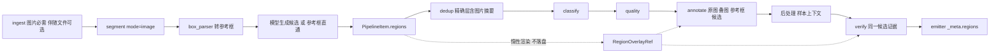

# LabelKit 图片候选区域分割规格

> 状态：规格已冻结，实现按本文切片推进；§11.8 的 CPU 实测表由切片 S4a 填写，这是本文唯一允许的后填内容
> 日期：2026-10-31
> 实施基线：`c42fef3`（代码行号取自此基线）
> 需求依据：[PROPOSAL-image-region-segmentation.md](PROPOSAL-image-region-segmentation.md)（§6 全部 15 项裁决已闭合，本文不重开）
> 范围：`run.mode = "process"`、`run.modality = "ui"` 且 `segment.enabled = true`、`segment.mode = "image"` 的独立图片候选区域生成，以及 annotate、verify、后处理、输出对同一候选的消费；另含 `segment.mode` 拆分对流模式判断的零行为变化重键
> 版本标签：v1.22（D8）

记号：**提案 §x** 指上述提案章节；**CONTRACTS §x** 指 `docs/CONTRACTS.md`；**spec §x** 指 `spec/*.md`；**rule N** 指 CONTRACTS §6.3 的 M1 规则编号；**AC-NN** 指本文 §19 的验收行。

本文与提案的关系：提案说明为什么这样做，本文规定做成什么样。两者不一致时以本文为准，并在 §22 记录差异。名称、错误码、措辞和键序一律从本文复制。代码必须偏离本文时，先在同一改动中修订本文与 CONTRACTS。

## 1. 产品行为

工程写 `segment.mode = "image"` 后，一张图片就是一个样本。segment 决定几何，annotate 只按 `region_id` 选择与标注，后处理做确定性的引用解析与格式转换。



候选来源只有三条路径（§10.1）：只有 `instruction` 时模型只看图片；`instruction` 与 `box_parser` 同时存在时模型同时看图片与参考框；只有 `box_parser` 时不调用模型，参考框直接成为矩形候选（D15）。

`segment.mode` 与 `run.mode`、`quality.mode` 是三个不同的键：`run.mode` 选择处理或只生成，`quality.mode` 选择打分方式，`segment.mode` 选择分割的语义（图片平面或时序流）。三者没有派生关系。

非图片工程（文本、普通 UI、流、生成）的提示词、输出、报告、golden 与计数逐字节不变。

本规格全部行为属于本轮交付，不设后续实现项目。

## 2. 裁决索引

| # | 裁决（提案 §6，已闭合） | 本文落点 |
|---|---|---|
| D1 | 叠图不落盘，只保留 `_meta.regions`；不声称可复现模型看到的叠图字节 | §11、§16 |
| D2 | 图片分割保留链首，链序元组不变 | §10.1 |
| D3 | 模型侧坐标用 0–1000 整数网格 | §5 |
| D4 | 不读取、不应用、不拒收 EXIF 方向；画布是存储像素网格 | §5 |
| D5 | 无树输入只在图片模式生效；segment 关闭时纯图片仍无法摄取 | §8 |
| D6 | 未知 region_id 用 `x-labelkit-region-ref` 注解，可修复 | §13.2 |
| D7 | 不用本地视觉端点作本特性证据，只做 z.ai 门 | §20 |
| D8 | 版本标签 v1.22 | 全文 |
| D9 | 允许只跑分割，仅限写了 `instruction` | §6.5 |
| D10 | 图片模式 quality 开启而 rubric 为空一律报错 | §6.4 |
| D11 | 修复轮与评审面板溢出沿用现行归因 | §10.7、§12、§14 |
| D12 | 低不透明度半透明填充，极细轮廓 | §11 |
| D13 | box_parser 给框命名；模型新画的多边形由框架编号 `r1…rN` | §9、§10.5 |
| D14 | 参考框只支持轴对齐矩形 | §9 |
| D15 | 不写 `instruction` 时参考框直接成为候选，不调用模型 | §10.1 |

## 3. 冻结值总表

提案留给 SPEC 的事项全部在此定值，无开放问题。详细语义见「章节」列。

| 事项 | 冻结值 | 章节 |
|---|---|---|
| 填充不透明度 | `OVERLAY_FILL_ALPHA = 64`（64/255，约 25.1%） | §11.3 |
| 轮廓宽度 | `OVERLAY_OUTLINE_PX = 1`，同色、不透明，填充合成之后绘制 | §11.4 |
| 颜色序列 | `OVERLAY_COLORS`，8 色，见 §11.5 | §11.5 |
| 底色 | `OVERLAY_BASE_COLOR = (255, 255, 255)` | §11.2 |
| 标识字号 | `max(12, round(long_edge * 0.012))`，`long_edge` 为请求画布长边 | §11.6 |
| 对比描边 | 字色 `(255, 255, 255)`，描边色 `(0, 0, 0)`，描边宽 `max(1, font_size // 8)` | §11.6 |
| RGBA 呈现说明 | 叠图合成到白底；原图请求不改，服务端怎样呈现透明通道不受 LabelKit 保证 | §11.2 |
| 载荷规模行 | 每请求 2 图；上界公式与样本数据见 §11.9 | §11.9 |
| segment 提示词终稿 | §10.2 | §10.2 |
| annotate 提示词终稿 | §12.1 | §12.1 |
| verify 提示词终稿 | §14.1 | §14.1 |
| classify、quality 无树变体 | 标签 `[图片]`、`[{label} 图片]`，省略树段 | §15.2 |
| `TEMPLATE_HEAD_TOKENS` 新键 | 仅新增 `"segment_image" = 410`；其余键不变 | §10.2 |
| ingest WARN 文本 | `image mode: ignored %d file(s) that are neither images nor declared companion files` | §8.3 |
| Record 摘要字段名 | `Record.image_sha256`、`Record.companion_sha256`（完整 64 位小写十六进制） | §4.3 |
| 报表块名 | `report.segment_image` | §16.3 |
| 图片模式 trace excerpt 来源 | 空串 `""` | §14.4 |
| 伴随文件大小上限 | 不新增；理由见 §8.5 | §8.5 |
| spec 章节 | 新增 `spec/318-m14-segment-image.md`，标题 `## 3.18 segment 图片模式（M14）`，`tools/build_design_doc.py` 的 `ORDER` 在 `317-m17-execution-runtime` 后加入 `318-m14-segment-image`；`spec/314-m14-segment.md` 只改前置条件措辞并交叉引用 | §18 |
| 中立后校验载体模块 | `labelkit/common/contracts/post_validation.py` | §10.4 |
| 图片模式配置规则模块 | `labelkit/common/config/_segment_image.py` | §6.3 |
| 分割质量门 IoU 阈值 | 0.5，一对一贪心匹配 | §20 |
| 新 M1 规则编号 | CONTRACTS §6.3 rule 72–81；修订 rule 17、29、33、34 | §6.3 |

## 4. 载体与数据流

### 4.1 候选载体

新模块 `labelkit/common/contracts/regions.py`。载体只含 int、float、str、tuple，本身深不可变，不复用 `contracts/generation.py` 的 `_ImmutableCarrier`（该模块导入 `llm_client` 与 `schema_engine`，会形成导入环）。导入方向只允许 `regions.py → types.py`，`types.py` 只在 `TYPE_CHECKING` 下引用 `RegionSet`。Pillow 在函数内局部导入。

```python
@dataclass(frozen=True)
class ReferenceBox:
    """box_parser 钩子返回并经框架校验的一个参考框（原图像素，仅轴对齐矩形，D14）。"""

    box_id: str                                        # 钩子给出的框名，全部留空时由框架按数组顺序补为 "1"…"N"
    bbox: tuple[int | float, int | float, int | float, int | float]  # (l, t, r, b)，保留钩子给出的数值类型
    text: str                                          # 钩子给模型看的描述，可为空


@dataclass(frozen=True)
class RegionPolygon:
    """单个多边形部件：原图像素闭环外环与零到多个闭环内环。"""

    exterior: tuple[tuple[int | float, int | float], ...]  # 闭环：≥4 个位置，首末相同
    holes: tuple[tuple[tuple[int | float, int | float], ...], ...]  # 每个内环同样是闭环


@dataclass(frozen=True)
class CandidateRegion:
    """一个候选区域：区域标识（框名或框架编号 r<n>）、几何部件、来源参考框与叠图标注点。"""

    region_id: str                                     # 来自参考框：框名；模型新画：框架按出现顺序编号 r1, r2, …
    polygons: tuple[RegionPolygon, ...]                # 1 个 = Polygon；多个 = MultiPolygon
    box_id: str | None                                 # 几何取自哪个参考框（复用或 D15 直通）；模型画的多边形为 None
    source_box_ids: tuple[str, ...]                    # 没有参考框时恒为空；box_id 非空时恒为 (box_id,)
    label_anchor: tuple[float, float]                  # 原图像素点，仅用于渲染，不是几何真值


@dataclass(frozen=True)
class RegionSet:
    """一个样本的完整分割结果；regions 为空元组表示合法的空候选。"""

    width: int                                         # 原图存储像素宽（Pillow 只读文件头）
    height: int
    boxes: tuple[ReferenceBox, ...]                    # 未注册钩子或无伴随文件时为空
    regions: tuple[CandidateRegion, ...]


@dataclass(frozen=True)
class RegionOverlayRef:
    """原图加候选的惰性叠图引用；与 ImageRef 共享 load_base64 接口。"""

    base: ImageRef
    regions: RegionSet

    def load_base64(self, max_px: int) -> tuple[str, str]:
        """按与 base 相同的逐轴缩放渲染叠图，字节不保留。

        @param max_px 本次请求的长边像素上限。
        @return (media_type, b64)，media_type 恒为 image/png。
        @raises OSError 文件不可读或 Pillow 解码失败（DecompressionBombError 与解码时的其他异常都转成它），由 image_decode_error 归类
        """
```

同模块的公开函数（名称冻结）：

| 函数 | 作用 |
|---|---|
| `render_reference_boxes(regions: RegionSet) -> str` | §5.4 的 `[参考框]` 正文，每框一行 JSON |
| `render_candidates(regions: RegionSet) -> str` | §12.1 的 `[候选区域]` JSON 正文 |
| `render_material_note(regions: RegionSet) -> str` | §12.1 的固定材料说明 |
| `project_regions(regions: RegionSet) -> dict` | §16.1 的 `{"image", "boxes", "items"}` JSON 投影，后处理上下文与 `_meta.regions` 共用 |

`labelkit/common/contracts/types.py` 新增（`types.py` 不导入 labelkit 内任何模块）：

```python
def scaled_size(width: int, height: int, max_px: int) -> tuple[int, int]:
    """按长边上限计算逐轴缩放尺寸；ImageRef.load_base64 与叠图渲染共用。

    @param width 原图宽。
    @param height 原图高。
    @param max_px 长边上限。
    @return 长边不超限时原样返回；否则 (max(1, round(width * s)), max(1, round(height * s)))，s = max_px / 长边。
    """
```

`ImageRef.load_base64` 改为调用 `scaled_size`，字节行为不变；不缩放时也解码一次像素以发现截断（`_check_header` 与 `_read_canvas` 仍只读文件头），发送的仍是文件原字节。两处 load_base64 把 Pillow 的任何解码失败转成 `OSError` 再抛出：`PIL.Image.DecompressionBombError`（它不是 `OSError` 子类），以及 PNG 解码器对损坏数据块抛的 `SyntaxError`、`ValueError`，使现有 `image_decode_error` 归类覆盖这些情形（§10.7）。叠图的绘制步骤不在转换范围内，绘制缺陷仍归 `internal_error`。

### 4.2 几何真值

唯一几何真值是原图像素坐标，不取整。

- 参考框 bbox 与由框派生的候选顶点保留钩子给出的 JSON 数值类型（int 或 float）。
- 模型画的多边形顶点经除法投影，恒为 float：`x_px = gx * width / 1000`，`y_px = gy * height / 1000`。不取整、不吸附、不改变顶点顺序。
- 由框派生的矩形顶点顺序冻结为 `(l,t)→(r,t)→(r,b)→(l,b)→(l,t)`，没有内环。
- 矩形候选同样以多边形表达，不维护第二套几何。
- 每个候选只换算一次：模型多边形投影一次；复用参考框不经网格。

### 4.3 信封与记录字段

`labelkit/common/contracts/types.py`（全部末尾追加、带默认值）：

| 字段 | 类型 | 语义 |
|---|---|---|
| `PipelineItem.regions` | `RegionSet \| None = None` | `None` 表示未运行图片分割或分割失败；`RegionSet(regions=())` 表示合法空候选，二者不混用 |
| `Record.companion` | `bytes \| None = None` | 伴随文件原始字节，不解码、不解释；未注册钩子或无伴随文件时为 `None` |
| `Record.companion_path` | `str \| None = None` | 伴随文件路径字符串，与 `str(record.image.path)` 同形；无伴随文件时为 `None` |
| `Record.image_sha256` | `str \| None = None` | 图片文件 sha256 完整十六进制；仅图片模式由 M2 写入 |
| `Record.companion_sha256` | `str \| None = None` | 伴随文件 sha256 完整十六进制；无伴随文件时为 `None` |

非图片模式这五个字段恒为默认值。`Record.exact_dedup_text` 不被借用（设置它会走 exact_only 并跳过 pHash 层）。

### 4.4 传递

全部显式传递同一冻结对象，不在任何位置复制或重建：

| 消费方 | 传递方式 |
|---|---|
| annotate | `AnnotatePromptOptions.regions: RegionSet \| None = None`，由 annotate 从信封填入，自洽采样与 L3 修复共用 |
| verify 评审 | `VerifyPromptOptions.regions: RegionSet \| None = None`，由 `_plan_classic_review` 从 `state.item.regions` 填入，`_panel_fit` 据此按两张图计费 |
| verify 修复 | `_reannotate_leaf` 把 `state.item.regions` 传入 `AnnotatePromptOptions` |
| segment 自身 | `box_parser` 结果在模型调用前冻结进 `RegionSet.boxes`，首轮与 L3 修复共用 |
| 后处理与校验器 | `annotation_record_context(record, regions)`、`annotation_transforms(record, cfg, label, temporal_context, regions)`（恰为 5 个参数上限），帧路径传 `None` |
| classify 多标签扇出 | `_fan_out` 字段清单加入 `regions`，按引用共享 |

### 4.5 Part 与 trace

`Part.image` 类型放宽为 `ImageRef | RegionOverlayRef`。Anthropic 构造器丢弃 system 消息里的图片，所以图片只放 user 消息。

trace `full` 档位把叠图记为 `{"type": "image", "path": <原图路径>, "overlay": "regions"}`，不内联字节（`llm_client.py:847-864` 现在直接取 `.path`，同步修改）。原图记录形态不变。

## 5. 坐标与画布

### 5.1 画布

原图的存储像素网格；左上角为原点，x 向右，y 向下。宽高由 segment 阶段用 Pillow 只读文件头得到。图片方向不做任何处理（D4）：带方向标签的 JPEG 按普通图片处理，宽高取存储像素，与伴随数据对齐由输入方负责。

已知残余（写入手册 05 章）：未缩放的 JPEG 原样发送并保留方向标签，若服务端按标签旋转显示，模型看到的方向可能与按存储像素绘制的叠图不同，segment 的网格坐标也会按存储画布投影而错位。

### 5.2 模型侧网格

segment 输出与图片模式所有提示词里的候选坐标一律用 0–1000 整数网格，x 相对宽度、y 相对高度，两轴各自归一化。x 精度为 `width / 1000` 像素，y 精度为 `height / 1000` 像素（1080 × 2340 约为 1.08 / 2.34 像素）。候选是区域提议而非像素级掩膜。

合法性在网格整数坐标上判定，避免浮点误差改变共点、共线等边界情形；正比例的逐轴缩放不改变自交、孔洞包含、部件相交这些拓扑性质。

### 5.3 闭环约定

模型给出的每个环必须闭合（≥ 4 个位置，首末相同），发布时原样投影，不改写。未闭合按违规进入修复，框架不代为闭合。相邻重复顶点在 OGC 下合法，原样保存。

### 5.4 提示词里的网格显示

像素真值回到提示词时只是显示投影，不回写真值。全部用 `fractions.Fraction` 精确有理运算，避免浮点歧义（`Fraction(float)` 取浮点的精确值）。

| 几何来源 | 显示函数 |
|---|---|
| `[参考框]` 块本身；`box_id` 非空的候选（复用与 D15 直通） | 外扩取整：`gl = floor(l*1000/width)`，`gt = floor(t*1000/height)`，`gr = ceil(r*1000/width)`，`gb = ceil(b*1000/height)` |
| `box_id` 为空的模型画多边形顶点 | 就近取偶：`round(Fraction(x) * 1000 / width)`（Python `round` 对 Fraction 按 half-even），可精确还原模型原先给出的整数 |

外扩取整保证同一框在两个块中逐值相等、任何正尺寸的框仍有正面积（4000 像素宽、l = 1000、r = 1001 显示为 250 / 251）；网格框恒包含像素框，最大外扩误差一个网格单位；框已校验在画布内，网格值不超出 `0..1000`。

**参考框渲染**：`[参考框]` 每框一行，行间 `\n`，无末尾换行，每行恰为：

```python
json.dumps({"box_id": box.box_id, "bbox": [gl, gt, gr, gb], "text": box.text}, ensure_ascii=False)
```

text 中的换行、引号与控制字符由 JSON 转义，任何 text 都不能伪造出另一行。

**候选渲染**：`[候选区域]` 正文是一行 `json.dumps(items, ensure_ascii=False)`（默认分隔符），`items` 每项键序为 `region_id`、`polygons`、`box_id`、`source_box_ids`，几何来自参考框的候选（`box_id` 非空）再追加 `text`。`polygons` 每项键序为 `exterior`、`holes`；不是 GeoJSON。空候选渲染为 `[]`。以画布 1080 × 2340、复用 n12（像素框 `[43, 140, 821, 1264]`）为例：

```text
[参考框]
{"box_id": "n12", "bbox": [39, 59, 761, 541], "text": "Button 登录"}
[候选区域]
[{"region_id": "n12", "polygons": [{"exterior": [[39, 59], [761, 59], [761, 541], [39, 541], [39, 59]], "holes": []}], "box_id": "n12", "source_box_ids": ["n12"], "text": "Button 登录"}]
```

图片模式不构造 `UITree`；`UITree.serialize()` 与非图片模式的 uitree 解析都不改。

### 5.5 不承诺

服务端对图片的二次处理不在 LabelKit 的保证内。归一化网格只对逐轴缩放免疫，对旋转不免疫。模型是否遵守网格约定只能靠真实端点证据确认（§20）。

## 6. 配置面

### 6.1 `SegmentConfig` 新字段

`labelkit/common/config/model.py`（末尾追加）：

```python
mode: Literal["image", "sequence"] | None = None   # enabled = true 时必填；无默认语义、无别名
instruction: str = ""                              # 图片模式分割指令；空串 = 未写
box_parser: str | None = None                      # "hooks.py:fn" 引用；None = 不读伴随文件
companion_suffix: str | None = None                # 与 box_parser 同时出现，例如 ".xml"
resolved_box_parser: ResolvedHook | None = None    # 解析产物，永非用户键
sequence_resolved: bool = False                    # 解析产物，永非用户键
```

只读属性（非字段）：

```python
@property
def llm_referenced(self) -> bool:
    """按 enabled 加 mode 判定 segment.llm 是否进入引用集合。

    @return 图片模式写了 instruction，或流模式 strategy 为 llm / hybrid 时为 True；未启用或缺 mode 时为 False。
    """
```

解析产物：

- `sequence_resolved = enabled ∧ mode == "sequence"`，由 `_parse_segment` 在解析本节时冻结，因为 `_check_stream_family` 先于 `_freeze_vision` 运行。
- `resolved_box_parser` 由 M1 在 `enabled ∧ mode == "image"` 时用 `load_hook` 加载并做静态签名检查后冻结。
- `vision_resolved` 公式改为按模式求值：流模式保持 `modality == "ui" ∧ enabled ∧ strategy ∈ {llm, hybrid} ∧ supports_vision`；图片模式为 `modality == "ui" ∧ enabled ∧ instruction 非空 ∧ supports_vision`。

测试中直接构造流模式配置时必须同时写 `mode="sequence", sequence_resolved=True`。

### 6.2 键的模式合法性

是否显式书写由原始节探针判定（`_stream_family_probes` 的 `segment` 表逐键增加布尔探针；`input.ui_tree_max_chars` 新增 `input_provided` 探针）。以下检查只在 `segment.enabled = true` 时运行；`enabled = false` 时这些键属于停放配置，沿用 `_warn_segment_off` 的 WARN，`box_parser` 不加载。`mode` 的取值枚举在解析层恒检查。

| 键 | image | sequence |
|---|---|---|
| `enabled` | `true` | `true` |
| `mode` | 必填 | 必填 |
| `llm` | 只在有 `instruction` 时可写并被引用；没有 `instruction` 时显式书写即定向 `CONFIG_ERROR` | 可写，仅 `strategy` 为 `llm` 或 `hybrid` 时引用 |
| `instruction` | 可选，写则去空白后非空；与 `box_parser` 至少有一个 | 定向 `CONFIG_ERROR` |
| `box_parser` | 可选，`hooks.py:fn` 引用，M1 用 `load_hook` 加载并做静态签名检查 | 定向 `CONFIG_ERROR` |
| `companion_suffix` | 与 `box_parser` 同时出现或同时缺省；以 `.` 开头，不含路径分隔符，大小写不敏感地不等于 `.png`、`.jpg`、`.jpeg` | 定向 `CONFIG_ERROR` |
| `strategy` / `window` / `noise_filter` / `min_len` / `context` / `on_error` | 显式书写即定向 `CONFIG_ERROR` | 原语义 |

### 6.3 M1 规则

检查集中在新模块 `labelkit/common/config/_segment_image.py`，入口 `check_segment_image(ctx, products)`，由 `_check_stream_family` 在 `segment.enabled = true` 时调用（rule 73b 在 `mode == "sequence"` 时生效，其余在 `mode == "image"` 时生效）。例外：rule 77a 由 `_warn_undeclared_windows` 发出，77b、77c 由 `_check_vision_profiles` 发出，rule 81 由 `_postprocessing.py` 在 Schema 编译时发出。`_LoadCtx` 只在 `TYPE_CHECKING` 下导入。全部是 `CONFIG_ERROR`，同一配置错误只上报一次。下列文本是冻结的英文错误文本（`{fp}` 为 project 路径，`{fc}` 为 config 路径）。

| 规则 | 条件 | 错误文本 |
|---|---|---|
| 72 | `enabled = true` 缺 `mode` | `{fp}:[segment].mode: required when segment.enabled = true; expected "image" or "sequence"` |
| 73a | image 下显式书写 `strategy` 等六键之一 | `{fp}:[segment].{key}: not allowed when segment.mode = "image" (sequence segmentation key)` |
| 73b | sequence 下显式书写 `instruction`、`box_parser`、`companion_suffix` 之一 | `{fp}:[segment].{key}: not allowed when segment.mode = "sequence" (image segmentation key)` |
| 73c | image 无 `instruction` 而显式书写 `llm` | `{fp}:[segment].llm: not allowed when segment.mode = "image" has no instruction (no segment model call is made)` |
| 73d | `instruction` 去空白后为空 | `{fp}:[segment].instruction: must be non-empty when set` |
| 73e | `box_parser` 与 `companion_suffix` 只出现一个 | `{fp}:[segment].companion_suffix: box_parser and companion_suffix must be set together` |
| 73f | `companion_suffix` 形态非法 | `{fp}:[segment].companion_suffix: expected a suffix starting with "." that is not an image extension, got {value}` |
| 73g | `box_parser` 无法加载 | `{fp}:[segment].box_parser: cannot load box_parser {reference!r}` |
| 73h | `box_parser` 签名非法 | `{fp}:[segment].box_parser: box_parser must be synchronous with exactly two positional parameters and no defaults` |
| 74 | image 且 `instruction` 与 `box_parser` 都没有 | `{fp}:[segment]: segment.mode = "image" requires at least one of instruction and box_parser` |
| 75 | image 且 `run.modality != "ui"` | `{fp}:[segment].mode: segment.mode = "image" requires run.modality = "ui", got {modality}` |
| 76a | image 且开启 stitch | `{fp}:[stitch].enabled: stitch.enabled = true is not available when segment.mode = "image"` |
| 76b | image 且开启 extract | `{fp}:[extract].enabled: extract.enabled = true is not available when segment.mode = "image"` |
| 76c | image 且开启 frame.classify | `{fp}:[frame.classify].enabled: frame.classify.enabled = true is not available when segment.mode = "image"` |
| 76d | image 且开启 frame.annotate | `{fp}:[frame.annotate].enabled: frame.annotate.enabled = true is not available when segment.mode = "image"` |
| 76e | image 且存在 `[stream]` 节 | `{fp}:[stream]: the [stream] section is not available when segment.mode = "image"` |
| 77a | image 且被引用 LLM profile 的 `context_window` 不为正 | `{fc}:[llm.{name}].context_window: segment.mode = "image" requires a positive deployment context window for every referenced model profile` |
| 77b | image、写了 `instruction` 且 `segment.llm` 不支持视觉 | 沿用 rule 4 的 `_check_vision_profiles` 文本，stage 名 `segment` |
| 77c | image 且 `repair_llm` 经修复重放图片（`max_repair_attempts > 0`）而不支持视觉 | 沿用 rule 4 文本，stage 名 `output.repair` |
| 78a | image 且 `dedup.semantic = true` | `{fp}:[dedup].semantic: not available when segment.mode = "image" (image samples have no text to embed)` |
| 78b | image 且显式书写 `input.ui_tree_max_chars` | `{fp}:[input].ui_tree_max_chars: not allowed when segment.mode = "image" (image mode builds no UI tree)` |
| 79 | image 且 `output.meta_mode = "none"` | `{fp}:[output].meta_mode: must not be "none" when segment.mode = "image" - candidates and original polygons are carried only by _meta.regions (sidecar is legal), got "none"` |
| 80 | image、`quality.enabled = true` 而 `quality.rubric` 为空 | `{fp}:[quality].rubric: segment.mode = "image" has no default rubric; set quality.rubric or quality.enabled = false` |
| 81a | 非图片模式 Schema 含 `x-labelkit-region-ref` | `{file}:{location}: x-labelkit-region-ref requires segment.mode = "image"` |
| 81b | 注解位于 `x-labelkit-postprocessor` 代码负责字段或其子树内 | `{file}:{location}: x-labelkit-region-ref must not be used inside a x-labelkit-postprocessor field` |
| 81c | 注解值不是 `true`，或所在节点 `type` 不是 `"string"` 或 `["string", "null"]` | `{file}:{location}: x-labelkit-region-ref must equal true on a string property or string items` |

rule 19 与 rule 29 的「process 模式、generate 关闭」两项照旧适用于两种模式，文本不变。

WARN（非阻塞）：图片模式写了 `instruction` 且 `output.max_repair_attempts > 2` 时输出 `{fp}:[output].max_repair_attempts: segment.mode = "image" repairs segmentation at most 2 rounds; larger values do not extend it`（L3 轮数为 `min(max_repair_attempts, 2)`）。

### 6.4 既有规则的修订

| 规则 | 修订 |
|---|---|
| rule 17 | 图片模式且写了 `instruction` 时放宽（D9）；其他情况原样 |
| rule 29 | `annotate.enabled = true` 一项在图片模式且写了 `instruction` 时放宽；图片模式无 `instruction` 而 annotate 关闭时报 `{fp}:[segment].enabled: segment.mode = "image" without instruction requires annotate.enabled = true (box_parser-only runs make no model call)`；流模式文本不变 |
| rule 33 | `segment.llm` 进入引用集合的判据改为 `SegmentConfig.llm_referenced` |
| rule 34 | 图片模式写了 `instruction` 时 `segment.llm` 必须支持视觉；annotate、verify 恒要求视觉；stitch 句不变 |

D10：图片模式恒无控件树，`default:ui` 对每条记录都无意义，所以 rule 80 一律报错；手册 07 章「没写的节取默认」为图片模式写明例外（quality 默认开启，图片工程不能省略 `[quality]`）。

### 6.5 只跑分割

图片模式写了 `instruction` 时，annotate 与 quality 可同时关闭，主输出为 §16.2 的记录载荷加 `_meta.regions`。没写 `instruction` 不放宽：那样的运行不调用任何模型，钩子完全可以离线单测。dry-run 与 report 去掉 quality 相关项。

### 6.6 迁移面

无别名，一次改完：

- 11 个已启用 `[segment]` 的工程 TOML 补 `mode = "sequence"`：`examples/stream/project.toml`、`examples/stream/project-text.toml`、`examples/mix/project.toml`、`examples/mix/project-text.toml`、`examples/sequence-context-capacity/project-{minimum,reactive,static,stitch,text,ui}.toml`、`examples/sequence-generation/project-replay.toml`。
- `examples/sequence-context-capacity/prepare.py:37-38` 模板同步修改，重新生成须与已提交文件逐字节一致。
- 测试中的 `SegmentConfig(` 构造与内联 `[segment]` TOML 片段（含 `tests/common/config/test_config.py` 的 `SEG_ON`）以及 `tests/integration/test_stream_llm.py`、`test_stitch_llm.py`、`test_frame_llm.py`。
- 手册 25、26 章的 `[segment]` 片段。
- 归档的 `out/verification-*` 配置是历史证据，不改。

## 7. `segment.enabled` 判断登记

### 7.1 搜索与核对

搜索命令（基线 `c42fef3`，2026-10-31 实跑）：`grep -rn --include='*.py' 'segment\.enabled' labelkit/`。另用 `\.segment\b.*enabled`、`seg\.enabled`、`segment_enabled`、`getattr(...segment` 搜索间接判断，没有新增命中（`getattr(item, "segment_degraded", ...)` 是信封字段，不属于本判断）。

| 口径 | 提案 | 实测 |
|---|---|---|
| 文件数 | 13 | 13 |
| 出现次数 | 69 | 69 |
| 含代码判断的文件数 | 12 | 12 |
| 代码判断 | 52 | 52 |
| 注释、docstring、报错文本 | 17 | 17 |

计数与提案一致。提案正文的两处行号与实测不同，差异已记入 §22 第 12 条：`_constraints.py:1119` 实为 `:1122`；`credentials.py:106` 不是 `segment.enabled` 判断。

类别含义：**类 1** 流语义，改用 `sequence_resolved`；**类 2** 阶段在链，保持 `enabled`；**类 3** 引用、视觉、修复与预算集合，按 `enabled` 加 `mode` 分别求值。合计：类 1 共 37 处，类 2 共 4 处，类 3 共 11 处。

### 7.2 52 处代码判断

| # | 位置 | 符号 | 类 | 改写后谓词 |
|---|---|---|---|---|
| 1 | `labelkit/cli/console.py:348` | `_freeze_header_facts` | 2 | `cfg.segment.enabled`（链段名单） |
| 2 | `labelkit/cli/console.py:364` | `_freeze_header_facts` | 1 | `cfg.segment.sequence_resolved`（`/stream` 徽标） |
| 3 | `labelkit/cli/console.py:1185` | `_account_line` | 1 | `self._cfg.segment.sequence_resolved`（noise、absorbed 列） |
| 4 | `labelkit/cli/console.py:1445` | `_print_estimate_notes` | 1 | `sequence_resolved` 且 strategy 为 llm 或 hybrid |
| 5 | `labelkit/common/config/_constraints.py:159` | `_check_profile_refs` | 3 | `p.segment.llm_referenced` |
| 6 | `labelkit/common/config/_constraints.py:227` | `_vision_users` | 3 | `p.segment.llm_referenced` |
| 7 | `labelkit/common/config/_constraints.py:246` | `_vision_users` | 3 | 保持 `p.segment.enabled and bool(users)`：两种模式的修复都重放图片 |
| 8 | `labelkit/common/config/_constraints.py:451` | `_collect_referenced` | 3 | `p.segment.llm_referenced` |
| 9 | `labelkit/common/config/_constraints.py:476` | `_collect_referenced` | 3 | 保持 `not enabled or max_repair_attempts > 0`：两种模式求值相同 |
| 10 | `labelkit/common/config/_constraints.py:579` | `_resolve_global_rubric` | 1 | `sequence_resolved or generate.form == "sequence"`（默认 trajectory rubric） |
| 11 | `labelkit/common/config/_constraints.py:709` | `_check_stage_switches` | 2 | `p.segment.enabled`；rule 29 的 annotate 项按 mode 拆分（§6.4） |
| 12 | `labelkit/common/config/_constraints.py:721` | `_check_stage_switches` | 1 | 语义 `not sequence_resolved`，见 §7.3 |
| 13 | `labelkit/common/config/_constraints.py:731` | `_check_stage_switches` | 1 | 语义 `not sequence_resolved`，见 §7.3 |
| 14 | `labelkit/common/config/_constraints.py:855` | `_check_stream_family` | 1 | `sequence_resolved` → `_warn_segment_on`；`not enabled` → `_warn_segment_off`；图片模式两者都不运行 |
| 15 | `labelkit/common/config/_constraints.py:870` | `_check_frame_switches` | 1 | 语义 `not sequence_resolved`，见 §7.3 |
| 16 | `labelkit/common/config/_constraints.py:873` | `_check_frame_switches` | 1 | 语义 `not sequence_resolved`，见 §7.3 |
| 17 | `labelkit/common/config/_constraints.py:1071` | `_freeze_vision` | 3 | §6.1 按模式求值的公式 |
| 18 | `labelkit/common/config/_constraints.py:1109` | `_warn_undeclared_windows` | 3 | 保持 `enabled`；图片模式走 rule 77a 文本，流模式文本不变 |
| 19 | `labelkit/common/config/_constraints.py:1122` | `_warn_undeclared_windows` | 3 | `sequence_resolved`：图片模式 embedding 不进入集合，语义层已由 rule 78a 报错，不追加第二条 error |
| 20 | `labelkit/common/config/_constraints.py:1177` | `_static_checks_prefix` | 3 | 流模式 `sequence_resolved` 且 strategy 为 llm 或 hybrid；图片模式 `llm_referenced` 时用 `TEMPLATE_HEAD_TOKENS["segment_image"] + est_text(instruction)`，不估 `segment.context` |
| 21 | `labelkit/common/inference/credentials.py:75` | `referenced_profiles` | 3 | `cfg.segment.llm_referenced` |
| 22 | `labelkit/common/inference/credentials.py:102` | `referenced_profiles` | 3 | 保持 `not enabled or max_repair_attempts > 0` |
| 23 | `labelkit/operators/annotate.py:372` | `_assemble_prompt` | 1 | `run.mode == "process" and sequence_resolved` |
| 24 | `labelkit/operators/annotate.py:405` | `_sequence_parts` | 1 | 同上 |
| 25 | `labelkit/operators/annotate.py:612` | `_budgeted_call` | 1 | `record.kind == "sequence"`、process 且 `sequence_resolved` |
| 26 | `labelkit/operators/annotate.py:1026` | `_assemble_frame_prompt` | 1 | `run.mode == "process" and sequence_resolved` |
| 27 | `labelkit/operators/annotate.py:1146` | `_frame_call_prompt` | 1 | 同上 |
| 28 | `labelkit/operators/classify.py:452` | `_classify_prompt` | 1 | `record.kind == "sequence"`、process 且 `sequence_resolved` |
| 29 | `labelkit/operators/classify.py:678` | `_assemble_frame_classify` | 1 | `run.mode == "process" and sequence_resolved` |
| 30 | `labelkit/operators/classify.py:683` | `_assemble_frame_classify` | 1 | `fc.vision_resolved or (process and sequence_resolved)` |
| 31 | `labelkit/operators/classify.py:719` | `_frame_prompt_fit` | 1 | 同上 |
| 32 | `labelkit/operators/emitter.py:530` | `_rubric_selector` | 1 | `self._cfg.segment.sequence_resolved` |
| 33 | `labelkit/operators/emitter.py:613` | `_stream_block` | 1 | `not sequence_resolved or rec.kind != "sequence"`（`_meta.stream`） |
| 34 | `labelkit/operators/emitter.py:752` | `_verification_block` | 1 | `sequence_resolved`（`verification.defects`） |
| 35 | `labelkit/operators/extract.py:183` | `build_extract_prompt` | 1 | `run.mode == "process" and sequence_resolved` |
| 36 | `labelkit/operators/extract.py:330` | `_extract_transition_outcome` | 1 | 同上 |
| 37 | `labelkit/operators/ingest.py:589` | `Ingestor.scan` | 1 | `stream_mode = self._cfg.segment.sequence_resolved` |
| 38 | `labelkit/operators/quality.py:1586` | `_pairwise_prompt` | 1 | `self.cfg.segment.sequence_resolved`（短谓词，rule 29 保证它蕴含 process） |
| 39 | `labelkit/operators/verify.py:923` | `VerifyStage.run` | 1 | `episodes and self.cfg.segment.sequence_resolved` |
| 40 | `labelkit/orchestration/factory.py:26` | `build_stages` | 2 | `cfg.segment.enabled`，内部按 mode 选 `SegmentImageStage` 或 `SegmentStage` |
| 41 | `labelkit/orchestration/process_workflow.py:274` | `_estimate_scale` | 1 | `sequence_resolved and run.mode == "process"`；图片模式另有 §16.5 分支 |
| 42 | `labelkit/orchestration/process_workflow.py:302` | `_estimate_classify_calls` | 1 | `sequence_resolved` |
| 43 | `labelkit/orchestration/process_workflow.py:709` | `_run_process` | 1 | `sequence_resolved`（会话路由） |
| 44 | `labelkit/orchestration/process_workflow.py:977` | `_batch_end_payload` | 1 | `sequence_resolved` |
| 45 | `labelkit/orchestration/process_workflow.py:1055` | `_log_budget_startup` | 1 | `sequence_resolved`（窗口预算日志） |
| 46 | `labelkit/orchestration/process_workflow.py:1074` | `_compose_chain` | 2 | `cfg.segment.enabled` |
| 47 | `labelkit/orchestration/process_workflow.py:1174` | `_build_report` | 1 | `sequence_resolved`（`report.stream`） |
| 48 | `labelkit/orchestration/process_workflow.py:1229` | `_report_counts` | 1 | `sequence_resolved`（episodes、absorbed、dropped_noise） |
| 49 | `labelkit/orchestration/process_workflow.py:1236` | `_report_counts` | 1 | `self._circuit_broken or (sequence_resolved and self._interrupted)` |
| 50 | `labelkit/orchestration/process_workflow.py:1585` | `_report_budget` | 1 | `sequence_resolved`（`minimum_frames`） |
| 51 | `labelkit/orchestration/process_workflow.py:1751` | `_print_dry_notes` | 1 | `sequence_resolved` 且 strategy 为 llm 或 hybrid |
| 52 | `labelkit/orchestration/process_workflow.py:1755` | `_print_dry_notes` | 1 | `sequence_resolved` |

### 7.3 前置条件的错误文本

第 12、13、15、16 行（stitch、extract、frame.classify、frame.annotate 的前置条件）语义是「要求 `sequence_resolved`」，错误只报一条：

- `segment.enabled = false`：沿用现有错误文本，字节不变。
- `enabled = true` 且 `mode = "image"`：不报旧文本，只报 rule 76 的定向文本。
- `enabled = true` 且缺 `mode`：只报 rule 72。

`_estimate_stream_calls`、`SegmentStage`、`judge_window`、`stream_verify` 里对 `cfg.segment.strategy`、`llm`、`window` 的读取都已被上表的门挡住，不是新的判断点，不改。

### 7.4 17 处注释、docstring 与报错文本

| 位置 | 符号 | 处置 |
|---|---|---|
| `labelkit/common/config/model.py:188` | `StreamConfig` docstring | 改写为「`segment.sequence_resolved` 为假时」 |
| `labelkit/common/config/model.py:236` | `StitchConfig.enabled` 注释 | 改为 `true ⇒ segment.sequence_resolved` |
| `labelkit/common/config/model.py:264` | `ExtractConfig.enabled` 注释 | 同上 |
| `labelkit/common/config/model.py:483` | `FrameClassifyConfig.enabled` 注释 | 同上 |
| `labelkit/common/config/_constraints.py:711` | `_check_stage_switches` 报错 | 指开关本身，字节不变 |
| `labelkit/common/config/_constraints.py:714` | `_check_stage_switches` 报错 | 字节不变 |
| `labelkit/common/config/_constraints.py:718` | `_check_stage_switches` 报错 | 流模式字节不变 |
| `labelkit/common/config/_constraints.py:724` | `_check_stage_switches` 报错 | 只在开关关闭时发出，字节不变 |
| `labelkit/common/config/_constraints.py:733` | `_check_stage_switches` 报错 | 同上 |
| `labelkit/common/config/_constraints.py:793` | `_warn_segment_on` 告警 | 只在流模式发出，字节不变 |
| `labelkit/common/config/_constraints.py:842` | `_warn_segment_off` 告警 | 指开关本身，字节不变 |
| `labelkit/common/config/_constraints.py:872` | `_check_frame_switches` 报错 | 只在开关关闭时发出，字节不变 |
| `labelkit/common/config/_constraints.py:876` | `_check_frame_switches` 报错 | 同上 |
| `labelkit/operators/ingest.py:329` | `IngestPlan.session_lens` 注释 | 改为 `segment.sequence_resolved=False 时为 ()` |
| `labelkit/operators/ingest.py:579` | `Ingestor.scan` docstring | 改为 `segment.sequence_resolved` |
| `labelkit/operators/ingest.py:599` | `_scan_text` docstring | 同上 |
| `labelkit/operators/ingest.py:644` | `_scan_ui_plan` docstring | 同上 |

`SegmentConfig` 的 docstring「也是流模式的总开关」同步改写。

## 8. 输入（M2）

新模块 `labelkit/operators/ingest_image.py` 承载图片模式发现与读取（`ingest.py` 只剩 15 行余量）。`Ingestor` 在 `segment.enabled ∧ mode == "image"` 时委托给它，非图片模式的配对与计数逐字节不变（`examples/ui` 仍为 `scanned=6 ingested=5 bad_input=1`）。

### 8.1 发现

1. 图片沿用 `_IMAGE_RE`（`image_<n>.(png|jpg|jpeg)`，扩展名大小写不敏感）与现行全局 index 命名空间：递归扫描，index 按十进制整数解析，跨子目录共用。同一 index 两张以上图片（含 png 与 jpg、跨子目录同名）是 `index_conflict`，遵循 `input.on_index_conflict`，所以 `source.pair_index` 唯一。
2. 伴随文件只在注册了 `box_parser` 时参与发现：文件名为 `image_<n>` 加 `companion_suffix`（大小写严格匹配），与图片按 index 配对，可跨子目录。同一 index 两个以上伴随文件是 `index_conflict`。只有伴随文件、没有图片是缺对（`present = "companion"`），遵循 `input.on_missing_pair`。
3. 只有图片、没有伴随文件：写了 `instruction` 时合法；没写时（D15）是缺对（`present = "image"`），计 `missing_pair` 与 `bad_input`，不产生 Record，不会写成空候选。
4. 图片模式不解析控件树。`uitree_<n>.jsonl` 在图片模式下没有特殊含义；原来的数据改名为 `image_<n>.jsonl` 并声明 `companion_suffix = ".jsonl"` 即可。

### 8.2 计划与记录

- `IngestPlan.pairs` 图片模式形态为 `(index, companion_path | None, image_path)`，`files` 按「伴随文件（若有）后图片」排列，与 id 拼接顺序一致；`session_lens` 恒为 `()`。
- 记录 id：`sha256(companion_bytes + image_bytes)[:16]`，没有伴随文件或未注册钩子时 `companion_bytes = b""`。没有伴随文件与零字节伴随文件因此同 id，后者仍会调用钩子。
- `RecordRef.source_file` 取图片相对路径，`pair_index` 取 index，`line_no = None`。
- `Record.ui_tree = None`，`Record.raw = None`，`Record.image` 为 `ImageRef`，`Record.modality = "ui"`。
- 伴随文件按原始字节读入 `Record.companion`，路径写入 `Record.companion_path`，M2 在已持有字节时计算 `image_sha256` 与 `companion_sha256` 并随 Record 冻结。

### 8.3 忽略计数

既不是图片、也不是已声明伴随文件的文件计入新增的 `IngestReport.ignored_files: int = 0`（未注册钩子时所有非图片文件都计入）。扫描结束时计数大于 0 则给一条只含计数、不含文件名的 WARN：

```python
_LOGGER.warning(
    "image mode: ignored %d file(s) that are neither images nor declared companion files",
    report.ignored_files, extra=_LOG_EXTRA)
```

该计数不计入 `scanned` 与 `bad_input`，不参与守恒恒等式。

### 8.4 文件头检查

由 ingest 独占：沿用 `_check_image`（魔数、`input.max_image_mb`），再用 Pillow 惰性 `open` 只读文件头，不调用 `load()` / `verify()`。必须能识别格式，且 `width × height` 不超过 `Image.MAX_IMAGE_PIXELS`；`DecompressionBombError` 与 `DecompressionBombWarning` 都视为超限（`warnings.catch_warnings` 把该 warning 升为错误）。图片方向不检查（D4）。失败走坏样本路径：计 `bad_input`，写英文错误日志，不产生 Record。

### 8.5 伴随文件大小

不新增单文件上限。理由：现行 `uitree_<n>.jsonl` 也没有字节上限（`input.max_image_mb` 只约束图片，`ingest.py:1583, 1644, 1683-1691`），伴随字节与解析后的 `UITree` 同量级，随 `Record.companion` 驻留到批结束；没有契约要求新键，新增上限还要新增配置键与错误路径。手册提示钩子保持轻量。

## 9. 伴随数据：`segment.box_parser`

新模块 `labelkit/common/extensions/box_parser.py`（仿 `postprocessing.py`）；`hooks.py` 模块文档补第五种钩子形态。LabelKit 不判断伴随数据是不是控件树：注册钩子就是工程的声明，钩子的输出是唯一被框架信任的结构。

### 9.1 钩子形态

```python
def uiautomator_to_boxes(companion: bytes, image: dict) -> list[dict] | None:
    """把一份 uiautomator XML 转成参考框数组。

    @param companion 伴随文件的原始字节，由钩子自行解码
    @param image {"width": W, "height": H}，原图存储像素尺寸
    @return 参考框数组；数据无法解析时返回 None，拒收本样本
    """
```

`"<python-file>:<attribute>"` 引用，M1 用 `load_hook` 加载一次并冻结。必须是同步函数，恰好两个位置参数且都没有默认值（比后处理更严：后处理允许第二参数默认 `None`）。异步函数、异步 `__call__`、生成器、异步生成器、可变参数、额外参数都在启动期拒绝。M1 只做静态签名检查，不在启动期调用。

公开函数：`resolve_box_parser(reference, project_root) -> ResolvedHook`、`invoke_box_parser(hook, companion, width, height) -> tuple[ReferenceBox, ...] | None`。

### 9.2 统一参考框格式

| 字段 | 规则 |
|---|---|
| `id` | 框名（D13）。要么每个框都给出非空 `id`，要么每个框都留空（省略该键或给空字符串）；全部留空时框架按数组顺序补为 `"1"`、`"2"`…`"N"`；只命名一部分 → `invalid_box`。`null`、非字符串、超长或含字符集以外的字符一律 `invalid_box`。给出的框名：1–64 个字符，只含 `[A-Za-z0-9_.:-]`，样本内唯一，不得匹配 `^r[1-9][0-9]*$`。 |
| `bbox` | `[l, t, r, b]`，长度恰为 4，原图像素，整数或有限浮点（不接受布尔、NaN、无穷）；`0 ≤ l < r ≤ width`，`0 ≤ t < b ≤ height` |
| `text` | 字符串，可为空，可含换行；必须能编码为 UTF-8（孤立代理是 `invalid_box`） |

框架不裁剪、不取整、不去重、不合并。超出画布或零面积的框是钩子的错误。

### 9.3 校验顺序（冻结）

1. 返回值恰为 `None` → `companion_invalid`（§9.4）；不是 `None` 也不是 `list` → `return_type`。
2. 按严格 JSON 复制（元组、集合、非字符串键、NaN、无穷、循环引用都拒绝，与后处理返回值同一规则）→ 失败为 `invalid_json`。
3. 逐项形状：每项是 `dict`，键集合是 `{"bbox", "text"}` 或 `{"id", "bbox", "text"}` → 否则 `invalid_box`，`box_index` 为该项序号。
4. 命名一致性：`id` 键缺省或值为 `""` 视为未命名，否则视为已命名。以第 0 个框的状态为准，第一个状态不同的框 → `invalid_box`，日志 `box_index` 为其 0 基序号。
5. 逐框值校验（§9.2），第一个违规框 → `invalid_box`。
6. 全部未命名时补名 `"1"…"N"`，构造 `ReferenceBox`。

### 9.4 调用与失败

| 情况 | 结果 |
|---|---|
| 钩子返回 `list`，每个框都合法 | 冻结进 `RegionSet.boxes` |
| 钩子返回 `None` | 记录 `failed`，`stage = "segment"`，错误码 `companion_invalid`，固定英文原因 `box_parser rejected companion`，不调用模型，不进修复，不计 `bad_input`，`input.on_bad_line` 不适用；报表单独计数 |
| 钩子抛异常、返回既非 `list` 也非 `None`、非严格 JSON、任一框违反 §9.2 | `BoxParserError`（`InternalError` 子类）→ `internal_error`，记录 `failed`；日志只记固定英文原因（`exception` / `return_type` / `invalid_json` / `invalid_box`）、出错框的序号（键 `box_index`）与钩子引用，不记数据；不调用模型，不进修复 |
| 没有伴随文件，写了 `instruction` | 不调用钩子，参考框为空，模型依据图片生成候选 |
| 没有伴随文件，没写 `instruction`（D15） | 摄取时按缺对处理：计 `missing_pair` 与 `bad_input`，遵循 `input.on_missing_pair`，不产生 Record |
| 零字节伴随文件 | 原样以 `b""` 交给钩子，由钩子决定 |

`[]` 表示数据合法但没有框；`None` 表示数据无法解析。手册明确要求钩子不要写 `except: return []`。空树、只有窗口外壳、数据不是控件树，都由钩子决定返回什么。

`BoxParserError` 放在 `labelkit/common/errors.py`，构造参数 `reason`、`box_index: int | None`、`hook`，`str()` 只含固定原因。`ErrorKind` 新增 `COMPANION_INVALID = "companion_invalid"`。

### 9.5 时机与信任边界

在 segment 阶段内、提交任何模型任务之前同步调用，每个样本恰好一次。classify 扇出克隆、L3 修复、verify 修复都不再调用；`validate` 与 `--dry-run` 不调用。钩子不读文件、不联网、不依赖随机性（与后处理同一信任边界）。它在事件循环线程上同步执行，解析很大的伴随文件会推迟同批其他请求，手册提示保持轻量。

## 10. segment 图片阶段

### 10.1 阶段

新模块 `labelkit/operators/segment_image.py`，类 `SegmentImageStage`，`name = "segment"`，占链首原位置，链序元组不变（D2）。走普通批路径（`session_attempt = None`）。不改动 `SegmentStage`、`judge_window` 和 `stream_verify` 对它们的依赖。`factory.py` 按 mode 选择阶段类。

几何校验放在 `labelkit/operators/segment_geometry.py`，它是 Shapely 的唯一导入点（静态测试守护）。

| 配置 | 候选来源 |
|---|---|
| 有 `instruction`，无 `box_parser` | 模型只依据图片生成候选 |
| 有 `instruction`，有 `box_parser` | 模型同时看到图片与 `[参考框]`。每个候选要么只填 `box_id` 原样复用一个框（几何取框的像素矩形，不经网格），要么画新多边形。没被复用的框不会成为候选 |
| 无 `instruction`，有 `box_parser` | 不调用模型、不提交任何运行时任务：每个参考框按返回顺序直接成为矩形候选（`region_id` 取框名，`box_id` 与 `source_box_ids` 都指向该框，`label_anchor` 取框中心）。此时 `segment.llm` 不在引用集合，运行时也没有这个资源键，任何提交都会让任务组以 `unknown runtime resource key` 失败，所以这条路径完全不碰 runtime |
| 两者都没有 | `CONFIG_ERROR`（rule 74） |

流程：对 active 记录逐条读文件头得到宽高，调用钩子（若注册且有伴随文件）并冻结参考框；钩子失败的记录直接置 `failed`。只有写了 `instruction` 时，才为其余 active 记录各提交一个 `TaskSpec(resource_key=("llm", segment.llm))`，经 `ctx.run_group` 并发。

首轮超限预检用 `labelkit/common/inference/sequence_evidence.py` 的 `request_overflow(CapacityRequest(segment.llm, prompt, schema), ctx)`。

### 10.2 提示词（CONTRACTS §10.20 新增冻结条目）

system 消息（单个 text part）。下列文本 `_SYSTEM_STATIC` 是模块常量，行间 `\n`，无末尾换行，紧接 `\n{segment.instruction}`：

```text
你负责为图片生成候选区域。坐标使用 0–1000 整数网格：x 是相对图片宽度的千分位，y 是相对图片高度的千分位，原点在左上角。
每个区域由一个或多个多边形组成；每个多边形给出闭合的外环（至少 4 个点，最后一个点与第一个点相同），可以给出同样闭合的内环表示孔洞。同一区域的多个多边形之间不能重叠，也不能共用边；相邻的部分请合并成一个多边形。孔洞不能与外环共用边。不要输出区域编号。
提供了参考框时，每个区域二选一：复用一个参考框时只填 box_id，polygons 与 source_box_ids 都填 null；画新多边形时 box_id 填 null，可以在 source_box_ids 中列出参考了哪些框（不要重复）。同一个参考框最多复用一次。未提供参考框时 box_id 与 source_box_ids 都填 null。没有符合指令的区域时输出空列表。
输出必须是符合以下结构的单个 JSON 对象，不输出任何其他内容：
{"regions": [{"box_id": <参考框 box_id|null>, "polygons": [{"exterior": [[x, y], ...], "holes": [[[x, y], ...], ...]}, ...]|null, "source_box_ids": [<参考框 box_id>, ...]|null}, ...]}
[分割指令]
```

user 消息（一条，图片只放这里）：

```text
text part:  [图片]
image part: record.image
text part:  [参考框]\n{render_reference_boxes(regions)}      ← 有参考框时
text part:  本样本没有参考框。                                ← 没有参考框时（含钩子返回 []）
```

`TEMPLATE_HEAD_TOKENS["segment_image"] = 410 = est_text(segment_image._SYSTEM_STATIC)`，由 `tests/common/inference/test_budget.py` 的跨层等式钉住。其余键不变，`TEMPLATE_HEAD_TOKENS["annotate"]` 不变。

### 10.3 内部 Schema（CONTRACTS §10.7 新增）

构造器 `segment_image_schema()` 放在 `schema_engine.py` 既有内部 Schema 同区。遵守内部 Schema 既有约束：不引入 `$ref` / `$defs`、全部键必填、可空用联合类型、不用 `uniqueItems`。环定义构造一次，在 `exterior` 与 `holes.items` 两处引用。

```json
{"type": "object", "additionalProperties": false, "required": ["regions"],
 "properties": {"regions": {"type": "array", "items": {
   "type": "object", "additionalProperties": false,
   "required": ["box_id", "polygons", "source_box_ids"],
   "properties": {
     "box_id": {"type": ["string", "null"]},
     "polygons": {"type": ["array", "null"], "minItems": 1, "items": {
       "type": "object", "additionalProperties": false, "required": ["exterior", "holes"],
       "properties": {
         "exterior": {"type": "array", "minItems": 4, "items": {
           "type": "array", "minItems": 2, "maxItems": 2,
           "items": {"type": "integer", "minimum": 0, "maximum": 1000}}},
         "holes": {"type": "array", "items": {
           "type": "array", "minItems": 4, "items": {
             "type": "array", "minItems": 2, "maxItems": 2,
             "items": {"type": "integer", "minimum": 0, "maximum": 1000}}}}}}},
     "source_box_ids": {"type": ["array", "null"], "items": {"type": "string"}}}}}}}
```

坐标范围、整数类型与顶点数在 L2 判定，违规沿用 CONTRACTS §10.6 的「期望与实际」措辞（会回显越界标量）；`_render_error` 不改。

### 10.4 通用后校验接缝

新模块 `labelkit/common/contracts/post_validation.py` 是中立载体模块，只在 `TYPE_CHECKING` 下引用 `PromptBundle`、`CallScope`、`Usage`，运行期不导入 `llm_client` 与 `schema_engine`。

```python
@dataclass(frozen=True)
class PostValidationResult:
    """M8 单次后置校验产生的违规或成功证明。"""

    violations: tuple[str, ...]                   # 可修复违规；成功时为空
    proof: object | None                          # 成功时非空的证明对象


CallPostValidator: TypeAlias = Callable[[Mapping[str, object]], PostValidationResult]


@dataclass(frozen=True)
class PostValidatedCallRequest:
    """一次带 request-local 后置校验器的 M8 调用。"""

    profile: str                                  # 调用 profile
    prompt: PromptBundle                          # 完整提示包
    schema: Mapping[str, object]                  # 完整内部 Schema（构造时深冻结）
    scope: CallScope                              # 记账与 trace 范围
    post_validator: CallPostValidator             # 仅本请求生效的后置验证器


@dataclass(frozen=True)
class ValidatedPostCall:
    """M8 后置验证成功且保留同一证明对象的结果。"""

    object: Mapping[str, object]                  # 成功候选对象
    proof: object                                 # 同一候选的成功证明
    resolved_at: Literal["l0_or_clean", "l1", "l3_1", "l3_2"]  # 内部解析路径
    usage: Usage                                  # 累计 token 用量
    attempts: int                                 # 总 LLM 调用次数
    model: str                                    # 首轮实际模型名
```

- `PostValidatedCallRequest.schema` 与 `ValidatedPostCall.object` 在 `__post_init__` 深冻结（模块内私有 `_freeze_json`，与 `generation._freeze_value` 同规则），`proof` 不复制，同一实例原样返回。`PostValidationResult.violations` 过同一函数（沿用迁出前 `_ImmutableCarrier` 的行为）：列表归一为元组，字符串等非容器形状原样保留，由 M8 判为 `post_validator_invalid`。
- 这三个载体与类型别名从 `contracts/generation.py` 迁出；`ValidatedGenerationCall` 改名 `ValidatedPostCall`，`event_execution` 字段改名 `proof`。不保留别名或再导出，调用方（`operators/generation/scenario.py`、`operators/generation/state.py`、`schema_engine.py`、相关测试）改为从中立模块导入，`generation.py` 末尾向 `schema_engine` 注入这两个类的两行删除。
- `_normalize_post_result` 的成功形状改为「违规为空且 `proof` 非空」，内部 `_PostInspection.execution` 改名 `proof`。接缝本身不含几何语义。
- EventPlan 迁到同一入口，返回 `EventExecution` 作为 proof；`scenario.py` 对 `result.proof` 断言 `isinstance(..., EventExecution)`，不是则 `InternalError`。这替代了原来接缝内的类型检查，`PostValidationResult((), object())` 的旧用例移到 scenario 层。segment 返回 `RegionSet` 作为 proof。
- `tests/common/contracts/test_generation_contracts.py` 的接缝签名清单同步。

现有行为逐条保留：

| 行为 | 依据 |
|---|---|
| 修复轮恒经 `_build_post_repair_prompt` 重放首轮 prompt（含图片与 `image_px`），不读取 `retain_repair_prompt` | `schema_engine.py:263-283`、`:1391-1392` |
| L3 轮数为 `min(max_repair_attempts, 2)` | `schema_engine.py:1357` |
| 修复轮溢出返回 `None`，以 `SchemaViolation` 结束 | `schema_engine.py:1385-1400`，D11 |
| 校验函数抛异常收敛为终态 `post_validator_exception`，非法返回为 `post_validator_invalid` | `schema_engine.py:866-873` |
| 后校验违规在修复提示中带 `(post-validator) ` 前缀；CONTRACTS §10.6.1 对话形式不变，标题由 EventPlan 专用改为通用 | `schema_engine.py:849, 897` |
| `CallScope.repair_context_bytes` 在 segment 图片调用中为 `None` | 只有生成路径配置该上限 |

`SchemaViolation` 新增只读键参 `usage: Usage | None = None`，只由 `_repair_post_validated` 在修复穷尽时写入累计用量，用于 §16.3 的成本统计；其他路径不写，语义不变。

### 10.5 几何检查函数

`segment_geometry.validate_regions(obj, boxes, width, height) -> PostValidationResult`。对 `regions` 数组逐区域按序检查；一步内的全部违规都报告，一个区域某步违规后跳过该区域其余步骤，继续检查后续区域，违规按输出顺序全部返回。D15 路径的候选由同模块的 `boxes_as_regions(boxes, width, height) -> RegionSet` 构造。下列文本是 `item` 部分（M8 加 `(post-validator) ` 前缀），不回显坐标或模型给出的值。

| 步 | 检查 | 违规文本 |
|---|---|---|
| 1 | `box_id` 与 `polygons` 恰好一个非空 | `/regions/<i>: exactly one of box_id and polygons must be set` |
| 2a | 没有参考框时 `box_id` 必须为 `null` | `/regions/<i>/box_id: must be null when no reference boxes are provided` |
| 2b | `box_id` 必须是本样本的参考框 id | `/regions/<i>/box_id: unknown reference box` |
| 2c | 同一个框最多被复用一次 | `/regions/<i>/box_id: reference box reused more than once` |
| 3 | 每个环首末相同 | `/regions/<i>/polygons/<j>/exterior: ring is not closed`；`/regions/<i>/polygons/<j>/holes/<k>: ring is not closed` |
| 4 | Shapely 构造每个部件并检查 `is_valid` | `/regions/<i>/polygons/<j>: invalid geometry (<类别>)`，类别取 `shapely.is_valid_reason` 在第一个 `[` 之前的部分（去掉坐标），例如 `Self-intersection` |
| 5 | 多部件区域整体：`MultiPolygon(parts).is_valid` | `/regions/<i>: parts overlap or share an edge` |
| 6a | `box_id` 非空时 `source_box_ids` 必须为 `null` 或空 | `/regions/<i>/source_box_ids: must be null when box_id is set` |
| 6b | 没有参考框时 `source_box_ids` 必须为 `null` 或空 | `/regions/<i>/source_box_ids: must be null or empty when no reference boxes are provided` |
| 6c | `box_id` 为空时每个值都必须是本样本的参考框 id | `/regions/<i>/source_box_ids/<k>: unknown reference box` |

OGC 合法性下，部件之间单点相接合法，共边非法；孔中岛（外环带孔的部件加孔内另一部件）合法。

第 7 步：全部通过后构造 `RegionSet` 作为 proof。

- **编号**：复用区域的 `region_id` 就是框名；模型新画的多边形按其在模型输出中的出现顺序编号 `r1, r2, …`，复用区域不占编号。框名不会形如 `r<正整数>`，两类编号不相撞。
- **顺序**：`RegionSet.regions` 的元组顺序就是模型输出 `regions` 数组的顺序，复用与新画按输出位置交错；D15 路径为钩子返回顺序。
- **规范化**：复用区域 `box_id` 取该框，`source_box_ids = (box_id,)`；多边形区域 `box_id = None`，`source_box_ids` 按首次出现顺序确定性去重（重复不算违规、不占 L3 轮次）；`null` 与空列表都规范化为 `()`。
- **锚点**：多边形区域在网格空间对整个几何（Polygon 或 MultiPolygon）取 `point_on_surface`，再按 §4.2 公式投影为 float；复用框取框中心 `((l+r)/2, (t+b)/2)`。

禁止调用 `make_valid`、`buffer(0)`、`orient_polygons`、`set_precision`，静态测试守护。

### 10.6 错误码定义

`segmentation_invalid` 补图片模式定义并加入 CONTRACTS §9.2 归因表：图片模式下，模型输出经 L3 修复穷尽后仍违反内部 Schema 或几何检查，或修复轮溢出。`stage = "segment"`。流模式定义不变。`errors.py` 的 `image_decode_error` 注释与 CONTRACTS §7.6 的归因注释补上 M14。

### 10.7 失败语义

记录级，无 `on_error` 键。归类器先调用 `budget.classify_stage_error`，再用标准词表。

| 情况 | 结果 |
|---|---|
| `box_parser` 返回 `None` | `companion_invalid`，记录 `failed`；不调用模型、不进修复；不计 `bad_input` |
| `box_parser` 抛异常、返回值不合 §9 契约 | `BoxParserError` → `internal_error`，记录 `failed`；不调用模型、不进修复；日志只记固定原因、框序号与钩子引用 |
| 首轮预检超限或服务端报超限 | `context_overflow`，记录 `failed`，计 `budget.overflow_records`；服务端 400 终局由 segment 阶段经 `budget.feed_reactive_terminal` 恰一次喂熔断 |
| Schema 或几何违规修复穷尽；修复轮溢出（D11） | `segmentation_invalid`，`stage = "segment"` |
| 输出截断 | `output_truncated`，与空候选严格区分 |
| provider 错误 | `provider_retryable_exhausted` / `provider_fatal`；`CircuitBreakerTripped` 与取消原样上抛。不沿用流模式「非预算错误一律 `segmentation_invalid`」的回落 |
| 校验函数异常或非法返回 | 框架程序错误，`internal_error`，不进 L3 |
| 摄取之后图片不可读（文件被改动或删除、像素数据截断、`DecompressionBombError`） | `image_decode_error`，同一归类适用于 `load_base64` 的所有调用方 |
| 模型返回空列表，或 D15 路径下钩子对存在的伴随文件返回 `[]` | `RegionSet(regions=())`，合法结果，不判负、不补整图框、不进 rejects |

`output.repair_llm` 在图片模式下进入视觉必需集合。

## 11. 叠图渲染

全部渲染在 `RegionOverlayRef.load_base64`，样式是 `regions.py` 模块级冻结常量，不放在载体实例上。

### 11.1 请求尺寸

先用 `scaled_size` 把原图缩到本次请求的工作点，再把像素几何与标注点按同一逐轴比例换算到缩放后的画布。换算冻结为：

```python
x_req = min(round(x_px * req_w / width), req_w - 1)
y_req = min(round(y_px * req_h / height), req_h - 1)
```

`round` 为 Python 内置（half-even）。标识字号不随缩图变小消失，变换与原图逐像素一致。叠图只画候选，不画参考框。

### 11.2 合成链路

原图 → 长边超限时按 `scaled_size` 用 `Image.Resampling.LANCZOS` 缩放（与 `ImageRef.load_base64` 相同）→ 含透明度的图（`mode` 为 RGBA、LA、PA，或 `"transparency" in info`）先 `convert("RGBA")` 再 `alpha_composite` 到 `OVERLAY_BASE_COLOR` 白底 → `convert("RGB")` → `convert("RGBA")` → 合成填充层 → 描轮廓 → 绘制标识 → `convert("RGB")` → PNG。

**RGBA 呈现说明**：叠图恒在白底上呈现透明通道。原图请求不经这条链路：未缩放时原样发送，透明通道怎样显示由服务端决定，可能是黑底或别的底色；所以带透明通道的原图在原图请求与叠图里的呈现可能不同。这不影响几何。手册 05 章写明，建议输入方交付不透明图片。

### 11.3 填充

- 所有区域共用一张初始全透明的 RGBA 填充层，整层只与底图做一次 `alpha_composite`，所以任一像素的填充不透明度恒等于 `OVERLAY_FILL_ALPHA`，与重叠、嵌套层数无关。
- 每个区域一张 L 模式掩膜：逐部件在部件掩膜上把外环填 255、该部件的内环填 0，再把各部件掩膜逐像素取最大值（`ImageChops.lighter`）。结果与部件顺序无关，孔中岛正确着色。
- 按 `RegionSet.regions` 元组顺序执行 `layer.paste((*color, OVERLAY_FILL_ALPHA), box, mask)`：paste 只写入、不混合，后画区域在重叠处覆盖先画区域的颜色，孔洞处保留其他区域已有的填充。不得在共享层上把孔洞画成透明。
- 掩膜只覆盖该区域在请求画布上的外接矩形（§11.1 坐标，各边留 1 个请求像素余量并截到画布内），按偏移 paste，输出与整幅掩膜逐字节相同。

### 11.4 轮廓

`OVERLAY_OUTLINE_PX = 1`。填充合成之后，按元组顺序对所有外环与内环以该区域颜色（不透明）`ImageDraw.line(ring, fill=color, width=1)` 描线。它贴合 issue「细线」，并让循环取色时相邻、共边且同色的两个区域仍能分辨。

### 11.5 颜色

第 i 个区域（从 0 计，按 `RegionSet.regions` 顺序）取 `OVERLAY_COLORS[i % 8]`：

```python
OVERLAY_COLORS = (
    (230, 25, 75), (60, 180, 75), (0, 130, 200), (245, 130, 48),
    (145, 30, 180), (0, 170, 170), (240, 50, 230), (128, 128, 0),
)
```

### 11.6 标识

- 文本恒为完整的 region_id，不截断。
- 字体 `ImageFont.load_default(size=font_size)`，`font_size = max(12, round(long_edge * 0.012))`，`long_edge = max(req_w, req_h)`。
- 位置：`label_anchor` 按 §11.1 比例换算后 `round`，`anchor="mm"`。
- 样式：`fill=(255, 255, 255)`，`stroke_fill=(0, 0, 0)`，`stroke_width=max(1, font_size // 8)`，全部不透明，画在合成与轮廓之后，按元组顺序绘制。
- 越界平移：用 `ImageDraw.textbbox(..., stroke_width=...)` 取含描边的外接框，越出画布则整体平移使其完整落在画布内；外接框比画布还宽（或高）时左（或上）对齐。平移只改变标识位置，不改变几何与 `label_anchor`。

框名会直接画进叠图，手册与示例钩子建议框名简短（例如 `n12`）。

### 11.7 编码、依赖与确定性

- 叠图恒为 RGB 模式 PNG，不用 JPEG。
- 依赖：`Pillow>=10.1`（`load_default(size=...)` 需要）。
- 确定性承诺范围：同一输入、同一 Pillow / FreeType 构建、同一 Shapely / GEOS 构建，字节相同。测试校验几何、标识位置与像素判据，不比较跨环境哈希。
- 原图不动：原图仍走 `ImageRef.load_base64`，文件本身不改。
- 每条记录的渲染次数 = annotate 的 Σ(自洽样本 × 修复轮 × HTTP 尝试) + verify 的 Σ(评审请求 × HTTP 尝试)。单次成本与各区域外接矩形面积之和成正比，外加一次整幅合成与一次 PNG 编码；渲染在事件循环线程上进行。

### 11.8 叠图 CPU 实测登记表

由切片 S4a 用真实 `RegionOverlayRef.load_base64` 实跑填写，这是本文唯一允许的后填内容。S4a 须写明机器、Pillow 与 FreeType 版本、输入图片形态与重复次数；数值不得估算或沿用下方规模行的样本数据。

**实测条件（2026-10-31）**：Intel Core i7-10875H（8 核 16 线程，2.30 GHz），47.8 GB 内存，Windows 11，Python 3.12.14，Pillow 12.3.0，FreeType 2.14.3（无 Raqm）。每格单进程重复 15 次，取 `time.perf_counter` 墙钟中位数；`process_time` 与之相差不到 12%。每次渲染都含读文件、解码、缩放、合成与 PNG 编码。区域按 3:5:1:1 混合：嵌套大容器矩形、小控件矩形、带孔矩形、双部件矩形。

照片形态输入：6000×4500 合成图（平滑渐变加低幅噪声），JPEG 质量 90，约 3.5 MB。

| 工作点（长边） | 请求尺寸 | 区域数 | 单次渲染耗时中位数（ms） | PNG 字节数 |
|---|---|---|---|---|
| 512 | 512×384 | 20 | 476.9 | 170371 |
| 1024 | 1024×768 | 20 | 698.0 | 782611 |
| 2048 | 2048×1536 | 20 | 1192.5 | 3710356 |
| 4000 | 4000×3000 | 20 | 3242.0 | 14863694 |
| 512 | 512×384 | 100 | 473.4 | 202034 |
| 1024 | 1024×768 | 100 | 782.1 | 821716 |
| 2048 | 2048×1536 | 100 | 1833.9 | 3773470 |
| 4000 | 4000×3000 | 100 | 5620.4 | 14875327 |

截图形态输入：1080×2340 合成图（纯色底加 40 个色块），PNG，约 14 KB；原图长边不足 4000，所以没有 4000 档。

| 工作点（长边） | 请求尺寸 | 区域数 | 单次渲染耗时中位数（ms） | PNG 字节数 |
|---|---|---|---|---|
| 512 | 236×512 | 20 | 66.9 | 20001 |
| 1024 | 473×1024 | 20 | 100.0 | 25373 |
| 2048 | 945×2048 | 20 | 226.6 | 47035 |
| 512 | 236×512 | 100 | 122.2 | 56997 |
| 1024 | 473×1024 | 100 | 212.9 | 73425 |
| 2048 | 945×2048 | 100 | 664.8 | 160969 |

读数：

- 表中是第二轮数值；第一轮同机同脚本，单格耗时最多相差约 35%，PNG 字节数完全相同。耗时只能看量级，不是可移植承诺。
- 同一工作点的 `ImageRef.load_base64` 作对照：照片 1024 档 406.3 ms、2048 档 531.9 ms；截图 1024 档 49.2 ms、2048 档 77.2 ms。照片形态的耗时主要来自解码与缩放大图。
- 渲染在事件循环线程上进行，单次渲染期间其他任务得不到调度。按上表，945×2048 截图每次阻塞约 0.2 到 0.7 秒，4000 档照片约 3 到 6 秒；渲染次数按 §11.7 的公式累计。

**外接矩形掩膜的实现约束（实测）**：Pillow 12.3.0 的多边形扫描用 float32 计算交点，把顶点平移到小掩膜上会改变 `.5` 附近的取整。6000 个随机整数顶点多边形中有 122 个与整幅掩膜不同（抽查的样本差 1 个像素），所以不能靠平移实现 §11.3 的逐字节相同。实现只分配一张与请求画布同尺寸的暂存 L 画布，各部件按请求画布绝对坐标绘制，裁出外接矩形作为部件掩膜，再把这块清回 0。掩膜本身仍只覆盖外接矩形，单次成本在 §11.7 的基础上多一次整幅暂存画布分配。

### 11.9 载荷规模行

图片模式 annotate 与 verify 每请求 2 张图：原图（JPEG 按原格式重编码或原样）加叠图（恒为 PNG）。

| 项 | 值 |
|---|---|
| 单张叠图字节上界 | `3 × req_w × req_h`（未压缩 RGB），base64 后乘 4/3；1080 × 2340 缩到长边 2048（945 × 2048）时约 5.8 MB，base64 后约 7.7 MB |
| 样本比值 | 945 × 2048 合成噪声图、20 个区域：PNG 叠图约 3.0 MB，同尺寸 JPEG 原图约 0.44 MB，约 6.9 倍（S0 原型，Pillow 12.3.0 / FreeType 2.14.3；噪声图偏最坏情形，不是真实照片的承诺值） |
| 结论 | 照片类原图为 JPEG 时，PNG 叠图载荷通常比原图大数倍；spec §2.6「规模与内存」补每请求 2 图 |

## 12. annotate

### 12.1 提示词（CONTRACTS §10.1 新增冻结条目）

system 消息不变（用户指令 + Schema 句 + Schema）。few-shot 消息不变。当前记录的 user 消息：

```text
text part:  [原图]
image part: record.image
text part:  [候选区域叠图]
image part: RegionOverlayRef(record.image, regions)
text part:  [参考框]\n{render_reference_boxes(regions)}      ← 有参考框且写了 instruction 时；D15 路径省略
text part:  [候选区域]\n{render_candidates(regions)}\n{render_material_note(regions)}
```

`render_material_note` 的文本（`{width}`、`{height}` 为原图存储像素，`×` 为 U+00D7）：

```text
原图与候选区域叠图来自同一样本；叠图中每个区域的标识就是该候选的 region_id；候选只是辅助信息，不要求全部选中。引用候选只能用 region_id；没有成为候选的参考框不能被引用。候选与参考框坐标为 0–1000 网格，画布为 {width}×{height} 像素。
```

最后一段恒为文本，修复后缀照旧追加在这里。不新增分类、筛选、合并或遮挡规则。分支判据是 `AnnotatePromptOptions.regions is not None`。

防御路径：`regions is None` 且 `record.ui_tree is None` 时（流水线不可达：图片模式的活跃记录恒有 `RegionSet`），不调用 `ui_tree.serialize()`、不渲染空树段，当前记录消息只有 `[原图]` 与图片；这时末段是图片，修复后缀单独成一段文本。

### 12.2 容量

- 两张图按 `n_images × image_cost` 自然计费，公式不改；`annotate.py` 中 `_PackScale`「普通记录至多一张图」的不变式注释改写。
- 候选块与参考框块都是固定块，从不裁剪；`source_box_ids` 引用的框因此总在提示词里。`_trim_pack` 没有可裁槽位，放不下就以 `ContextOverflowError(phase="precheck")` 明确失败。任何情况下都不静默删减候选、原图或叠图。
- 所有被引用 profile 须声明正的 `context_window`（rule 77a），这是首轮超限必有明确容量错误的前提。
- 修复轮溢出（D11）：由 M8 短路为 `SchemaViolation` 并恰一次喂熔断，记录以 `schema_violation` 失败。
- 自洽采样可用。投票只覆盖顶层枚举、布尔、整数字段，`items[].region_id` 不参与投票，`agreement_ratio` 不反映区域选择的一致性，手册写明。单个样本修复穷尽仍按 spec §3.5.2 弃权。
- `annotate.py:1026-1028` 是流成员路径，图片模式不可达，无树保护不改。

## 13. 后处理与区域引用

### 13.1 样本上下文

`annotation_record_context(record, regions)` 在 `regions` 非 `None` 时返回框架绑定的 JSON，同时供给后处理函数与 `output.validator`（由同一次调用的结果构造）；文本、成员帧、序列记录维持原值。钩子签名不变。每次都是新的深拷贝。

```json
{
  "sample_id": "8f3c2a91d0b47e65",
  "source": {"file": "image_7.png", "pair_index": 7},
  "image": {"width": 1080, "height": 2340},
  "boxes": [
    {"id": "n12", "bbox": [43, 140, 821, 1264], "text": "Button 登录"}
  ],
  "regions": [
    {"region_id": "n12",
     "geometry": {"type": "Polygon",
                  "coordinates": [[[43, 140], [821, 140], [821, 1264], [43, 1264], [43, 140]]]},
     "box_id": "n12",
     "source_box_ids": ["n12"]}
  ]
}
```

- 键序冻结如上。`sample_id` 即记录 id；`source.file` 相对 `run.input`。
- `boxes` 是 `RegionSet.boxes` 的 JSON 投影，每项恒为 `{"id", "bbox", "text"}` 三键，`id` 恒为非空字符串。
- `regions[]` 与 `_meta.regions.items[]` 逐元素同形，由 `project_regions` 生成。
- 上下文只提供路径字符串，不提供文件句柄或像素数据。
- 启动探针与 few-shot 干跑仍以 `None` 调用 `output.validator`，图片模式的校验器与钩子必须处理 `record is None`；few-shot 输出里的 region_id 只做 Schema 检查，不做引用检查。

需修订 `SPEC-annotation-postprocessing.md` §3.2：图片样本的第二入参是框架样本上下文，不是原始行，因此不违反「不虚构原始行字段」。`passthrough_fields` 仍读 `Record.raw`。

### 13.2 引用检查（D6）

Schema 注解 `x-labelkit-region-ref: true`，可标在字符串属性或字符串 `items` 上。

- M1 解析并冻结被标记的路径到 `ClassView.region_ref_paths: tuple[str, ...] = ()` 与 `ResolvedConfig.region_ref_paths: tuple[str, ...] = ()`（与 `class_effective_model_schema` 同一取值规则：有类视图取视图，否则取全局），路径语法为 JSON Pointer，数组项写 `*`，例如 `/items/*/region_id`。解析放在 `labelkit/common/config/_postprocessing.py`。`region_ref_paths` 不进入 generation program digest（§22 第 36 条）。
- 注解从发给端点的模型 Schema 与 L2 所用 Schema 中删除，完整 Schema 保留。
- `CallScope` 新增冻结字段 `region_ids: frozenset[str] | None = None` 与 `region_ref_paths: tuple[str, ...] = ()`。`region_ids` 由框架从同一 `RegionSet` 派生，不从用户可见的上下文 JSON 反解析。`region_ids is None` 时不检查。
- 检查位置：`complete_finalized` 中位于模型 Schema L2 之后、finalizer 之前；`complete_validated`（未配后处理）中位于 L2 之后、L2.5 之前。
- `null` 值跳过，缺失的可选字段跳过。
- 未知值产生可修复违规，文本 `<concrete-pointer>: unknown region reference`（例如 `/items/0/region_id: unknown region reference`），不回显模型给出的值，进入 L3；自洽采样中该样本弃权。
- 重复引用、是否必须全选等语义属于业务规则，交给用户的校验器或钩子。
- 手册写明：自动补名是字符串 `"1"` 不是整数，region_id 字段必须声明为 string。

后处理异常仍是程序错误（`SPEC-annotation-postprocessing.md` §5.2），不作为引用检查手段。

### 13.3 格式转换

保留多边形还是转外接矩形，写在后处理钩子里（对 Polygon / MultiPolygon 各外环顶点取 min/max，与 Shapely `bounds` 结果相同）。示例工程同时给出两种写法；LabelKit 不新增公开几何 API，也不新增配置。钩子返回值必须是 JSON 列表，不能是元组。

## 14. verify

### 14.1 评审提示词（CONTRACTS §10.5 新增冻结条目）

system 不变。图片变体的 user 消息（`VerifyPromptOptions.regions is not None` 时）：

```text
text part:  [任务指令] {instruction}\n[原始数据]\n[原图]
image part: record.image
text part:  [候选区域叠图]
image part: RegionOverlayRef(record.image, regions)
text part:  [参考框]\n{render_reference_boxes(regions)}      ← 有参考框且写了 instruction 时
text part:  [候选区域]\n{render_candidates(regions)}\n{render_material_note(regions)}\n[标注结果] {json.dumps(output, ensure_ascii=False)}
```

文本与普通 UI 的现有字节保持为回归锚点。

防御路径同 §12.1：`regions is None` 且 `record.ui_tree is None` 时，user 消息依次为文本 `[任务指令] {instruction}\n[原始数据]\n[原图]`、图片、文本 `[标注结果] {json.dumps(output, ensure_ascii=False)}`。

### 14.2 计费与路由

`_panel_fit` 按 `VerifyPromptOptions.regions` 判定按两张图计费，候选块计为固定块。`verify.py:923` 改用 `sequence_resolved`；图片样本是 `kind = "single"`，到不了流驱动器。

### 14.3 修复与多评委

修复调用把 `item.regions` 传入 `AnnotatePromptOptions`；verify 从不调用 segment。配置了 `verify.judges` 时，任一评委的服务端超限或评委自身修复轮溢出沿用现行语义，经 `_judge_error_entry` 降成一条 `judge_error` 反对票（D11），手册写明。只有阶段级预检以 `context_overflow` 失败。

已知成本：评审在 `[标注结果]` 中再次看到代码负责字段里的几何（原图像素浮点），与 `[候选区域]`（网格）重复，且都不可裁剪，verify 可能在 annotate 成功后才溢出。材料说明给出画布尺寸供对照。本特性不提供消除重复的手段。

### 14.4 trace excerpt

`_excerpt_source`（`verify.py:738` 起）在 `record.ui_tree is None` 时返回 `""`。

## 15. 其他算子

### 15.1 dedup

- **精确层**：键为 canonical JSON `["labelkit:image", "exact", <image_sha256>, <companion_sha256 或 null>]`（`json.dumps(..., ensure_ascii=False, separators=(",", ":"))`，与 v1.20 编码域同一参数）。
- **近重复**：树侧证据改由参考框承担。用 `item.regions.boxes` 构造规范文本，每框一行 `[l,t,r,b] text`：坐标恒为 int（`q > 0` 时 `floor(c / q)`，`q = 0` 时 `floor(c)`，`q` 为 `dedup.bounds_quantize_px`），`text` 为 `json.dumps(box.text, ensure_ascii=False)`，不含 id，按钩子返回顺序以 `\n` 拼接，参与 MinHash。
- `ui_dup_requires` 照常适用，默认 `"both"` 保留「同一界面模板、不同内容不误杀」。样本没有参考框时树侧缺席：`"both"` 对该记录退化为 `"image"`，`"tree"` 下只可能是精确重复。
- **语义层④**不适用：rule 78a；embedding profile 不进入引用、凭据与探测集合。
- 手册写明：纯图片样本的近重复只靠 pHash，同模板不同文字的图片可能被判重，可调 `image_phash_max_distance` 或关闭 dedup。

### 15.2 classify 与 quality 无树变体（CONTRACTS §10.2、§10.3、§10.8 新增）

分支判据 `record.ui_tree is None`（非图片模式的 UI 记录恒有树，所以非图片字节不变）。classify 与 quality 不接收候选和叠图。

| 位置 | 无树变体 |
|---|---|
| §10.8 classify 当前记录 | text part `[图片]`，image part `record.image` |
| §10.2 pairwise | text part `[记录 A 图片]`，image part，text part `[记录 B 图片]`，image part |
| §10.3 pointwise | text part `[记录内容 图片]`，image part |

`classify.py:351`、`quality.py:635` 据此分支；`quality._ui_parts` 的 fit 只计标签文本。其余 system 文本不变。`classify._fan_out` 字段清单加入 `regions`。

### 15.3 generate

图片模式仍是 `modality = "ui"`，rule 19 与 rule 29 已排除 generate，无需新规则。

## 16. 输出与观测

### 16.1 `_meta.regions`

图片模式下 `_meta` 新增顶层键 `regions`，键位冻结在 `"stream"` 之后、`"scores"` 之前，`_meta` 顶层键序为 id、run、source、stream、regions、scores、dedup、classification、annotation、verification。图片模式下 `stream` 恒为 `null`。

```json
"regions": {
  "image": {"width": 1080, "height": 2340},
  "boxes": [{"id": "n12", "bbox": [43, 140, 821, 1264], "text": "Button 登录"}],
  "items": [
    {"region_id": "n12",
     "geometry": {"type": "Polygon",
                  "coordinates": [[[43, 140], [821, 140], [821, 1264], [43, 1264], [43, 140]]]},
     "box_id": "n12",
     "source_box_ids": ["n12"]}
  ]
}
```

- `geometry`：单部件 `{"type": "Polygon", "coordinates": [外环, *内环]}`；多部件 `{"type": "MultiPolygon", "coordinates": [[外环, *内环], ...]}`。环序与顶点顺序不变，数值类型保留。
- `boxes` 未注册钩子或无伴随文件时为空数组。
- 这是 CONTRACTS §9.1 通用信封里第一个顶层条件键。非图片模式下该键不出现，CONTRACTS §9.1「all keys always present」、spec §6.3 示例与 emitter `_assemble_meta` 的 docstring 同步加注此例外。
- annotate 关闭的只分割运行同样输出该块。图片模式每条主输出的 `regions` 恒为对象。
- 坐标精度：几何是像素浮点，x、y 精度由 §5.2 决定，手册写明。

### 16.2 记录载荷

图片模式下，annotate 关闭时的主输出与 rejects `full` 档的 `record` 载荷冻结为 `{"image_path": str}`，有伴随文件时追加 `"companion_path": str`；不含 `ui_tree` 键，不内联伴随字节。非图片 UI 模态仍为 `{ui_tree, image_path}`，字节不变。`companion_path` 取自 `Record.companion_path`。

### 16.3 报表

`report.segment_image` 只在图片模式出现，位于 `"counts"`（及 `"estimate"`）之后、`"dedup"` 之前（流模式 `"stream"` 的同一位置），键序冻结：

```json
"segment_image": {
  "calls": 0, "samples": 0, "boxes": 0, "regions": 0, "empty": 0,
  "failed": {},
  "usage": {"prompt_tokens": 0, "completion_tokens": 0}
}
```

| 键 | 语义 | 计数器 |
|---|---|---|
| `calls` | 提交的模型任务数（不含 L3）；D15 路径恒 0 | `segment_image.calls` |
| `samples` | 进入 segment 阶段的 active 记录数 | `segment_image.samples` |
| `boxes` | 全部 `RegionSet.boxes` 长度之和（成功记录） | `segment_image.boxes` |
| `regions` | 全部 `RegionSet.regions` 长度之和 | `segment_image.regions` |
| `empty` | `regions` 为空元组的记录数 | `segment_image.empty` |
| `failed` | `{错误码: 条数}`，只列出现过的码，键按字典序；无失败时 `{}` | `segment_image.failed.<code>` |
| `usage` | 分割调用用量，来自 `ValidatedPostCall.usage` 与修复穷尽时的 `SchemaViolation.usage`；首轮超限或 provider 错误没有响应，不计；D15 路径全为 0 | `segment_image.prompt_tokens`、`segment_image.completion_tokens` |

`usage` 键名与 `report.llm_usage` 同名，用来拆分 segment 与 annotate 共用同一 profile 时的成本。

`counts` 只增 `ignored_files`（来自 `IngestReport.ignored_files`），位于 `fanout` 之后、`unprocessed` 之前，只在图片模式出现，不参与守恒式。现有 `counts.*` 键与守恒恒等式不变。

### 16.4 trace

新增 `EV_SEGMENT_REGIONS = "segment.regions"`（`obslog.py`），每条成功记录一个事件，segment 通道已存在，事件目录只增不改。payload 键序：`regions`、`reused`、`drawn`、`width`、`height`、`attempts`，全部是计数，各档位保留，且 `regions = reused + drawn`；D15 路径 `attempts = 0`。不携带几何数组，不携带框名。脱敏集合与 CONTRACTS §8.3 档位表不变。

### 16.5 dry-run 与控制台

- 写了 `instruction` 时 `segment_calls = estimated_records`（不含修复轮）；只用参考框时为 0。两种配置各一份 golden：`tests/cli/goldens/dryrun-image-model.txt`、`tests/cli/goldens/dryrun-image-boxes.txt`。
- 不做会话预演，`IngestPlan.session_lens` 为空。
- 控制台不显示 `/stream` 徽标，链段名单含 segment。
- 启动预算日志（`_log_budget_startup`）不打印 `minimum_frames` 行。

### 16.6 叠图不落盘

不新增输出通道，`ResolvedPaths` 与 CONTRACTS §9.4 / §11 都不变。可核对的运行证据是 `_meta.regions`。叠图只存在于请求的生命周期内；手册如实说明运行结束后不能复现模型当时看到的叠图字节。

## 17. 模块清单

### 17.1 新增生产模块

全部登记进 `tests/cli/test_cli.py` 的 `EXPECTED_PRODUCTION_PY`。

| 文件 | 职责 |
|---|---|
| `labelkit/common/contracts/regions.py` | 候选载体、`RegionOverlayRef`、叠图渲染、参考框与候选渲染、`project_regions` |
| `labelkit/common/contracts/post_validation.py` | 中立后校验载体 |
| `labelkit/common/config/_segment_image.py` | rule 72–81 的图片模式配置检查 |
| `labelkit/common/extensions/box_parser.py` | `box_parser` 静态签名检查、调用、严格 JSON 复制与参考框校验 |
| `labelkit/operators/ingest_image.py` | 图片模式发现、伴随读取、文件头检查、摘要 |
| `labelkit/operators/segment_image.py` | `SegmentImageStage`、提示词、三条候选路径、失败归类 |
| `labelkit/operators/segment_geometry.py` | Shapely 唯一导入点、几何检查、投影、编号与规范化 |

`tests/cli/test_cli.py` 的导入族：`{"segment", "segment_capacity"}` 扩为 `{"segment", "segment_capacity", "segment_image", "segment_geometry"}`，新增 `{"ingest", "ingest_image"}`。

### 17.2 修改的生产模块

提案 §4.13 的清单有效；本文新增的落点：`labelkit/common/errors.py`（`BoxParserError`、`COMPANION_INVALID`、`SchemaViolation.usage`）、`labelkit/common/config/_postprocessing.py`（region-ref 解析与投影）、`labelkit/common/contracts/generation.py`（载体迁出）、`labelkit/operators/generation/scenario.py` 与 `state.py`（改导入、`proof`）、`labelkit/common/extensions/hooks.py`（模块文档）。

### 17.3 新增测试文件

全部登记进 `EXPECTED_TEST_PY`。离线测试用 `complete_*` 接缝的进程内引擎桩，不用 mock LLM 服务或传输。写进 TOML 的路径用 `.as_posix()`。

| 文件 | 覆盖 |
|---|---|
| `tests/common/config/test_segment_mode_config.py` | `mode`、键合法性、rule 72–81、D9、配置侧重键 |
| `tests/common/contracts/test_regions.py` | 载体、`scaled_size`、网格显示、参考框与候选渲染、投影 |
| `tests/common/contracts/test_region_overlay.py` | 叠图渲染样式 |
| `tests/image_damage_helpers.py` | AC-27 的真实损坏图片夹具 |
| `tests/common/contracts/test_post_validation.py` | 中立载体形状与导入方向 |
| `tests/common/extensions/test_box_parser.py` | 钩子加载、签名、返回值与参考框校验 |
| `tests/common/inference/test_post_validation_seam.py` | 通用接缝行为、EventPlan 迁移 |
| `tests/common/inference/test_region_ref_engine.py` | `CallScope.region_ids` 与引用检查层位 |
| `tests/operators/test_ingest_image.py` | 发现、计数、id、文件头 |
| `tests/operators/test_segment_geometry.py` | 几何检查、投影、编号、静态守护 |
| `tests/operators/test_segment_image.py` | 阶段、三条路径、提示词、失败语义 |
| `tests/operators/test_annotate_image.py` | annotate 变体、容量、对象同一性 |
| `tests/operators/test_verify_image.py` | verify 变体、计费、修复、多评委 |
| `tests/operators/test_image_bypass.py` | classify 与 quality 无树变体、扇出 |
| `tests/operators/test_dedup_image.py` | 精确键、参考框文本、退化规则 |
| `tests/operators/test_emitter_image.py` | `_meta.regions`、记录载荷、键序 |
| `tests/operators/test_region_context.py` | 样本上下文、校验器第二入参 |
| `tests/operators/test_image_examples.py` | 示例钩子与示例工程 |
| `tests/orchestration/test_segment_mode_rekey.py` | 52 处判断运行侧测试、11 个工程迁移 |
| `tests/orchestration/test_image_workflow.py` | 图片模式端到端（进程内桩）、报表、trace |
| `tests/cli/test_image_cli.py` | validate、dry-run golden |
| `tests/integration/test_segment_image_llm.py` | z.ai 真实端点五道门（marker `zai`） |
| `tests/common/contracts/test_image_region_closure.py` | 闭合门：解析本文与提案，验收、延期标记、证据、重键、文档与范围围栏、行数与参数上限 |

`tests/common/inference/test_budget.py` 增加 `segment_image` 跨层等式并更新键集合断言。

### 17.4 示例工程

新增 `examples/image-segmentation/`：`project.toml`（纯图片，模型路径）、`project-boxes.toml`（只用参考框）、`project-uiautomator.toml`（uiautomator XML）、`project-accessibility.toml`（无障碍 JSON）、`project-ocr.toml`（文档图片加 OCR JSON）、`project-fixed.toml`（孔洞与多部件夹具配缩放请求）、`hooks.py`（`uiautomator_to_boxes`、`accessibility_to_boxes`、`ocr_to_boxes`、`keep_polygons`、`to_bounding_boxes`）、`data/`、`schemas/`、`fixtures/fixed-candidates.json`（`project-fixed.toml` 的固定 segment 输出与独立算出的期望几何）、`prepare.py`（生成 `data/` 与 `fixtures/`）、`README.md`。

## 18. 实施切片与契约修订

切片依提案 §4.12：〇 契约先行；一 mode 拆分与重键（零行为变化）；二 图片输入；三 候选生成；四 叠图与标注材料；五 后处理与引用；六 观测与证据。每片可运行、可验收。切片〇按提案 §4.13 逐项修订 `docs/CONTRACTS.md`、`spec/*.md` 与相关开发规格。

CONTRACTS 落点补充：新增「Image region segmentation contract」修订前言节（仿 2026-09-09 节）；新提示词冻结为 §10.20 segment 图片提示词与 §10.1、§10.2、§10.3、§10.5、§10.8 的图片或无树变体；§10.6.1 改为通用后校验对话；§12 登记全部新的 FROZEN HERE 决策。

spec 落点补充：`spec/318-m14-segment-image.md`（§3）；`tools/build_design_doc.py` 的 `ORDER` 同步；mermaid 图另绘 SVG；`rg -n 'segment\.enabled' spec docs/dev docs/CONTRACTS.md` 的每一处流语义改为 `sequence_resolved` 或注明仅指开关。

`CLAUDE.md`、`AGENTS.md` 被 gitignore 且不在本检出中，提案要求对它们的修改无法在本仓完成；不创建这两个文件，由 §22 第 13 条记录。

## 19. 验收矩阵

**全部开发验收行必须在本轮闭合，任何一行都不得延期**。每行列出的测试节点是证明该行的具体测试；后续切片必须创建这些测试，或在同一改动中更新该行。测试只能断言行为，不能只证明代码能运行。只有真实端点 RUN 证据（§20）可以保持 `[PENDING-EVIDENCE:<name>]`，离线结果不得替代它。

### 19.1 提案 §5 矩阵

| ID | 场景 | 必须观察到的行为 | 测试节点 | 真实端点证据 |
|---|---|---|---|---|
| AC-01 | 纯图片，无控件树文件 | 未注册钩子或没有伴随文件时样本只有图片；各算子走无树分支；端到端 dry-run 通过 | `tests/operators/test_ingest_image.py::test_image_only_directory_ingests_without_companion`<br>`tests/operators/test_image_bypass.py::test_classify_image_mode_prompt_omits_tree`<br>`tests/operators/test_image_bypass.py::test_quality_image_mode_prompts_omit_tree`<br>`tests/operators/test_annotate_image.py::test_annotate_image_prompt_parts_in_frozen_order`<br>`tests/operators/test_verify_image.py::test_verify_image_prompt_mirrors_annotate_evidence`<br>`tests/cli/test_image_cli.py::test_dry_run_image_golden_files` | `segment-image-zai` |
| AC-02 | 控件树为空或只有窗口外壳 | 钩子返回 `[]` 与单个整图框时都继续分割；伴随文件相同、图片不同不判重；同模板、参考框文字不同且 pHash 相近的两图在默认 `"both"` 下不判重；没有参考框的两张相似图按 pHash 判重；不发 embedding；D15 路径 `[]` 得空候选、外壳框得单个候选 | `tests/operators/test_segment_image.py::test_model_path_continues_when_hook_returns_empty_or_shell`<br>`tests/operators/test_dedup_image.py::test_same_companion_different_image_not_exact_duplicate`<br>`tests/operators/test_dedup_image.py::test_same_template_different_box_text_not_near_duplicate_under_both`<br>`tests/operators/test_dedup_image.py::test_no_boxes_similar_images_near_duplicate_by_phash`<br>`tests/operators/test_dedup_image.py::test_image_mode_never_calls_embedding`<br>`tests/operators/test_segment_image.py::test_boxes_only_empty_and_shell_candidates` | `segment-image-zai` |
| AC-03 | 图片与控件树对齐 | 复用框的候选几何与钩子像素矩形逐值相等；同一框在 `[参考框]` 与 `[候选区域]` 中网格坐标逐值相等（复用与 D15 各一例）；不足一个网格单位的框在两块中都有正面积；`source_box_ids` 三种写法（`null`、非空列表进 L3、`["n5","n5","n3"]` 规范化为 `("n5","n3")`）；annotate 与 verify 看到同一编号与坐标空间 | `tests/operators/test_segment_image.py::test_reused_box_geometry_equals_hook_pixel_rectangle`<br>`tests/common/contracts/test_regions.py::test_reference_and_candidate_blocks_show_identical_grid_for_same_box`<br>`tests/common/contracts/test_regions.py::test_subgrid_box_has_positive_area_in_both_blocks`<br>`tests/operators/test_segment_geometry.py::test_source_box_ids_null_accepted_on_reuse`<br>`tests/operators/test_segment_geometry.py::test_source_box_ids_nonempty_on_reuse_is_repairable`<br>`tests/operators/test_segment_geometry.py::test_source_box_ids_deduplicated_in_first_seen_order`<br>`tests/operators/test_verify_image.py::test_segment_annotate_verify_share_numbering_and_grid` | `segment-image-zai` |
| AC-04 | 伴随数据不是控件树 | OCR JSON 与 uiautomator XML 经两个示例钩子得到合法参考框；`None` → `companion_invalid`；全部留空 `id` 补 `"1"…"N"`；部分命名 → `internal_error`；候选 region_id 等于框名，新画编号 `r1…` 不计复用区域；异常、元组、NaN、多余键、零面积、越界、重复 id、形如 `r2`、含空白或换行的 id 都 → `internal_error`；以上都不调用模型；text 含换行与伪造框行仍渲染为单行 JSON | `tests/operators/test_image_examples.py::test_uiautomator_and_ocr_hooks_produce_valid_boxes`<br>`tests/operators/test_segment_image.py::test_hook_none_fails_companion_invalid_without_model_call`<br>`tests/common/extensions/test_box_parser.py::test_all_unnamed_boxes_numbered_in_array_order`<br>`tests/operators/test_segment_image.py::test_box_parser_contract_violation_fails_internal_error_without_model_call`<br>`tests/operators/test_segment_geometry.py::test_region_ids_use_box_name_and_r_numbering_skips_reused`<br>`tests/common/contracts/test_regions.py::test_reference_box_text_cannot_forge_a_line` | — |
| AC-05 | 只按参考框标注（D15） | 不提交任务组、不发模型请求，`segment.llm` 不在引用集与资源表；dry-run `segment_calls = 0`；annotate 用非 `default` profile 不因未知资源键失败；候选数与框数相等、顺序一致；`[]` 得合法空候选；缺伴随文件计 `missing_pair` 与 `bad_input`、不进 segment，`on_missing_pair = "fail"` 时运行失败；写了 `instruction` 时缺伴随文件仍分割 | `tests/operators/test_segment_image.py::test_boxes_only_submits_no_task_group`<br>`tests/common/config/test_segment_mode_config.py::test_boxes_only_segment_llm_not_referenced`<br>`tests/cli/test_image_cli.py::test_dry_run_boxes_only_segment_calls_zero`<br>`tests/orchestration/test_image_workflow.py::test_boxes_only_annotate_non_default_profile_runs`<br>`tests/operators/test_segment_image.py::test_boxes_only_candidates_match_boxes_in_order`<br>`tests/operators/test_ingest_image.py::test_boxes_only_missing_companion_counts_missing_pair`<br>`tests/operators/test_ingest_image.py::test_boxes_only_missing_companion_fail_policy_fails_run`<br>`tests/operators/test_ingest_image.py::test_instruction_path_missing_companion_is_legal` | `segment-image-zai` |
| AC-06 | 两张独立图片 | 普通批路径，`session_attempt = None`，会话工作流不可达 | `tests/orchestration/test_image_workflow.py::test_image_records_never_reach_session_workflow` | — |
| AC-07 | 多边形含孔洞或多部件 | 固定候选夹具贯通叠图与后处理，`_meta.regions` 像素几何与夹具逐值相等、环序与顶点顺序不变；共边双矩形与部分共边进 L3，单点相接通过；「带孔外环 + 孔中岛」两种部件顺序叠图像素相同，岛着色、孔洞不着色 | `tests/operators/test_emitter_image.py::test_fixture_pixel_geometry_preserved_in_meta_regions`<br>`tests/operators/test_region_context.py::test_context_geometry_equals_fixture`<br>`tests/operators/test_segment_geometry.py::test_shared_edge_parts_are_repairable`<br>`tests/operators/test_segment_geometry.py::test_single_point_touching_parts_accepted`<br>`tests/common/contracts/test_region_overlay.py::test_hole_island_fixture_is_part_order_independent` | 不宣称 VLM 能生成 |
| AC-08 | 模型请求缩放图片 | 原图与叠图在多个工作点逐轴尺寸一致；投影公式单测 | `tests/common/contracts/test_regions.py::test_scaled_size_matches_load_base64_on_working_points`<br>`tests/common/contracts/test_region_overlay.py::test_overlay_and_base_request_size_match_on_working_points`<br>`tests/operators/test_segment_geometry.py::test_grid_projection_formula_without_rounding` | `segment-image-zai` |
| AC-09 | 修改 annotate 的用户 prompt | 同一候选集切换两套指令，候选块字节不变 | `tests/operators/test_annotate_image.py::test_switching_instruction_keeps_candidate_set` | `segment-image-annotate-quality` |
| AC-10 | 候选为空 | `RegionSet(regions=())`，不判负、不补整图框、不进 rejects | `tests/operators/test_segment_image.py::test_empty_model_list_is_legal_region_set`<br>`tests/orchestration/test_image_workflow.py::test_empty_candidates_not_rejected_and_no_fullimage_box` | — |
| AC-11 | 几何非法或引用不存在 | 未闭合、自交、部件相交或共边、未知 id 各自进入 L3；几何后校验与引用违规不回显坐标或模型给出的值 | `tests/operators/test_segment_geometry.py::test_unclosed_ring_is_repairable`<br>`tests/operators/test_segment_geometry.py::test_self_intersection_reason_has_no_coordinates`<br>`tests/operators/test_segment_geometry.py::test_overlapping_parts_are_repairable`<br>`tests/operators/test_segment_image.py::test_geometry_violation_enters_l3_and_recovers`<br>`tests/common/inference/test_region_ref_engine.py::test_unknown_region_reference_enters_l3_without_echo` | — |
| AC-12 | annotate 修复或复核返工 | 自洽、L3、verify 修复用同一 `RegionSet` 对象 | `tests/operators/test_annotate_image.py::test_self_consistency_and_l3_share_region_set_object`<br>`tests/operators/test_verify_image.py::test_verify_repair_passes_same_region_set_object` | `segment-image-zai` |
| AC-13 | 用户选择矩形输出 | 示例后处理钩子单测；`_meta.regions` 留存原多边形；`meta_mode = "none"` 定向报错 | `tests/operators/test_image_examples.py::test_keep_polygons_and_bounding_box_postprocessors`<br>`tests/operators/test_emitter_image.py::test_rectangle_output_keeps_original_polygon_in_meta`<br>`tests/common/config/test_segment_mode_config.py::test_rule79_meta_mode_none_rejected` | — |
| AC-14 | 开启图片分割 | stitch、extract、frame、`[stream]` 各自定向报错；流语义门全部不触发；`_meta` 顶层键序为 id、run、source、stream、regions、scores、dedup、classification、annotation、verification | `tests/common/config/test_segment_mode_config.py::test_rule76_sequence_stages_rejected`<br>`tests/orchestration/test_image_workflow.py::test_stream_gates_not_triggered_in_image_mode`<br>`tests/operators/test_emitter_image.py::test_meta_key_order_in_image_mode` | — |
| AC-15 | 关闭图片分割 | 阶段不入链；无候选、无叠图、无分割调用；非图片工程输出逐字节不变（由 `test_non_image_rows_match_frozen_bytes` 比对冻结字节，其余节点只证前几项与键集） | `tests/orchestration/test_image_workflow.py::test_segment_disabled_has_no_candidates_or_overlay`<br>`tests/operators/test_emitter_image.py::test_non_image_output_has_no_regions_key`<br>`tests/cli/test_console.py::test_dry_run_plain_golden_files`<br>`tests/operators/test_emitter_image.py::test_non_image_rows_match_frozen_bytes` | — |
| AC-16 | 图片方向（D4） | 带 Orientation = 6 的 JPEG 与无 EXIF 的 PNG 都正常摄取；宽高取存储像素；几何不旋转 | `tests/operators/test_ingest_image.py::test_exif_oriented_jpeg_and_plain_png_ingest`<br>`tests/operators/test_segment_image.py::test_canvas_uses_stored_pixels_without_rotation` | — |
| AC-17 | 叠图样式（D12） | 见 AC-101 至 AC-114，全部通过才算本行通过 | `tests/common/contracts/test_region_overlay.py::test_region_pixels_blend_color_at_frozen_alpha`<br>`tests/common/contracts/test_region_overlay.py::test_hole_pixels_equal_scaled_base`<br>`tests/common/contracts/test_region_overlay.py::test_nested_regions_keep_constant_opacity`<br>`tests/common/contracts/test_region_overlay.py::test_outline_is_one_request_pixel`<br>`tests/common/contracts/test_region_overlay.py::test_label_text_equals_region_id_and_is_opaque`<br>`tests/common/contracts/test_region_overlay.py::test_long_label_near_corner_stays_inside_canvas`<br>`tests/common/contracts/test_region_overlay.py::test_overlay_is_rgb_png`<br>`tests/common/contracts/test_region_overlay.py::test_same_build_renders_identical_bytes` | `segment-image-overlay-ablation` |
| AC-18 | 框名（D13） | 缺省与 `""` 混用时补 `"1"…"N"`；部分命名 `internal_error` 且 `box_index` 为第一个不一致框的 0 基序号；`id` 为 `null` 或整数 `invalid_box`；64 / 65 字符边界；补名出现在上下文 `boxes[].id`、`_meta.regions.boxes[].id`、`[参考框]` 与 `CallScope.region_ids` 且都是字符串；D15 路径 `items[i].region_id == items[i].box_id == boxes[i].id`；annotate 引用未成为候选的框名判为可修复违规且不回显 | `tests/common/extensions/test_box_parser.py::test_missing_and_empty_ids_mix_are_numbered`<br>`tests/common/extensions/test_box_parser.py::test_partial_naming_reports_first_inconsistent_index`<br>`tests/common/extensions/test_box_parser.py::test_null_or_integer_id_is_invalid_box`<br>`tests/common/extensions/test_box_parser.py::test_id_length_boundary_64_and_65`<br>`tests/orchestration/test_image_workflow.py::test_autonumbered_names_are_strings_everywhere`<br>`tests/operators/test_emitter_image.py::test_boxes_only_item_ids_align_with_boxes`<br>`tests/common/inference/test_region_ref_engine.py::test_box_name_not_a_candidate_is_repairable_without_echo` | — |
| AC-19 | 图片模式发现与计数 | 跨子目录按 index 配对；同 index 两张图或两个伴随文件为 `index_conflict`；只有伴随文件为缺对；杂项文件计入 `counts.ignored_files` 且守恒式成立；`examples/ui` 报告不新增键 | `tests/operators/test_ingest_image.py::test_companion_pairs_across_subdirectories_by_index`<br>`tests/operators/test_ingest_image.py::test_duplicate_image_index_is_conflict`<br>`tests/operators/test_ingest_image.py::test_duplicate_companion_index_is_conflict`<br>`tests/operators/test_ingest_image.py::test_companion_without_image_is_missing_pair`<br>`tests/orchestration/test_image_workflow.py::test_ignored_files_counted_and_conservation_holds`<br>`tests/orchestration/test_image_workflow.py::test_examples_ui_report_has_no_new_keys` | — |

### 19.2 提案 §4.4 失败表

| ID | 情况 | 必须观察到的行为 | 测试节点 |
|---|---|---|---|
| AC-20 | `box_parser` 返回 `None` | `companion_invalid`，记录 `failed`，不调用模型，不进修复，不计 `bad_input` | `tests/operators/test_segment_image.py::test_hook_none_fails_companion_invalid_without_model_call` |
| AC-21 | `box_parser` 抛异常或返回值不合契约 | `internal_error`，不调用模型，日志只含固定原因、框序号与钩子引用 | `tests/operators/test_segment_image.py::test_box_parser_contract_violation_fails_internal_error_without_model_call`<br>`tests/operators/test_segment_image.py::test_box_parser_failure_log_has_no_data` |
| AC-22 | 首轮预检超限或服务端报超限 | `context_overflow`，计 `budget.overflow_records`；服务端 400 恰一次喂熔断；预检不喂 | `tests/operators/test_segment_image.py::test_precheck_overflow_fails_without_feeding_breaker`<br>`tests/operators/test_segment_image.py::test_reactive_overflow_feeds_breaker_exactly_once` |
| AC-23 | Schema 或几何违规修复穷尽；修复轮溢出 | `segmentation_invalid`，`stage = "segment"` | `tests/operators/test_segment_image.py::test_repair_exhausted_is_segmentation_invalid`<br>`tests/operators/test_segment_image.py::test_repair_overflow_is_segmentation_invalid` |
| AC-24 | 输出截断 | `output_truncated`，不是空候选 | `tests/operators/test_segment_image.py::test_truncated_output_is_not_empty_candidates` |
| AC-25 | provider 错误 | `provider_retryable_exhausted` / `provider_fatal`；`CircuitBreakerTripped` 与取消原样上抛；不回落为 `segmentation_invalid` | `tests/operators/test_segment_image.py::test_provider_errors_keep_standard_kinds`<br>`tests/operators/test_segment_image.py::test_circuit_breaker_and_cancellation_propagate` |
| AC-26 | 校验函数异常或非法返回 | `internal_error`，不进 L3 | `tests/operators/test_segment_image.py::test_validator_exception_is_internal_error_without_repair` |
| AC-27 | 摄取之后图片不可读 | `image_decode_error`；`DecompressionBombError`、不缩放也会发现的像素截断、Pillow 解码时抛的 `SyntaxError` 与 `ValueError` 对 segment、annotate、verify 都归此码，图片字节不发出 | `tests/operators/test_segment_image.py::test_image_changed_after_ingest_is_decode_error`<br>`tests/operators/test_segment_image.py::test_image_load_failure_during_call_is_decode_error`<br>`tests/common/contracts/test_regions.py::test_decompression_bomb_becomes_oserror_from_load_base64`<br>`tests/common/contracts/test_regions.py::test_damage_fixtures_pass_header_and_fail_decode_as_declared`<br>`tests/common/contracts/test_regions.py::test_pixel_truncation_fails_load_base64_without_resize`<br>`tests/common/contracts/test_regions.py::test_pillow_decode_failures_become_oserror_from_load_base64`<br>`tests/common/contracts/test_regions.py::test_overlay_paint_bug_is_not_a_decode_error`<br>`tests/operators/test_annotate_image.py::test_unreadable_image_is_decode_error`<br>`tests/operators/test_verify_image.py::test_unreadable_image_is_decode_error` |
| AC-28 | 模型返回空列表，或 D15 钩子返回 `[]` | `RegionSet(regions=())`，不判负、不补框、不进 rejects | `tests/operators/test_segment_image.py::test_empty_model_list_is_legal_region_set`<br>`tests/operators/test_segment_image.py::test_boxes_only_empty_list_is_legal_region_set` |

### 19.3 提案 §4.15 钩子契约、校验与失败

| ID | 项 | 必须观察到的行为 | 测试节点 |
|---|---|---|---|
| AC-29 | 钩子形态 | 同步、恰两个位置参数、都无默认值；异步、生成器、可变参数、额外参数、带默认值都在启动期拒绝；相对路径按工程根解析 | `tests/common/extensions/test_box_parser.py::test_signature_rejections`<br>`tests/common/extensions/test_box_parser.py::test_reference_resolves_from_project_root` |
| AC-30 | 启动期不调用 | `validate` 与 `--dry-run` 不调用钩子 | `tests/cli/test_image_cli.py::test_validate_and_dry_run_never_call_box_parser` |
| AC-31 | 入参 | 第一参数是原始字节（UTF-16 XML 原样），第二参数 `{"width", "height"}` 为存储像素 | `tests/common/extensions/test_box_parser.py::test_hook_receives_raw_bytes_and_image_size` |
| AC-32 | `id` 字段 | §9.2 的命名、字符集、唯一性、`r<正整数>` 规则 | `tests/common/extensions/test_box_parser.py::test_id_rules`<br>`tests/common/extensions/test_box_parser.py::test_id_length_boundary_64_and_65` |
| AC-33 | `bbox` 字段 | 整数或有限浮点；布尔、NaN、无穷、长度错误、越界、零面积都拒绝；数值类型保留 | `tests/common/extensions/test_box_parser.py::test_bbox_rules`<br>`tests/common/extensions/test_box_parser.py::test_bbox_numeric_type_preserved` |
| AC-34 | `text` 字段 | 字符串，可空可含换行；非字符串拒绝 | `tests/common/extensions/test_box_parser.py::test_text_rules` |
| AC-35 | 返回值形状 | 只接受 `None` 或 `list`；每项只含 `bbox`、`text`、可选 `id`；元组、多余键、非字符串键拒绝；校验顺序与原因码符合 §9.3 | `tests/common/extensions/test_box_parser.py::test_invalid_return_reasons`<br>`tests/common/extensions/test_box_parser.py::test_validation_order_shape_before_naming_before_values` |
| AC-36 | `[]` 与 `None` 不混用 | `[]` 合法无框；`None` 拒收 | `tests/common/extensions/test_box_parser.py::test_empty_list_and_none_are_distinct` |
| AC-37 | 框架不修正 | 不裁剪、不取整、不去重、不合并 | `tests/common/extensions/test_box_parser.py::test_framework_never_rewrites_boxes` |
| AC-38 | 失败行：合法 `list` | 冻结进 `RegionSet.boxes` | `tests/operators/test_segment_image.py::test_valid_boxes_frozen_into_region_set` |
| AC-39 | 失败行：返回 `None` | `companion_invalid`，固定原因 `box_parser rejected companion`，报表单独计数 | `tests/operators/test_segment_image.py::test_hook_none_fails_companion_invalid_without_model_call`<br>`tests/orchestration/test_image_workflow.py::test_report_counts_companion_invalid` |
| AC-40 | 失败行：异常与违约 | 四个固定原因都走 `BoxParserError` → `internal_error` | `tests/common/extensions/test_box_parser.py::test_invalid_return_reasons`<br>`tests/operators/test_segment_image.py::test_box_parser_contract_violation_fails_internal_error_without_model_call` |
| AC-41 | 失败行：无伴随文件且有 `instruction` | 不调用钩子，参考框为空，模型照常 | `tests/operators/test_segment_image.py::test_no_companion_with_instruction_skips_hook` |
| AC-42 | 失败行：无伴随文件且无 `instruction` | 摄取期缺对，不产生 Record | `tests/operators/test_ingest_image.py::test_boxes_only_missing_companion_counts_missing_pair` |
| AC-43 | 失败行：零字节伴随文件 | 以 `b""` 交给钩子；id 与无伴随文件相同 | `tests/operators/test_segment_image.py::test_zero_byte_companion_passed_to_hook`<br>`tests/operators/test_ingest_image.py::test_zero_byte_and_absent_companion_share_id` |
| AC-44 | 时机 | 每样本恰一次；扇出克隆、L3、verify 修复不再调用；结果共用 | `tests/orchestration/test_image_workflow.py::test_box_parser_called_once_per_sample_across_pipeline` |
| AC-45 | 候选来源：只有 `instruction` | 模型只依据图片，提示词为「本样本没有参考框。」 | `tests/operators/test_segment_image.py::test_instruction_only_prompt_has_no_boxes` |
| AC-46 | 候选来源：两者都有 | 模型看到 `[参考框]`；复用只填 `box_id`；未复用的框不成为候选 | `tests/operators/test_segment_image.py::test_instruction_and_boxes_prompt_contains_rendered_boxes`<br>`tests/operators/test_segment_image.py::test_unreused_boxes_do_not_become_candidates` |
| AC-47 | 候选来源：只有 `box_parser` | 每框按序成矩形候选，不碰 runtime | `tests/operators/test_segment_image.py::test_boxes_only_submits_no_task_group`<br>`tests/operators/test_segment_image.py::test_boxes_only_candidates_match_boxes_in_order` |
| AC-48 | 候选来源：两者都没有 | `CONFIG_ERROR` | `tests/common/config/test_segment_mode_config.py::test_rule74_requires_instruction_or_box_parser` |

### 19.4 提案 §4.10 键合法性

| ID | 键与模式 | 必须观察到的行为 | 测试节点 |
|---|---|---|---|
| AC-49 | `enabled`，两种模式 | 恒为开关；`enabled = false` 时其余键是停放配置，只 WARN，`box_parser` 不加载 | `tests/common/config/test_segment_mode_config.py::test_disabled_keys_are_parked_with_warning` |
| AC-50 | `mode`，两种模式 | 启用时必填，枚举外的值报错，无默认、无别名 | `tests/common/config/test_segment_mode_config.py::test_rule72_mode_required_when_enabled`<br>`tests/common/config/test_segment_mode_config.py::test_mode_rejects_unknown_value` |
| AC-51 | `llm`，image 有 `instruction` | 可写并被引用 | `tests/common/config/test_segment_mode_config.py::test_image_llm_referenced_with_instruction` |
| AC-52 | `llm`，image 无 `instruction` | 显式书写定向报错；不写时不引用 | `tests/common/config/test_segment_mode_config.py::test_image_explicit_llm_without_instruction_rejected`<br>`tests/common/config/test_segment_mode_config.py::test_boxes_only_segment_llm_not_referenced` |
| AC-53 | `llm`，sequence | 可写，仅 `strategy` 为 llm 或 hybrid 时引用 | `tests/common/config/test_segment_mode_config.py::test_sequence_llm_reference_follows_strategy` |
| AC-54 | `instruction`，image | 可选，写则非空 | `tests/common/config/test_segment_mode_config.py::test_image_instruction_blank_rejected` |
| AC-55 | `instruction`、`box_parser`、`companion_suffix`，sequence | 各自定向报错 | `tests/common/config/test_segment_mode_config.py::test_sequence_rejects_image_keys` |
| AC-56 | `box_parser`，image | M1 加载并静态检查，冻结 `resolved_box_parser`；加载失败与签名非法各自报错 | `tests/common/config/test_segment_mode_config.py::test_box_parser_loaded_and_frozen`<br>`tests/common/config/test_segment_mode_config.py::test_box_parser_load_and_signature_errors` |
| AC-57 | `companion_suffix`，image | 与 `box_parser` 同现或同缺；以 `.` 开头；不得是图片扩展名（大小写不敏感）；不含路径分隔符；允许 `.ocr.json` | `tests/common/config/test_segment_mode_config.py::test_companion_suffix_requires_box_parser`<br>`tests/common/config/test_segment_mode_config.py::test_companion_suffix_shape_rules` |
| AC-58 | `strategy` 等六键，image | 显式书写各自定向报错 | `tests/common/config/test_segment_mode_config.py::test_image_rejects_sequence_keys` |
| AC-59 | `strategy` 等六键，sequence | 原语义不变 | `tests/common/config/test_segment_mode_config.py::test_sequence_keys_keep_semantics` |

### 19.5 提案 §4.10 M1 规则

| ID | 规则 | 必须观察到的行为 | 测试节点 |
|---|---|---|---|
| AC-60 | 缺 `mode` | rule 72 文本 | `tests/common/config/test_segment_mode_config.py::test_rule72_mode_required_when_enabled` |
| AC-61 | `instruction` 与 `box_parser` 都没有 | rule 74 文本 | `tests/common/config/test_segment_mode_config.py::test_rule74_requires_instruction_or_box_parser` |
| AC-62 | `run.modality != "ui"` | rule 75 文本 | `tests/common/config/test_segment_mode_config.py::test_rule75_requires_ui_modality` |
| AC-63 | stitch、extract、frame.classify、frame.annotate、`[stream]` | rule 76 各一条，同一错误只报一次，不混入旧前置条件文本 | `tests/common/config/test_segment_mode_config.py::test_rule76_sequence_stages_rejected`<br>`tests/common/config/test_segment_mode_config.py::test_rule76_reports_each_error_once` |
| AC-64 | `context_window` 不为正 | 被引用 profile（含 classify、quality）全部要求正值；rule 77a 文本 | `tests/common/config/test_segment_mode_config.py::test_rule77_context_window_required_for_all_referenced` |
| AC-65 | 视觉要求 | 写了 `instruction` 时 `segment.llm` 必须支持视觉；`repair_llm` 进入视觉集合；annotate、verify 沿用 rule 4 | `tests/common/config/test_segment_mode_config.py::test_rule77_segment_llm_requires_vision`<br>`tests/common/config/test_segment_mode_config.py::test_rule77_repair_llm_requires_vision` |
| AC-66 | `dedup.semantic = true` 或显式 `input.ui_tree_max_chars` | rule 78 各一条；`ui_dup_requires` 与 MinHash 键仍合法 | `tests/common/config/test_segment_mode_config.py::test_rule78_semantic_dedup_rejected`<br>`tests/common/config/test_segment_mode_config.py::test_rule78_ui_tree_max_chars_rejected`<br>`tests/common/config/test_segment_mode_config.py::test_image_mode_keeps_ui_dup_requires` |
| AC-67 | `output.meta_mode = "none"` | rule 79 文本；sidecar 合法 | `tests/common/config/test_segment_mode_config.py::test_rule79_meta_mode_none_rejected`<br>`tests/common/config/test_segment_mode_config.py::test_rule79_sidecar_allowed` |
| AC-68 | quality 开启而 rubric 为空（D10） | rule 80 文本；显式 rubric 或关闭 quality 合法 | `tests/common/config/test_segment_mode_config.py::test_rule80_empty_rubric_rejected` |
| AC-69 | 非图片模式出现 `x-labelkit-region-ref` | rule 81a | `tests/common/config/test_segment_mode_config.py::test_rule81_region_ref_outside_image_rejected` |
| AC-70 | 注解位于代码负责字段子树内 | rule 81b | `tests/common/config/test_segment_mode_config.py::test_rule81_region_ref_inside_postprocessor_field_rejected` |
| AC-71 | 注解值或类型非法 | rule 81c；`["string", "null"]` 合法 | `tests/common/config/test_segment_mode_config.py::test_rule81_region_ref_value_and_type` |
| AC-72 | 只跑分割（D9） | 写了 `instruction` 时 annotate 与 quality 同时关闭合法；产出记录载荷加 `_meta.regions`；report 与 dry-run 去掉 quality 相关项 | `tests/common/config/test_segment_mode_config.py::test_segment_only_allowed_with_instruction`<br>`tests/orchestration/test_image_workflow.py::test_segment_only_run_emits_payload_and_regions` |
| AC-73 | D15 不放宽 | 无 `instruction` 时 rule 17 与 rule 29 的 annotate 项照常报错 | `tests/common/config/test_segment_mode_config.py::test_boxes_only_requires_annotate` |
| AC-74 | rule 29 其余两项与 rule 19 | 两种模式都要求 process、generate 关闭 | `tests/common/config/test_segment_mode_config.py::test_rule29_process_and_no_generate_in_both_modes` |
| AC-75 | `max_repair_attempts > 2` 告警 | 图片模式写了 `instruction` 时 WARN，L3 仍最多 2 轮 | `tests/common/config/test_segment_mode_config.py::test_repair_attempts_above_two_warns`<br>`tests/common/inference/test_post_validation_seam.py::test_l3_rounds_capped_at_two` |

### 19.6 提案 §4.12 切片一验收

| ID | 项 | 必须观察到的行为 | 测试节点 |
|---|---|---|---|
| AC-76 | 既有测试与 golden | 只补 `mode` 键后全部通过，现有 8 个 golden 逐字节不变 | `tests/cli/test_console.py::test_dry_run_plain_golden_files` |
| AC-77 | 11 个工程 | 逐一 keyless `validate` 与 `run --dry-run` 通过 | `tests/orchestration/test_segment_mode_rekey.py::test_all_stream_projects_validate_and_dry_run` |
| AC-78 | `prepare.py` | 重新生成后与已提交 TOML 无差异 | `tests/orchestration/test_segment_mode_rekey.py::test_prepare_regenerates_committed_projects` |
| AC-79 | 类 2、类 3 逐处测试 | 桩配置 `mode = "image"` 下 segment 在链与控制台链段名单中，`segment.llm` 在引用集与凭据集中；类 1 全部判断在图片模式为假 | `tests/orchestration/test_segment_mode_rekey.py::test_image_mode_segment_stays_in_chain_and_console`<br>`tests/orchestration/test_segment_mode_rekey.py::test_image_mode_factory_selects_image_stage`<br>`tests/common/config/test_segment_mode_config.py::test_image_mode_segment_llm_in_reference_and_vision_sets`<br>`tests/orchestration/test_segment_mode_rekey.py::test_image_mode_segment_llm_in_credential_set`<br>`tests/orchestration/test_segment_mode_rekey.py::test_class1_predicates_false_in_image_mode`<br>`tests/orchestration/test_segment_mode_rekey.py::test_registry_matches_source_search` |
| AC-80 | 集成测试可收集，真实门重跑或标记 | `tests/integration` 能完整收集；未重跑的门在 E2E-FINDINGS 记为 §20.2 的 PENDING 标记 | `tests/orchestration/test_segment_mode_rekey.py::test_integration_tests_collect` |

`test_registry_matches_source_search` 在 §7 的基线登记之上断言：`labelkit/` 中任何残留的 `segment.enabled` 只出现在 §7.2 第 1、7、9、11、12、13、14、15、16、17、18、22、40、46 行的符号内（这些位置的谓词或其分支仍读开关本身）、§7.4 的文本中，或 `_segment_image.py` 的开关判定与 rule 72 冻结文本中；实现后的行号按符号匹配。

### 19.7 提案 §4.5 叠图样式

| ID | 判据 | 必须观察到的行为 | 测试节点 |
|---|---|---|---|
| AC-101 | 请求尺寸渲染 | 输出尺寸等于 `scaled_size`；几何按同一逐轴比例换算（§11.1） | `tests/common/contracts/test_region_overlay.py::test_overlay_and_base_request_size_match_on_working_points`<br>`tests/common/contracts/test_region_overlay.py::test_geometry_scaled_with_same_axis_ratios` |
| AC-102 | 只画候选 | 不属于任何候选的参考框不着色 | `tests/common/contracts/test_region_overlay.py::test_reference_boxes_are_not_drawn` |
| AC-103 | 合成链路 | LANCZOS 缩放与 `ImageRef.load_base64` 同尺寸；透明图合成到白底，半透明像素按白底混合 | `tests/common/contracts/test_region_overlay.py::test_transparent_base_composited_on_white` |
| AC-104 | 填充混合 | 区域内像素等于缩放原图与冻结颜色按 `OVERLAY_FILL_ALPHA` 混合（±1） | `tests/common/contracts/test_region_overlay.py::test_region_pixels_blend_color_at_frozen_alpha` |
| AC-105 | 恒定不透明度 | k 层嵌套区域中心的填充不透明度等于冻结常数 | `tests/common/contracts/test_region_overlay.py::test_nested_regions_keep_constant_opacity` |
| AC-106 | 孔洞 | 孔洞内像素与缩放原图逐值相等；孔洞处保留其他区域已有填充 | `tests/common/contracts/test_region_overlay.py::test_hole_pixels_equal_scaled_base`<br>`tests/common/contracts/test_region_overlay.py::test_hole_keeps_other_region_fill` |
| AC-107 | 部件掩膜并集 | 结果与部件顺序无关，孔中岛着色 | `tests/common/contracts/test_region_overlay.py::test_hole_island_fixture_is_part_order_independent` |
| AC-108 | 外接矩形掩膜 | 与整幅掩膜的参考实现逐字节相同，含贴边区域 | `tests/common/contracts/test_region_overlay.py::test_bbox_mask_matches_full_canvas_mask` |
| AC-109 | 轮廓 | 宽度恰为 1 个请求像素，同色不透明，含内环 | `tests/common/contracts/test_region_overlay.py::test_outline_is_one_request_pixel`<br>`tests/common/contracts/test_region_overlay.py::test_outline_drawn_on_inner_rings` |
| AC-110 | 颜色循环 | 第 i 个区域取 `OVERLAY_COLORS[i % 8]`，第 9 个回到首色 | `tests/common/contracts/test_region_overlay.py::test_colors_cycle_in_region_order` |
| AC-111 | 标识内容与样式 | 文本等于完整 region_id；以换算后锚点为中心；像素不透明，白字黑描边；字号 `max(12, round(long_edge * 0.012))` | `tests/common/contracts/test_region_overlay.py::test_label_text_equals_region_id_and_is_opaque`<br>`tests/common/contracts/test_region_overlay.py::test_label_font_size_formula` |
| AC-112 | 标识越界 | 靠右下边缘的长框名标识外接框完整落在画布内；平移不改几何与 `label_anchor` | `tests/common/contracts/test_region_overlay.py::test_long_label_near_corner_stays_inside_canvas` |
| AC-113 | 编码与字体 | RGB 模式 PNG，media_type 恒为 `image/png`；`Pillow>=10.1` | `tests/common/contracts/test_region_overlay.py::test_overlay_is_rgb_png`<br>`tests/common/contracts/test_region_overlay.py::test_pyproject_pillow_lower_bound` |
| AC-114 | 确定性与原图不动 | 同一构建内两次渲染字节相同；渲染不改原图文件，不写任何文件 | `tests/common/contracts/test_region_overlay.py::test_same_build_renders_identical_bytes`<br>`tests/common/contracts/test_region_overlay.py::test_render_writes_no_files_and_keeps_base_unchanged` |
| AC-115 | 成本登记 | §11.8 表由 S4a 以真实测量填写，单元格不再含占位文本 | `tests/common/contracts/test_region_overlay.py::test_spec_cpu_table_is_filled` |

### 19.8 其余规定

| ID | 规定 | 必须观察到的行为 | 测试节点 |
|---|---|---|---|
| AC-120 | 载体（§4） | 载体深不可变；导入方向只允许 `regions.py → types.py`；`PipelineItem.regions` 默认 `None` 与 `RegionSet(regions=())` 语义不混用 | `tests/common/contracts/test_regions.py::test_carriers_are_frozen`<br>`tests/common/contracts/test_regions.py::test_regions_module_imports_only_types`<br>`tests/common/contracts/test_regions.py::test_none_and_empty_region_set_are_distinct` |
| AC-121 | `scaled_size`（§4.1） | `ImageRef.load_base64` 字节不变；不缩放时解码后仍发送文件原字节 | `tests/common/contracts/test_regions.py::test_load_base64_bytes_unchanged_by_scaled_size`<br>`tests/common/contracts/test_regions.py::test_load_base64_under_limit_sends_file_bytes` |
| AC-122 | trace 中的叠图（§4.5） | `full` 档记 `{"type": "image", "path", "overlay"}`，不内联字节 | `tests/common/inference/test_post_validation_seam.py::test_full_trace_records_overlay_without_bytes` |
| AC-123 | 网格显示（§5.4） | 外扩取整用精确有理运算（含浮点 bbox）；模型多边形就近取偶可还原原整数；网格值不超出 `0..1000` | `tests/common/contracts/test_regions.py::test_outward_rounding_uses_exact_rationals`<br>`tests/common/contracts/test_regions.py::test_drawn_polygon_display_round_trips_model_integers`<br>`tests/common/contracts/test_regions.py::test_grid_values_stay_in_range` |
| AC-124 | 渲染形态（§5.4） | 参考框与候选文本与 §5.4 示例逐字节相同；键序冻结；只有几何来自框的候选带 `text` | `tests/common/contracts/test_regions.py::test_rendered_blocks_match_spec_example`<br>`tests/common/contracts/test_regions.py::test_only_box_derived_candidates_carry_text` |
| AC-125 | segment 提示词（§10.2） | system 与 user 文本与本文逐字节相同；图片只在 user 消息；`segment_image` 模板头等于 `est_text` | `tests/operators/test_segment_image.py::test_system_prompt_matches_frozen_text`<br>`tests/operators/test_segment_image.py::test_images_only_in_user_message`<br>`tests/common/inference/test_budget.py::test_template_head_segment_image_matches_operator` |
| AC-126 | 内部 Schema（§10.3） | Schema 与本文 JSON 相等；越界、非整数、顶点数不足在 L2 判定；`_render_error` 不改 | `tests/operators/test_segment_geometry.py::test_schema_matches_frozen_json`<br>`tests/operators/test_segment_image.py::test_grid_range_violation_rendered_by_l2` |
| AC-127 | 通用接缝（§10.4） | 成功形状为「违规为空且 proof 非空」；EventPlan 与 RegionSet 走同一入口；同一 proof 实例返回；修复重放首轮 prompt 含图片与 `image_px`；修复溢出以 `SchemaViolation` 结束且写 usage；校验函数异常收敛；载体无运行期 `llm_client` 导入 | `tests/common/inference/test_post_validation_seam.py::test_proof_shape_rules`<br>`tests/common/inference/test_post_validation_seam.py::test_returns_same_proof_instance`<br>`tests/common/inference/test_post_validation_seam.py::test_repair_replays_first_prompt_with_images_and_image_px`<br>`tests/common/inference/test_post_validation_seam.py::test_repair_overflow_raises_schema_violation_with_usage`<br>`tests/common/inference/test_post_validation_seam.py::test_validator_exception_is_terminal`<br>`tests/operators/generation/test_scenario.py::test_event_plan_proof_must_be_event_execution`<br>`tests/common/contracts/test_post_validation.py::test_module_has_no_runtime_inference_imports` |
| AC-128 | 几何检查（§10.5） | 步骤 1、2a–c、3、4、5、6a–c 的文本逐字节；违规不含坐标或模型值；一个区域违规不影响其他区域的报告 | `tests/operators/test_segment_geometry.py::test_exactly_one_of_box_id_and_polygons`<br>`tests/operators/test_segment_geometry.py::test_box_id_reference_rules`<br>`tests/operators/test_segment_geometry.py::test_unclosed_ring_is_repairable`<br>`tests/operators/test_segment_geometry.py::test_self_intersection_reason_has_no_coordinates`<br>`tests/operators/test_segment_geometry.py::test_hole_sharing_shell_edge_is_repairable`<br>`tests/operators/test_segment_geometry.py::test_shared_edge_parts_are_repairable`<br>`tests/operators/test_segment_geometry.py::test_source_box_ids_rules`<br>`tests/operators/test_segment_geometry.py::test_violations_collected_per_region_in_output_order` |
| AC-129 | 构造（§10.5 第 7 步） | 编号、顺序、规范化、锚点在区域内；孔中岛多部件通过；相邻重复顶点原样保存 | `tests/operators/test_segment_geometry.py::test_region_ids_use_box_name_and_r_numbering_skips_reused`<br>`tests/operators/test_segment_geometry.py::test_region_order_follows_model_output`<br>`tests/operators/test_segment_geometry.py::test_label_anchor_inside_region`<br>`tests/operators/test_segment_geometry.py::test_island_in_hole_accepted`<br>`tests/operators/test_segment_geometry.py::test_duplicate_adjacent_vertices_preserved` |
| AC-130 | 静态守护 | Shapely 只在 `segment_geometry.py` 导入；全仓不调用 `make_valid`、`buffer(0)`、`orient_polygons`、`set_precision` | `tests/operators/test_segment_geometry.py::test_shapely_imported_only_in_segment_geometry`<br>`tests/operators/test_segment_geometry.py::test_no_automatic_geometry_repair_calls` |
| AC-131 | ingest（§8） | id 公式；`IngestPlan.pairs` 与 `files` 形态；`source_file` 取图片路径；伴随按原始字节；摘要字段；未注册钩子不读伴随文件；WARN 文本只含计数；头检查超限、不可识别走 `bad_input`；segment 关闭时纯图片仍无法摄取；非图片计数不变 | `tests/operators/test_ingest_image.py::test_record_id_formula`<br>`tests/operators/test_ingest_image.py::test_plan_pairs_and_files_shape`<br>`tests/operators/test_ingest_image.py::test_source_file_is_image_path`<br>`tests/operators/test_ingest_image.py::test_companion_kept_as_raw_bytes`<br>`tests/operators/test_ingest_image.py::test_digest_fields_written`<br>`tests/operators/test_ingest_image.py::test_unregistered_hook_never_reads_companion`<br>`tests/operators/test_ingest_image.py::test_ignored_files_warning_has_count_only`<br>`tests/operators/test_ingest_image.py::test_header_check_rejects_oversize_and_unknown`<br>`tests/operators/test_ingest_image.py::test_segment_disabled_image_only_still_no_valid_records`<br>`tests/operators/test_ingest_image.py::test_non_image_counts_unchanged` |
| AC-132 | annotate 提示词（§12.1） | 部件顺序与文本逐字节；D15 省略 `[参考框]`；末段为文本且修复后缀追加在此；system 不变；空候选渲染 `[]` | `tests/operators/test_annotate_image.py::test_annotate_image_prompt_parts_in_frozen_order`<br>`tests/operators/test_annotate_image.py::test_boxes_only_prompt_omits_reference_block`<br>`tests/operators/test_annotate_image.py::test_repair_suffix_appended_to_final_text_part`<br>`tests/operators/test_annotate_image.py::test_system_message_unchanged`<br>`tests/operators/test_annotate_image.py::test_empty_candidates_render_empty_array` |
| AC-133 | annotate 容量（§12.2） | 两张图计费；候选块与参考框块不裁剪；超限 `context_overflow`；修复轮溢出 `schema_violation` 且恰一次喂熔断；自洽弃权 | `tests/operators/test_annotate_image.py::test_two_images_billed_on_precheck`<br>`tests/operators/test_annotate_image.py::test_candidate_blocks_never_trimmed_precheck_overflow`<br>`tests/operators/test_annotate_image.py::test_repair_overflow_is_schema_violation`<br>`tests/operators/test_annotate_image.py::test_self_consistency_sample_abstains_on_repair_exhaustion` |
| AC-134 | 样本上下文（§13.1） | JSON 键序与示例相同；后处理与 validator 同值；文本、成员帧、序列维持原值；每次新深拷贝；`record is None` 探针路径；`passthrough_fields` 不受影响 | `tests/operators/test_region_context.py::test_context_shape_matches_spec`<br>`tests/operators/test_region_context.py::test_postprocessor_and_validator_receive_same_context`<br>`tests/operators/test_region_context.py::test_non_image_context_unchanged`<br>`tests/operators/test_region_context.py::test_context_is_fresh_deep_copy`<br>`tests/operators/test_region_context.py::test_probe_and_few_shot_call_validator_with_none`<br>`tests/operators/test_region_context.py::test_passthrough_fields_still_read_raw` |
| AC-135 | 引用检查（§13.2） | 注解不上行；检查层位（model L2 后 finalizer 前；L2 后 L2.5 前）；`null` 跳过；数组 items 路径；few-shot 不做引用检查；自洽样本弃权 | `tests/common/inference/test_region_ref_engine.py::test_marker_removed_from_model_schema`<br>`tests/common/inference/test_region_ref_engine.py::test_check_runs_before_finalizer`<br>`tests/common/inference/test_region_ref_engine.py::test_check_runs_before_validator_without_finalizer`<br>`tests/common/inference/test_region_ref_engine.py::test_null_value_skipped`<br>`tests/common/inference/test_region_ref_engine.py::test_items_path_reports_concrete_pointer`<br>`tests/operators/test_region_context.py::test_few_shot_skips_region_reference_check`<br>`tests/operators/test_annotate_image.py::test_self_consistency_sample_abstains_on_unknown_reference` |
| AC-136 | verify（§14） | 提示词部件逐字节；两张图计费，候选固定块；修复传同一对象；不调用 segment；图片样本到不了流驱动器；多评委溢出按 `judge_error` 反对票；excerpt 为空串；文本与普通 UI 字节不变 | `tests/operators/test_verify_image.py::test_verify_image_prompt_mirrors_annotate_evidence`<br>`tests/operators/test_verify_image.py::test_panel_fit_bills_two_images`<br>`tests/operators/test_verify_image.py::test_verify_repair_passes_same_region_set_object`<br>`tests/operators/test_verify_image.py::test_verify_never_calls_segment`<br>`tests/operators/test_verify_image.py::test_image_samples_never_reach_stream_driver`<br>`tests/operators/test_verify_image.py::test_judge_overflow_counts_as_judge_error`<br>`tests/operators/test_verify_image.py::test_excerpt_source_empty_without_tree`<br>`tests/operators/test_verify_image.py::test_text_and_ui_prompts_unchanged` |
| AC-137 | dedup（§15.1） | 精确键域分离且不走 exact_only；近重复文本量化公式；`"both"` 无框退化 `"image"`；`"tree"` 下无框只可能精确重复 | `tests/operators/test_dedup_image.py::test_exact_key_is_domain_separated_and_keeps_phash_layer`<br>`tests/operators/test_dedup_image.py::test_box_text_quantization_and_escaping`<br>`tests/operators/test_dedup_image.py::test_both_degrades_to_image_without_boxes`<br>`tests/operators/test_dedup_image.py::test_tree_only_exact_without_boxes` |
| AC-138 | classify、quality（§15.2） | 无树变体文本；不接收候选与叠图；扇出克隆按引用共享 `regions`；非图片字节不变 | `tests/operators/test_image_bypass.py::test_classify_image_mode_prompt_omits_tree`<br>`tests/operators/test_image_bypass.py::test_quality_image_mode_prompts_omit_tree`<br>`tests/operators/test_image_bypass.py::test_classify_quality_receive_no_candidates`<br>`tests/operators/test_image_bypass.py::test_fan_out_shares_regions_by_reference`<br>`tests/operators/test_image_bypass.py::test_non_image_ui_prompts_unchanged` |
| AC-139 | `_meta.regions`（§16.1） | 单部件与多部件 GeoJSON 形态；`items[]` 与上下文 `regions[]` 逐元素相同；`boxes` 与上下文同形；sidecar 同样携带 | `tests/operators/test_emitter_image.py::test_polygon_and_multipolygon_geometry_shape`<br>`tests/operators/test_emitter_image.py::test_items_equal_context_regions`<br>`tests/operators/test_emitter_image.py::test_sidecar_carries_regions` |
| AC-140 | 记录载荷（§16.2） | annotate 关闭与 rejects `full` 的图片模式载荷；不含 `ui_tree`；非图片字节不变（由 `test_non_image_rows_match_frozen_bytes` 比对冻结字节，`test_non_image_payload_unchanged` 只证键序与字段值） | `tests/operators/test_emitter_image.py::test_annotate_off_payload_has_image_and_companion_paths`<br>`tests/operators/test_emitter_image.py::test_rejects_full_payload_in_image_mode`<br>`tests/operators/test_emitter_image.py::test_non_image_payload_unchanged`<br>`tests/operators/test_emitter_image.py::test_non_image_rows_match_frozen_bytes` |
| AC-141 | 报表（§16.3） | 键序与语义；D15 `calls = 0`、`usage` 全 0；共用 profile 时 usage 只含分割；`counts.ignored_files` 只在图片模式；块位置 | `tests/orchestration/test_image_workflow.py::test_report_segment_image_block_shape`<br>`tests/orchestration/test_image_workflow.py::test_boxes_only_report_has_zero_calls_and_usage`<br>`tests/orchestration/test_image_workflow.py::test_usage_separates_segment_from_annotate_on_shared_profile`<br>`tests/orchestration/test_image_workflow.py::test_ignored_files_key_only_in_image_mode` |
| AC-142 | trace（§16.4） | payload 键序；`regions = reused + drawn`；无几何、无框名；各档位保留 | `tests/orchestration/test_image_workflow.py::test_segment_regions_event_payload`<br>`tests/orchestration/test_image_workflow.py::test_segment_regions_event_kept_on_all_tiers` |
| AC-143 | dry-run 与控制台（§16.5） | 两份 golden；`segment_calls` 公式；无 `/stream` 徽标；不打印 `minimum_frames` | `tests/cli/test_image_cli.py::test_dry_run_image_golden_files`<br>`tests/cli/test_image_cli.py::test_dry_run_model_segment_calls_equal_records`<br>`tests/orchestration/test_segment_mode_rekey.py::test_console_has_no_stream_badge_in_image_mode`<br>`tests/orchestration/test_image_workflow.py::test_budget_startup_log_has_no_minimum_frames` |
| AC-144 | 叠图不落盘（§16.6） | 运行结束后输出目录只有既有通道文件，无图片 | `tests/orchestration/test_image_workflow.py::test_run_writes_no_overlay_files` |
| AC-145 | 模块清单（§17） | `EXPECTED_PRODUCTION_PY`、`EXPECTED_TEST_PY` 与导入族包含新文件；生产文件不超过 2000 行 | `tests/cli/test_cli.py::test_package_layout_matches_frozen_spec`<br>`tests/cli/test_cli.py::test_package_layout_dependency_direction`<br>`tests/orchestration/test_segment_mode_rekey.py::test_production_files_within_line_limit` |
| AC-146 | 示例工程（§17.4） | 全部工程 keyless `validate` 与 `--dry-run` 通过；示例钩子单测 | `tests/operators/test_image_examples.py::test_all_image_projects_validate_and_dry_run`<br>`tests/operators/test_image_examples.py::test_uiautomator_and_ocr_hooks_produce_valid_boxes`<br>`tests/operators/test_image_examples.py::test_accessibility_hook_produces_valid_boxes`<br>`tests/operators/test_image_examples.py::test_keep_polygons_and_bounding_box_postprocessors` |

AC-81 至 AC-100、AC-116 至 AC-119 不使用。编号一旦发布不再复用。

## 20. 真实端点证据

### 20.1 五道门

只用 z.ai glm-5.2（D7），测试在 `tests/integration/test_segment_image_llm.py`，marker `zai`。按传输成功、解析、语义正确、重复运行稳定分别记录到 `docs/dev/E2E-FINDINGS.md`。没有真实运行记录前，门保持下列精确标记，不以离线结果代替，不伪造证据。

| 门 | 标记 | 内容 | 测试节点 |
|---|---|---|---|
| 1 | `[PENDING-EVIDENCE:zai-pixel-perception]` | 只有看懂像素才能答对的感知门（不注册 `box_parser`、无参考框文本、无文件名线索），先确认 glm-5.2 真在看图 | `tests/integration/test_segment_image_llm.py::test_zai_pixel_perception` |
| 2 | `[PENDING-EVIDENCE:segment-image-zai]` | 纯图片的「分割 → 叠图 → 标注 → 后处理」最小端到端，扩到注册 `box_parser` 的参考框输入（含空数组与外壳框）、只用参考框不调用模型的路径、缩放与 verify `policy = repair` 真实返工（确认同一候选与叠图） | `tests/integration/test_segment_image_llm.py::test_zai_segment_image_end_to_end`<br>`tests/integration/test_segment_image_llm.py::test_zai_reference_box_inputs`<br>`tests/integration/test_segment_image_llm.py::test_zai_boxes_only_path`<br>`tests/integration/test_segment_image_llm.py::test_zai_scaled_request_and_verify_repair` |
| 3 | `[PENDING-EVIDENCE:segment-image-overlay-ablation]` | 固定候选集下「原图 + 候选数据」对比「再加半透明填充叠图」，记录区域选择正确率、文字误读、调用成本与耗时 | `tests/integration/test_segment_image_llm.py::test_zai_overlay_ablation` |
| 4 | `[PENDING-EVIDENCE:segment-image-quality]` | 人工标注参考区域（纯图、钩子返回空数组、只返回外壳框、参考框与图片对齐各若干张，参考多边形以原图像素存为夹具），只分割运行读取 `_meta.regions`，记录参考区域召回率、匹配区域平均 IoU、多余候选数、空候选率、截断与 `segmentation_invalid` 比例 | `tests/integration/test_segment_image_llm.py::test_zai_segmentation_quality` |
| 5 | `[PENDING-EVIDENCE:segment-image-annotate-quality]` | 固定候选集上单独评估 annotate 的区域选择正确率与标签正确率。固定候选由集成测试直接构造带 `RegionSet` 的 `PipelineItem` 注入，第 3 道门共用这一注入方式 | `tests/integration/test_segment_image_llm.py::test_zai_annotate_quality` |

**分割质量门的 IoU**：阈值 0.5。对每个样本把候选与参考区域按 IoU 降序一对一贪心匹配，IoU ≥ 0.5 的配对计为命中。IoU 由测试代码计算（测试可以导入 Shapely，唯一导入点只约束生产代码），不进入生产路径。

第 1 道门不通过时，本特性只能交付离线能力，不以本地模型证据替代。分割质量（第 4 道门）与标注质量（第 3、5 道门）分别记录，任何一道都不以最终 JSON 通过 Schema 代替语义正确。

### 20.2 segment-mode 重键门

切片一的流模式零行为变化重键须重跑下列真实门；未重跑的在 `docs/dev/E2E-FINDINGS.md` 记为对应标记，不以离线结果代替：

| 标记 | 重跑内容 |
|---|---|
| `[PENDING-EVIDENCE:segment-mode-rekey-stream-llm]` | `tests/integration/test_stream_llm.py` |
| `[PENDING-EVIDENCE:segment-mode-rekey-stitch-llm]` | `tests/integration/test_stitch_llm.py` |
| `[PENDING-EVIDENCE:segment-mode-rekey-frame-llm]` | `tests/integration/test_frame_llm.py` |
| `[PENDING-EVIDENCE:segment-mode-rekey-project-replay]` | `examples/sequence-generation/project-replay.toml` 的运行与 `check_output.py --replay` |
| `[PENDING-EVIDENCE:segment-mode-rekey-local-capacity]` | `tests/integration/test_sequence_context_capacity_local_llm.py` 本地容量门 |

### 20.3 站立假设

实现前逐条验证，靠 §20.1 取证：① glm-5.2 确实感知像素内容；② 能遵守 0–1000 网格给出可用多边形（至少矩形）；③ 目标端点严格结构化输出接受 §10.3 的嵌套深度（约 8 层）与 `minItems` / `maxItems` / `minimum` / `maximum` 组合；④ 默认 `max_output_tokens = 4096` 能容纳典型候选数量，手册按实测给建议值；⑤ segment（单图）与 annotate / verify（双图加候选 JSON）共用或分用 profile 时图片成本校准保持稳定。

## 21. 不做

以下全部不属于本特性，不得以任何形式实现：

- 任意文件名的图片目录发现规则；
- 区域数量上限键；
- 视觉感知探针（`validate --probe` 仍只发文本，手册写明不验证视觉）；
- 按类配置分割指令（segment 在 classify 之前运行，`[class.<name>.segment]` 不存在）；
- 标识避让；
- 非框形态的伴随数据（例如整图说明文字）作为文本证据传给 annotate；
- v1 接入独立分割模型（受工具级负边界①⑦约束，不写成永久非目标）；
- 跨帧身份、区域追踪、参考帧与变体匹配；
- 截图与伴随数据（参考框）的自动配准、缩放推断；
- 按内容判断伴随数据的格式（内容嗅探）；
- 正则式的伴随数据抽取；
- 交互式视觉工具循环；
- 任何几何自动修复（`make_valid`、`buffer(0)`、`orient_polygons`、`set_precision`）；
- verify 触发的重新分割；
- 叠图落盘或任何新的输出通道；
- 新的 `default:image` rubric；
- `input.ui_tree` 键；
- EXIF 方向处理；
- 公开几何 API；
- 修改 extract 的「target 只用文本引用」决策；
- 图片模式下的控件树解析（`UITree` 不构造）；
- 消除评审中候选块与代码负责字段几何的重复（须先修订 `SPEC-annotation-postprocessing.md` §5.1）；
- 改变自洽采样的投票范围。

## 22. 决策日志

本文在提案之外作出的判断，每条一行问题、选择与理由。

| # | 问题 | 选择 | 理由 |
|---|---|---|---|
| 1 | segment 固定头没有输出结构句，`supports_structured_output = false` 的 profile 不会上行 Schema，模型不知道键名 | 在头部追加结构句 | 与 CONTRACTS §10.9 等内部 Schema 提示词一致；不改变提案语义 |
| 2 | 提案 §4.6 示例的 JSON 无空格，与 `json.dumps` 默认分隔符不符 | 以 `json.dumps(..., ensure_ascii=False)` 默认输出为准 | 提案正文明确调用该函数，示例只是排版 |
| 3 | 框架外接框比画布还大时标识无法完整落在画布内 | 左上对齐 | 提案未覆盖的极端情形，取确定性规则 |
| 4 | 叠图坐标换算是否取整 | 取整并钳到 `req - 1` | `ImageDraw.line` 会截断浮点；贴右下边的轮廓否则落在画布外不可见；仅用于渲染，不影响真值 |
| 5 | 区域引用的路径怎样从 M1 到 M8 | `CallScope` 除 `region_ids` 外再加 `region_ref_paths` | 注解已从 L2 Schema 删除，引擎必须另有路径来源；不增加接缝 |
| 6 | 接缝通用化后谁校验 proof 类型 | 调用方校验（EventPlan 断言 `EventExecution`） | 提案要求接缝不含语义；旧的 `object()` 用例移到 scenario 层 |
| 7 | `ValidatedGenerationCall` 迁入中立模块后的名字 | 改名 `ValidatedPostCall` | 不再限于生成；CONTRACTS §1.1 不留别名 |
| 8 | `report.segment_image.usage` 怎样覆盖修复穷尽的调用 | `SchemaViolation` 增 `usage` 键参 | 否则失败调用的成本丢失，违背 issue「记录分割调用成本」；首轮无响应的失败无用量，如实不计 |
| 9 | `companion_path` 的来源 | `Record.companion_path` 新字段 | `Record.companion` 只有字节；载荷里的路径要与 `image_path` 同形 |
| 10 | 伴随文件是否沿用单文件上限 | 不新增 | 见 §8.5：现行 uitree 无上限，无契约理由，新增会多一个键 |
| 11 | spec 314 拆分还是新增 318 | 新增 318，文件名保留 m14 | 314 全篇是流语义，新增不搅动既有章节；阶段名仍是 segment，不引入 M18 |
| 12 | 提案 §4.10 引用的行号与实测不符 | 以 §7.2 实测为准 | `_constraints.py:1119` 实为 `:1122`；`credentials.py:106` 是 `dedup.semantic` 判断，不是 `segment.enabled`，图片模式已由 rule 78a 排除，无需改写；总数不变 |
| 13 | `CLAUDE.md`、`AGENTS.md` 无法修改 | 不创建；相关内容由需求方在本地更新 | 两文件被 gitignore 且不在本检出中 |
| 14 | `sequence_resolved` 何时冻结 | `_parse_segment` | `_check_stream_family` 先于 `_freeze_vision`；它只依赖本节字段 |
| 15 | `_constraints.py:1122` 属于哪类 | 类 3，按 `sequence_resolved` 求值 | 图片模式语义层已有定向 error，避免第二条 error |
| 16 | 无树变体用什么判据 | `record.ui_tree is None` | `quality.py` 只剩 9 行余量且 `_ui_parts` 拿不到配置；非图片 UI 记录恒有树，字节不变 |
| 17 | pointwise 无树标签 | `[记录内容 图片]` | 沿用 `_ui_parts` 的 `[{label} …]` 形态 |
| 18 | 颜色序列、字号比例、描边的具体值 | §3 冻结值 | 在 473 × 1024 与 945 × 2048 原型上目视可读；8 色相邻区分度足够 |
| 19 | CPU 成本 | 留表给 S4a | 提案要求实测登记；须用真实实现测量 |
| 20 | `regions is None` 的无树记录走 annotate、verify 时渲染什么 | 只带 `[原图]` 与图片，修复后缀单独成段；verify 再接 `[标注结果]` | 流水线不可达，但不能再抛 `AttributeError`，也不渲染空树段；形态是 §12.1、§14.1 去掉叠图与候选后的子集，不引入新标签 |
| 21 | 钩子 `text` 含孤立代理（S3a 报告）怎么办 | §9.2 判为 `invalid_box` | 这样的文本写不进 UTF-8 输出通道，D15 路径会在 `_meta.regions` 写出时以 `UnicodeEncodeError` 中止整次运行；提案 §7 要求钩子缺陷只影响本记录 |
| 22 | §10.5「某步违规后跳过其余步骤」时，同一步内多个违规报几条 | 全部报告 | 一轮修复看到同一步的全部问题，L3 只有两轮；后续步骤仍然跳过，与 CONTRACTS §7.20 一致 |
| 23 | rule 81 的 `{location}` 写到多细，一份 Schema 有多处违规时报几条 | 节名（`[output]`、`[class.<name>.annotate]`），同一份 Schema 每条子规则至多一条 | 与 `compile_postprocessor_model` 的节定位一致；冻结文本不含 Schema 路径 |
| 24 | `x-labelkit-region-ref` 出现在 `anyOf`、`$defs`、`additionalProperties`、`prefixItems` 或根节点上 | rule 81c | 这些位置不是「字符串属性或字符串 items」，引用路径也无法用 `*` 语法表达 |
| 25 | rule 81a 覆盖哪些 Schema | 全局、类、帧标注与全部生成 Schema（`_load_generation_schema`） | 否则注解会原样发给端点；未物化的停放类不生效，不检查，与 `x-labelkit-postprocessor` 一致 |
| 26 | 同一轮多个未知引用的违规顺序 | 按具体指针排序 | 与 `_validate_full` 的确定序一致 |
| 27 | 配了注解而没有后处理函数时 `complete_validated` 用哪份 Schema | 传 `class_effective_model_schema`，`user_treatment=True` | 引擎持有的用户 Schema 仍含注解，不能发给端点；该分支记账与 L2.5 不变 |
| 28 | §20.1 的人工标注夹具与证据放在哪 | 夹具 `tests/integration/fixtures/segment_image_gates.json`，图片复用 `examples/` 的现有文件；每次运行的证据写 `out/verification-segment-image/` | 夹具随测试走、不进生产路径；`out/` 不入库，抄进 `docs/dev/E2E-FINDINGS.md` 之前门保持 PENDING |
| 29 | 五道门的语义通过线 | 只作测试常量：感知 5/6，分割召回 0.5，区域选择与标签正确率 0.6，参考框复用 2/3；消融门只对叠图臂设线，两臂差值只记录、不断言方向 | §20.1 只冻结 IoU 阈值，门又不能以 Schema 通过代替语义；叠图是否有益是实验问题（提案 §3），不预设结论 |
| 30 | verify 真实返工怎样稳定触发 | 把明显错误的 `Annotation` 与固定 `RegionSet` 一起注入真实 `VerifyStage` | 模型自己的首轮标注未必出错；注入方式与第 3、5 道门相同，评委判决与重标注都走真实端点 |
| 31 | 消融门怎样去掉叠图 | `LLMClient.complete` 的薄子类在转交前删除叠图、其标签与说明句，找不到就报错 | 不新增用户可见配置；生产提示词不变，这一处差异正是该门要比较的变量 |
| 32 | 标题 `3.18 M14 …` 在设计 HTML 里与 3.14 同为锚点 `m14`，目录中 3.18 的链接跳到 3.14 | §3 的标题改为 `## 3.18 segment 图片模式（M14）`，锚点为 `s3-18` | `heading_ids` 把 `3.x M<n>` 映射为 `m<n>`，同一模块编号必然撞车；构建工具不改，改标题是最小修订 |
| 33 | spec 318 是否配图 | 新增「图 3-10 segment 图片模式数据流」（`tools/design_figures/fig-3-10.svg`） | §18 要求 mermaid 图另绘 SVG；§1 的数据流是本特性的主图，构建器不渲染 mermaid |
| 34 | 延期与越界怎样变成失败 | 新增闭合门 `tests/common/contracts/test_image_region_closure.py`，随离线套件运行，不占验收行编号 | 验收行防的是行为退化，闭合门防的是验收行、标记、文档本身被删或漂移 |
| 35 | 伴随文件名怎样匹配 | `ingest_image.py` 用字符串前后缀加 `str.isdecimal`，不导入正则；`_IMAGE_RE` 仍由 `ingest.py` 持有，`box_parser.py` 只留 §9.2 的两条框名规则 | §8.1 只规定文件名形态，提案不引入新的正则；`isdecimal` 与 `\d` 的 Unicode 十进制数字范围相同，行为不变 |
| 36 | `ClassView.region_ref_paths` 新字段让 generation program digest 变了，全量离线套件的固定向量失败 | `_semantic_value` 排除该字段 | 生成工程由 rule 81a 保证它恒为空，不携带语义；digest 进 report 并派生 scenario 与 attempt 标识，生成工程必须逐字节不变 |
