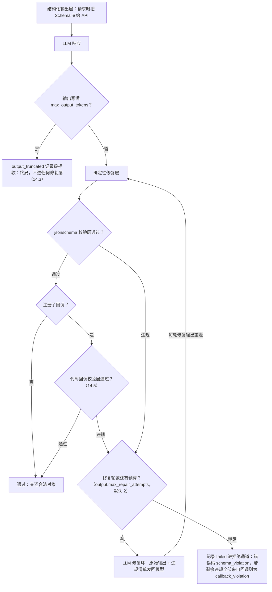
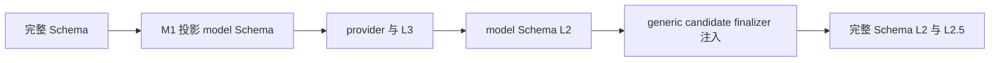

# 第 14 章　结构引擎：四层防线与 Schema 编写指南

> 结构引擎（schema engine）不是一个可开关的算子，而是所有 LLM 输出的**总验收台**——
> 标注、打分裁决、评审结论、生成样本，统统要过它的手。
> 本章讲四层防线如何兜住不守规矩的模型输出，以及怎样写一份「模型容易答对」的 JSON Schema。

## 14.1 直觉：不可信输出的层层安检

第 1 章立过铁律：**LLM 的输出不可信**。它可能——

```
```json                        ← 套了 Markdown 围栏
{
  "intent": "writing",         ← 枚举值答错（应为 writing_assist）
  "topic": "请假条写作",
  "difficulty": "easy",        ← 多了个尾逗号
}
```
```

结构引擎的职责：无论模型输出多不像话，**要么**交还一个通过你 Schema 校验的对象，**要么**明确宣告失败（该记录进拒绝通道）——绝无第三种结局。主输出里每一行都必然走过校验通过的分支，这是机制而非概率。

四层防线，从便宜到贵：

| 层 | 名字 | 干什么 | 成本 |
|---|---|---|---|
| **L0** | 结构化输出层 | 供应商原生结构化输出：请求时就把 Schema 塞给 API，让模型「戴着镣铐生成」 | 零（一个请求参数） |
| **L1** | 确定性修复层 | 纯代码修文本：剥围栏 → 取花括号平衡子串 → `json_repair` 修尾逗号/单引号（v1.11 起输出写满上限的截断响应**不进任何修复层**，见 14.3） | 零 |
| **L2** | jsonschema 校验层 | `Draft 2020-12` 全量校验，收集**全部**违规（不是只报第一条） | 零 |
| **L2.5** | 代码回调校验层（可选） | 你注册的 Python 函数对已过 Schema 的对象做**业务级硬校验**（跨字段、外部词表、坐标合法性……），违规意见与 Schema 违规同路进 LLM 修复环 | 零（跑你的代码） |
| **L3** | LLM 修复环（有界） | 把原始输出 + 违规清单发回给模型：「只输出修正后的 JSON」 | 每轮一次调用 |

流转规则如图。结构化输出层只是让确定性修复层与 LLM 修复环少触发的优化——**它不豁免 jsonschema 校验层**（各家供应商的 Schema 特性覆盖都有缺口，校验永远执行）：



修复边界规则：

- **截断响应不进这套循环**——输出写满 `max_output_tokens` 的响应（`finish_reason=length` / `stop_reason=max_tokens`）被终局化为 `output_truncated` 记录级拒收，从确定性修复层到 LLM 修复环都不再碰它（14.3）；
- **处理已有记录时保留修复依据**——记录标注的 Schema 修复保留首轮实际请求，包括任务、Schema、few-shot、文本和图片。普通记录修复超预算仍按 Schema 校验失败收尾；处理流继续交由会话容量机制处理。UI 的生效修复模型必须支持图片。
- **数组超长直接报告数量**——`maxItems` 错误写明最多允许和实际收到的项目数，避免在违规说明中再次粘贴整个数组。
- **修复调用自己也受上下文预算约束**——所引 profile 声明了 `context_window`（第 6 章）时，某轮修复请求本身超预算则该轮记失败并**短路至预算耗尽**（修复提示词恒定，余轮必然同败；`[原始输出]` 修复原文永不截断——截断即破坏修复语义），拒收归因维持 `schema_violation` / `callback_violation` 不变。

### 业务时间的 model Schema 与完整 Schema

v1.20 对以 `x-labelkit-business-time = true` 标记的业务时间叶子使用两份职责明确的 Schema。完整 Schema 始终是
工程权威；M1 从中机械派生不含时间叶子的 model Schema，provider 首轮与每轮 L3 只看到 model Schema。解析候选先过
model Schema L2，generic candidate finalizer 再把 Planner 或冻结 `SequenceTemporalContext` 中的机械值注入深拷贝，
最后执行完整 Schema L2 与用户回调 L2.5。



这一通用入口由 `FinalizedCallRequest` 描述，并通过 `complete_finalized` 执行。L3 的 `previous_output` 会先投影回
model space，不携带机械时间。候选自行提供时间叶子是 model Schema 违规；finalizer 抛异常、改写非时间字段、返回
非 object 或产物未通过完整 Schema，则是终态 candidate-finalizer contract 错误，不会把固定计划错误伪装成模型重试。

## 14.2 一次真实的抢救过程

上面那段三重问题的输出，引擎是这么救的：

1. **确定性修复层**：剥掉 ` ```json ` 围栏 → 取平衡花括号子串 → `json_repair` 修掉尾逗号。得到可解析对象——注意 `"intent": "writing"` 的枚举错误这一层管不了（它只管「能不能解析」，不看 Schema）；
2. **jsonschema 校验层**：校验发现 1 条违规：`/intent: expected one of enum ["writing_assist", "qa", "translation", "chitchat", "other"], got "writing"` ⇒ 进 LLM 修复环；
3. **LLM 修复环第 1 轮**：向 `repair_llm`（默认同调用方 profile）发一条修复消息（[违规清单] 就是 jsonschema 校验层渲染出的违规原文，只加序号、不改写）：

   ```
   [原始输出]
   （原文全文照贴）

   [违规清单]
   1. /intent: expected one of enum ["writing_assist", "qa", "translation", "chitchat", "other"], got "writing"

   只输出修正后的 JSON。
   ```

4. 修复响应 `{"intent": "writing_assist", ...}` 重走确定性修复层与 jsonschema 校验层 ⇒ 通过。记录的 `_meta.annotation.attempts = 2`（1 次原始 + 1 次修复），报告里 `resolved_at.l3_1` 计 1。

## 14.3 读懂修复分布：resolved_at

报告的 `schema_engine.resolved_at` 是模型「结构纪律」的体检单。它只统计**用户 Schema** 的记录级标注调用，
包括按 sequence class 选择的有效 Schema；内部裁决、评审、生成与帧级标注不进入这个聚合桶。

```json
"schema_engine": {"resolved_at": {"l0_or_clean": 4141, "l1": 87, "l3_1": 30, "l3_2": 3, "rejected": 9}}
```

| 桶 | 含义 | 健康线 |
|---|---|---|
| `l0_or_clean` | 一次到位（原生结构化输出或本来就干净） | 绝大多数 |
| `l1` | 代码修复就够了（围栏/尾逗号级别的小毛病） | 几个百分点很正常 |
| `l3_1` / `l3_2` | 花了 1/2 轮 LLM 修复 | 合计 >5% 该警惕：Schema 对模型不友好 |
| `rejected` | 修不好，进拒绝通道 | 接近 0 |

`l3_*` 高企的第一反应**不是**调大 `max_repair_attempts`（那是花钱掩盖问题），而是先问两个问题：Schema 能简化吗（见 14.4）？profile 能开 `supports_structured_output` 吗？另注意 `max_output_tokens` 太小的症状在 v1.11 变了位置：输出写满上限的截断响应**不再进任何修复层**（把截断 JSON「硬修」成结构合法的对象，可能带着语义残缺混进主输出——这是数据质量隐患，终局化是正确性修复、不设开关），而是按 `output_truncated` 记录级拒收——它体现在 rejects 而不是 `resolved_at`，看到该码批量出现就调大 `max_output_tokens`（第 17、18 章）。

## 14.4 Schema 编写指南：让模型容易答对

你的 Schema 会**逐字出现在提示词里**（第 11 章），它同时是「合同」和「说明书」。写得好，记录在结构化输出层或确定性修复层就一次到位；写得差，每条记录都在 LLM 修复环烧钱。

**枚举值取自解释的名字。**模型看得懂 `writing_assist`，看不懂 `type_3`。枚举本身就是最强的提示。

**给字段写 `description`。**它出现在提示词里，等于给每个字段配了内联判据：

```json
"difficulty": {
  "type": "string", "enum": ["easy", "medium", "hard"],
  "description": "以通用大模型完成该请求的难度衡量：easy 一步可答；medium 需多步推理；hard 需专业知识"
}
```

**`required` + `additionalProperties: false` 是标配。**前者防漏字段，后者防模型自作主张加字段——两者都让错误在 jsonschema 校验层被精确定位，而不是静默混进输出。

**结构越平越稳。**三层嵌套 + 数组套对象的 Schema，LLM 修复环触发率显著高于平铺结构。问自己：这层嵌套是下游真需要，还是顺手画的？能拆成两个顶层字段就别嵌套。

**约束要「模型可感知」。**`maxLength: 200` 这类数值约束，模型经常越界（它不数字数）——要么放宽，要么在 instruction 里用自然语言强调「一句话、50 字以内」。`pattern` 正则约束同理，慎用。

**需要推理的任务，给个 reasoning 字段。**严格格式约束可能压缩模型的思考空间（"Let Me Speak Freely?" 的实测结论）。缓解：在 Schema 里加一个 `reasoning` 字段**放在结论字段之前**，让模型先说理再作答，下游忽略该字段即可。（LabelKit 自己的内部 Schema 大多也这么设计：评审结论的 critiques 在 verdict 之前、pointwise 评分的 reason 在 score 之前；例外是成对裁决——其 reason 仅在 `quality.judgment_reasons` 生效时才有，且位于 winner 之后。）

**版本纪律。**Schema 必须是合法 draft 2020-12、顶层 object、不声明 `_meta`。启动时元校验，写错退出码 2，不会浪费一次调用。

## 14.5 代码回调校验层：把你的业务规则接进防线

JSON Schema 说不清的约束——跨字段关系（`bounds` 必须 l<r、t<b）、外部一致性（label 必须在动态词表里）、业务规则（日期真实存在）——可以注册一个 **Python 回调**来把关：

```toml
[output]
validator = "my_validators.py:check_annotation"   # 相对工程根目录加载文件
```

```python
# my_validators.py —— 放在工程根目录
def check_annotation(obj: dict, record: dict | None) -> list[str]:
    """返回违规描述列表，空列表 = 通过。
    obj    = 已通过完整 Schema 校验的标注对象的递归深拷贝；
    record = 原始行的递归深拷贝，缺失时为 None。"""
    problems = []
    if obj["difficulty"] == "hard" and len(obj["topic"]) < 4:
        problems.append("hard 难度的 topic 不应如此空泛，请给出具体主题")
    if record is not None and obj["topic"] == record.get("instruction"):
        problems.append("topic 不得整句复述原文，请压缩为名词短语")
    return problems
```

工作机制的关键在于：**回调不只是门卫，还是 LLM 修复环的教练**。它返回的违规文本会以 `(validator) 你的消息` 的形式并入 LLM 修复环提示词的违规清单——LLM 拿着你的意见自我修正，所以违规消息要写成「给模型看的改进指示」（说清楚错在哪、该怎么改），而不是只给人看的错误码。

规则速览：

- 只作用于**用户 Schema 的标注调用**（quality/verify/generate 的内部结构不经过它）；
- 与 Schema 违规**共享** `max_repair_attempts` 预算；预算耗尽且剩余违规全部来自回调 ⇒ 记录 `failed`、错误码 `callback_violation`（第 18 章）；
- **启动即体检**：M1 校验引用格式、可导入、可调用，并把每条 few-shot 示例的 output 干跑一遍——示例过不了你自己的回调，是配置错误（退出码 2），不会浪费一次调用；
- **回调抛异常不吞**：该记录按 `internal_error` 失败，运行继续（记录级隔离）；
- 回调以运行者同权限执行任意代码——信任边界与你亲手写的配置文件一致；建议保持纯函数（幂等、无 IO 副作用），它会被每条记录、每轮修复调用；
- 引用形式为 `<python-file>:<attribute-path>`，文件相对工程根目录解析，也接受绝对路径。无需设置 PYTHONPATH。
- 运行和启动示例检查都传递归深拷贝；修改嵌套字段或原始行不会改变正式结果。需要变换字段时使用 annotate.postprocessor。

后处理发生在模型 Schema 通过之后、完整 Schema 和本节业务校验之前。代码字段不会发送给模型，
后处理补齐后必须通过完整 Schema；业务违规仍可进入模型修复，但后处理函数异常和非法返回会直接失败。
后处理完整用法见[标注章节](11-annotate.md#118-用工程代码完成确定性字段)。

生成侧有一个孪生钩子 `generate.sample_validator`（签名 `fn(text) -> list[str]`），语义是**过滤器**而非 LLM 修复环：违规样本直接剔除、计入桶统计，详见第 12 章。

图片模式（v1.22）下回调的第二入参是框架绑定的样本上下文，而不是 `None`；启动干跑仍以 `None` 调用，回调必须处理这种情况（第 11 章 11.9）。未知 region_id 不必写进回调，用 14.9 的注解。

### 三种用户 Schema，三种待遇

用户可声明三类 Schema，它们的待遇不同：

| Schema | 声明在哪 | 管什么 | 四层防线 | 代码回调校验层 | 计入 `resolved_at` | 失败去哪 |
|---|---|---|---|:-:|:-:|---|
| 全局输出 Schema | `[output].schema_path` / `schema_inline` | 主输出每一行的标注对象 | 全在 | ✓ | ✓ | rejects（`schema_violation` / `callback_violation`） |
| **按 sequence class 输出 Schema** | `[class.<类名>.annotate].schema_path` / `schema_inline`（至多其一） | **该类**的行；未声明的类回落全局 | 全在 | ✓ | ✓ | 同上 |
| 帧级 Schema | `[frame.annotate].schema_path` / `schema_inline` | `_meta.stream.members[]` 里的帧标注对象 | 全在 | ✗ | ✗ | members[] 的 `status="failed"`，**不入 rejects** |

**按类 Schema 与全局 Schema 待遇完全相同**：回调照常执行，`resolved_at` 照常计数。每份类 Schema
各自过 draft 2020-12 元校验与 `_meta` 禁令，该类 few-shot 也用该类的有效 Schema 干跑。emitter 落盘前
再按该行的有效 Schema 做纯校验。

帧级 Schema 是特例（第 25 章）：它与 `output.schema` 互相独立，不经过 `output.validator`，也不计入
`resolved_at`。四层结构保证仍完整在场；修复耗尽的成员落 members[] 的 `failed` 状态位而不是 rejects。

## 14.6 配置参考

```toml
[output]
schema_path = "./schema.json"     # 与 schema_inline 恰好二选一
# schema_inline = """{...}"""
max_repair_attempts = 2           # LLM 修复环轮数预算（代码回调校验层违规同样消耗此预算）
# repair_llm = "fixer"           # 省略此键 = 同调用方；可指定便宜小模型专职修 JSON
                                  # （注意：显式写空字符串会报配置错误，退出码 2）
# validator = "mod:fn"           # 可选：代码回调校验层（见 14.5；同样禁止空字符串）
```

`repair_llm` 的使用时机：主力模型很贵、而 `l3_*` 又降不下来时，把修复外包给小模型——修 JSON 不需要智力，需要的是服从。注意小模型也要能把你的 Schema 看明白，太复杂的 Schema 外包修复反而修不动。

## 14.7 内部结构也走同一个引擎

不只用户标注，LabelKit 的内部 LLM 输出也走 SchemaEngine：质量裁决、pointwise 评分、评审结论、
flat 生成样本、闭集分类、分段关系、动作对象、缝合判定，以及 sequence generation 的 ScenarioSeed、
EventPlan、frame payload、SemanticEvaluation 和 noise 判定。内部 Schema 不计入用户 `resolved_at`，但它们的
repair、token 与 trace 仍完整记账。

- 裁决输出偶尔非法不会炸：修不好按平局计（`judgment_invalid`，对 Bradley-Terry 中性），计入 `report.quality.judgment_failures`；
- 内部修复调用同样计入 token 计量与 `llm.call` trace 事件——账一分不少；
- 分类结果的内部 Schema 用 enum 封闭集锁死类名；multi 重复标签在 Schema 通过后确定性归一化。
- 图片模式 segment 的内部 Schema 规定候选结构、0–1000 整数坐标与顶点数；其后的几何检查（环闭合、`Self-intersection` 之类的非法几何、部件共边）走同一个可修复的后校验接缝，修复最多两轮，违规不回显坐标（第 28 章）。框架不调用任何几何修复函数。
- sequence 的每个 frame class 必须是完整 object Schema。系统先按 payload binding 覆盖权威 state value，再由
  generic candidate finalizer 注入业务时间并复验完整 Schema；model Schema 与 L3 都不携带机械时间，不能通过改写
  Schema 或把 authoritative value 送进 L3 来掩盖冲突。
- instruction-only 的 `EventPlanRequest` 显式携带并呈现完整 `state_schema`，让真实 L3 repair 能看到合法枚举；
  declared request 的该字段固定为 null，权威 Schema 从冻结 program/context 解析。
- pre-state 与 base-state 进入 L3 的违规文本固定为
  `<kind>:<json-pointer>:<validator-keyword>`，不包含 actual/expected value。
- declared 最后事件的 outcome post-validation 由 hidden baseline 机械选择 positive Schema、交付 branch 选择
  当前 variant Schema；L3 同样只接收 value-free pointer/keyword。StateEvaluator 随后独立重放复验。
- production post-validator 返回的冻结 `EventExecution` 就是正式提交消费的同一实例，不能丢弃证据后重放。
- DeepSeek 示例声明 `supports_structured_output = false`，验证文本 JSON、确定性解析与真实修复环；
  z.ai 用例验证原生 structured-output body。最终真实端点结果为 DeepSeek 5 passed in 119.26s、
  z.ai 1 passed in 60.81s；显式双-noise 与两条 failure injection 均走生产 LLMClient 与真实服务端。

这就是「LLM 输出不可信」原则的完整落地：**没有任何一条 LLM 文本能绕过校验进入任何下游**。

## 14.8 `segment.box_parser`：把伴随数据转成参考框（v1.22）

图片模式下 LabelKit 不解释伴随数据：它可能是 uiautomator XML、无障碍 JSON、OCR 结果或别的格式，框架不嗅探内容，也不用正则抽取。工程注册一个钩子，把自己的格式转成统一的参考框数组，框架只严格校验这个数组。**是否注册钩子本身就是声明**：不注册就不读伴随文件。

```toml
[segment]
enabled = true
mode = "image"
box_parser = "hooks.py:uiautomator_to_boxes"   # 相对工程根目录
companion_suffix = ".xml"                      # image_7.png 配 image_7.xml
```

**签名。**必须是同步函数，恰好两个位置参数且都没有默认值，比后处理更严。异步函数、生成器、可变参数、额外参数都在启动时拒绝（退出码 2）。启动时只检查签名，不执行。

```python
def uiautomator_to_boxes(companion: bytes, image: dict) -> list[dict] | None:
    """companion 是伴随文件的原始字节，由钩子自行解码；image 是 {"width": W, "height": H}，原图存储像素。"""
```

**返回值只有三种语义，不要混用：**

| 返回 | 含义 | 结果 |
|---|---|---|
| 非空 `list` | 这些是参考框 | 冻结进样本，所有下游共用同一份 |
| `[]` | 数据合法，但没有框 | 继续：有 `instruction` 时模型依据图片生成候选，没有时是合法的空候选 |
| `None` | 数据无法解析，拒收本样本 | 记录以 `companion_invalid` 失败，不调用模型，不计 `bad_input` |

**不要写 `except: return []`。**这会把解析失败伪装成「这张图没有框」，错误数据不再有任何信号。无法解析就返回 `None`，空树或只有窗口外壳才返回 `[]` 或一个外壳框。这些策略写在你的代码里。

**参考框格式。**每项恰好是含 `bbox`、`text` 与可选 `id` 的 `dict`，不允许其他键：

| 字段 | 规则 |
|---|---|
| `id` | 框名。要么每个框都给非空 `id`，要么每个框都留空（省略或 `""`）。全部留空时框架按数组顺序补为字符串 `"1"…"N"`；只命名一部分被拒。给出的框名 1–64 个字符，只含 `[A-Za-z0-9_.:-]`，样本内唯一，不得形如 `r<正整数>`（留给模型新画的多边形）。`null` 与非字符串被拒 |
| `bbox` | `[l, t, r, b]` 列表，原图像素，整数或有限浮点（不接受布尔、NaN、无穷）；`0 ≤ l < r ≤ width`，`0 ≤ t < b ≤ height` |
| `text` | 字符串，可为空，可含换行，给模型看的描述。渲染时经 JSON 转义，任何 text 都不能伪造出另一行参考框 |

框架**不裁剪、不取整、不去重、不合并**。超出画布或零面积的框是钩子的错误，由你决定裁剪还是丢弃。违反上述规则、抛异常、返回元组都是程序错误：该记录以 `internal_error` 失败，其余记录继续，不调用模型，不进修复（重试无意义）。日志只有固定原因（`exception`、`return_type`、`invalid_json`、`invalid_box`）、框序号与钩子引用，不记数据。实跑一个只给第 0 个框命名的钩子（`box_index` 从 0 计）：

```text
box_parser failed: reason=invalid_box box_index=1 hook=...hooks.py:broken_hook
error stage=segment kind=internal_error message=BoxParserError: invalid_box retryable=False
```

这种钩子让每条记录都失败，而退出码仍是 0，只有 `report.counts.failed` 与 `report.segment_image.failed` 能看出来。上线前跑一次小样本，生产运行配 `--strict`。

**怎么写好一个钩子：**

- **只输出有意义的节点**：可见、有文字或可交互。参考框块不裁剪，钩子输出数百个框时每张图就有数百行提示，超窗以 `context_overflow` 失败。
- **框名简短**（例如 `n12`）。来自参考框的候选以框名作为 `region_id`，框名会直接画进叠图和提示词。
- **剔除 bbox 完全相同的嵌套框**。框架不去重，这是业务选择；不剔除的话，只用参考框的路径下这些候选的标识画在同一点上，模型分不清。同一条父子链上 bbox 相同的框只留一个：有文字或名称的节点优先，都有或都没有时留最内层；兄弟节点不算嵌套，不合并。所以包着带字 Button 的可点击 FrameLayout 留下 Button，带 `content-desc` 的 View 里套一个空的可点击 ImageView 时留下 View。

  这一步要在遍历树时做，那时还拿得到节点自身的文字和父子关系。`examples/image-segmentation/hooks.py` 的 `uiautomator_to_boxes` 与 `accessibility_to_boxes` 都这样做，可以照抄其中的 `_add_box`。不要等框转完再对数组按 bbox 去重：遍历先到父节点，「先见先留」会留下没有文字的外层容器、丢掉带文字的子节点，还会误删同框的兄弟节点。
- **保持纯函数和轻量**：不读文件、不联网、不依赖随机性。它在事件循环线程上同步执行，解析很大的文件会推迟同批其他请求。每个样本恰好调用一次，classify 扇出、修复、verify 返工都不再调用；`validate` 与 `--dry-run` 也不调用。
- 框要和图片的存储像素对齐，由你负责（第 5 章 5.6）。

**单测写法。**钩子是普通 Python 函数，直接测；要连框架的校验一起测，用 `invoke_box_parser`，它返回校验并补名后的框，钩子返回 `None` 时返回 `None`。下面这个文件实跑 `3 passed`：

```python
import json
from labelkit.common.extensions.box_parser import invoke_box_parser
from labelkit.common.extensions.hooks import ResolvedHook


def ocr_to_boxes(companion: bytes, image: dict) -> list[dict] | None:
    try:
        lines = json.loads(companion)["lines"]
        return [{"bbox": line["bbox"], "text": line["text"]} for line in lines]
    except (KeyError, TypeError, ValueError):
        return None


def check(companion: bytes, width: int, height: int):
    return invoke_box_parser(ResolvedHook("hooks.py:ocr_to_boxes", ocr_to_boxes), companion, width, height)


def test_named_by_framework():
    boxes = check(b'{"lines": [{"text": "Total", "bbox": [10, 20, 110, 40]}]}', 800, 1000)
    assert [(box.box_id, box.bbox, box.text) for box in boxes] == [("1", (10, 20, 110, 40), "Total")]


def test_empty_is_not_rejection():
    assert check(b'{"lines": []}', 800, 1000) == ()


def test_foreign_data_is_rejected():
    assert check(b"not json", 800, 1000) is None
```

可直接运行的三种钩子（uiautomator XML、无障碍 JSON、OCR JSON）见 `examples/image-segmentation/hooks.py`。

## 14.9 `x-labelkit-region-ref`：可修复的区域引用（v1.22）

图片模式下给输出 Schema 的字段标这个注解，模型引用不存在的候选时进入修复，不会走到后处理：

```json
"region_id": {"type": "string", "x-labelkit-region-ref": true}
```

- **层位**：配了后处理时位于模型 Schema L2 之后、后处理之前；没配时位于 L2 之后、L2.5 之前。违规进入 L3，文本例如 `/items/0/region_id: unknown region reference`，不回显模型给的值。自洽采样中该样本弃权。
- **注解不发给模型**：M1 解析后从发往端点的 Schema 中删除。
- **只能用在字符串上**：值必须恰为 `true`，节点 `type` 必须是 `"string"` 或 `["string", "null"]`（`null` 值跳过检查）。写在 `integer` 上时报 `x-labelkit-region-ref must equal true on a string property or string items`。**`region_id` 字段必须声明为 string**：框架自动补的框名是字符串 `"1"`，不是整数。
- **不能放进代码负责字段**：位于 `x-labelkit-postprocessor` 字段或其子树内是配置错误，因为这些字段不发给模型。非图片模式出现该注解也是配置错误。

检查只回答「这个值是不是本样本的候选」。重复引用、是否必须全选属于业务规则，交给 `output.validator` 或后处理钩子。没有成为候选的参考框不能被引用。
