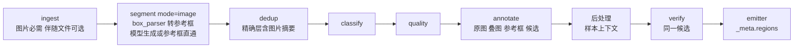

# 第 28 章　图片模式 segment：候选区域与基于候选的标注

> 本章讲 `segment.mode = "image"`（v1.22）：一张图片就是一个样本，segment 决定几何，annotate 只按 `region_id` 选择与标注，
> 后处理钩子做确定性的引用解析与格式转换。
> 权威契约是 `docs/dev/SPEC-image-region-segmentation.md` 与 `docs/CONTRACTS.md` §7.20。
> **证据状态**：28.5、28.9 与 28.11 引用 2026-10-31 的真实运行，条件很窄：一个模型（z.ai glm-5.2）、少量合成图片、人工标注没有复核。其余观测事实来自同日的离线实跑。模型路径没有稳定通过全部门，详见 28.11。

## 28.1 三条候选路径

segment 的两个键决定候选从哪里来：

| 配置 | 候选来源 | segment 调用模型 |
|---|---|---|
| 只有 `instruction` | 模型只依据图片生成 | 每张图一次（不含修复） |
| `instruction` 加 `box_parser` | 模型同时看图片与 `[参考框]`，每个候选要么按 `box_id` 原样复用一个框，要么画新多边形；没被复用的框不会成为候选 | 每张图一次（不含修复） |
| 只有 `box_parser` | 每个参考框按返回顺序直接成为矩形候选，模型不补充也不修正 | 不调用 |
| 两者都没有 | 配置错误 | — |

只用参考框时，伴随文件是候选的唯一来源，所以缺伴随文件的图片按缺对处理，不会写成空候选。



segment 仍在链首，阶段名不变，走普通批路径，没有会话、episode 或 `report.stream`。候选挂在记录信封上，annotate、后处理、verify 与输出读同一份，verify 从不重新分割。

`segment.mode`、`run.mode`、`quality.mode` 是三个不同的键，没有派生关系：`run.mode` 选处理或只生成，`quality.mode` 选打分方式，`segment.mode` 选分割语义（`"image"` 图片平面，`"sequence"` 时序流）。`[segment]` 启用时 `mode` 必填，没有默认值和别名；时序流见第 25 章。

**不做什么。**不接入 SAM 之类的独立分割模型，候选只来自已配置的 LLM profile；不做跨帧身份与追踪；不按内容判断伴随数据是什么格式；不做任何几何自动修复；没有区域数量上限键；没有按类分割指令（segment 运行在 classify 之前）。

## 28.2 跑通示例

示例工程在 `examples/image-segmentation`：

| 工程 | 输入 | 候选来源 | dry-run 估算（segment / classify / annotate / verify / total） |
|---|---|---|---|
| `project.toml` | 2 张纯图片 | 模型依据图片 | 2 / 0 / 2 / 0 / 4 |
| `project-boxes.toml` | 2 张截图加 uiautomator XML | 只用参考框 | 0 / 0 / 2 / 0 / 2 |
| `project-uiautomator.toml` | 同上 | 模型加参考框，verify 开 | 2 / 0 / 2 / 2 / 6 |
| `project-accessibility.toml` | 1 张截图加无障碍 JSON | 模型加参考框，classify 开 | 1 / 1 / 1 / 0 / 3 |
| `project-ocr.toml` | 1 张文档图片加 OCR JSON | 模型加参考框，框名由框架补 | 1 / 0 / 1 / 0 / 2 |
| `project-fixed.toml` | 1 张长边 2601 的大图 | 模型路径，离线测试用固定夹具代替模型输出 | 1 / 0 / 1 / 0 / 2 |

```bash
cd examples/image-segmentation
mkdir -p out
uv run labelkit validate --config ../config.toml --project project-boxes.toml --console plain
uv run labelkit run --config ../config.toml --project project-boxes.toml --dry-run --console plain
```

这两条命令不需要密钥，也不调用模型。`project-boxes.toml` 的实跑输出：

```text
configuration valid
dry-run: mode=process estimated_records=2 batches=1
dry-run: estimated LLM calls — generate_calls=0 segment_calls=0 stitch_calls=0 classify_calls=0 frame_classify_calls=0 extract_calls=0 quality_calls=0 annotate_calls=2 frame_annotate_calls=0 verify_calls=0 total=2 (excludes retries and repair calls)
dry-run: no LLM calls made, no output written (report only)
```

估算不含修复轮。dry-run 不调用 `box_parser`，它写的 `*.dryrun.report.json` 里 `counts.*` 与 `segment_image.*` 全是 0，估算要看 `estimate`。

正式运行需要 `LABELKIT_ZAI_KEY`（`examples/config.toml` 指向 z.ai glm-5.2）。没写 `instruction` 的路径 segment 不调用模型，但 annotate 仍然调用，所以它也需要密钥。

## 28.3 配置

```toml
[segment]
enabled = true
mode = "image"                                 # 启用时必填："image" 或 "sequence"
box_parser = "hooks.py:uiautomator_to_boxes"   # 可选：注册后才读取伴随文件（14.8）
companion_suffix = ".xml"                      # 与 box_parser 同时出现：image_7.png 配 image_7.xml
llm = "default"                                # 只在写了 instruction 时可写
instruction = """
结合图片和参考框生成候选区域。参考框准确时直接复用。
"""

[quality]
enabled = false                                # 或显式指定 rubric，图片模式没有默认 rubric

[annotate]
enabled = true
llm = "default"
postprocessor = "hooks.py:keep_polygons"       # 可选：把候选几何写进输出（28.7）
instruction = """
判断每个候选控件的功能。通过 region_id 引用候选，label 写功能名称。
"""

[output]
schema_path = "schemas/region-polygons.json"
meta_mode = "inline"
```

| 键 | 图片模式 | 时序流模式 |
|---|---|---|
| `enabled`、`mode` | `true`、必填 | `true`、必填 |
| `llm` | 只在有 `instruction` 时可写并被引用 | 可写，仅 `strategy` 为 `llm` 或 `hybrid` 时引用 |
| `instruction` | 可选，写则非空；与 `box_parser` 至少有一个 | 不可写 |
| `box_parser` | 可选，`hooks.py:fn`，启动时加载并检查签名，不执行 | 不可写 |
| `companion_suffix` | 与 `box_parser` 同时出现或同时缺省；以 `.` 开头，不含路径分隔符，不是 `.png`、`.jpg`、`.jpeg` | 不可写 |
| `strategy`、`window`、`noise_filter`、`min_len`、`context`、`on_error` | 不可写 | 原语义 |

组合约束与实跑得到的报错（退出码都是 2，同一次校验汇总全部错误）：

| 情形 | 报错 |
|---|---|
| 启用而缺 `mode` | `[segment].mode: required when segment.enabled = true; expected "image" or "sequence"` |
| 写了时序流的键 | `[segment].strategy: not allowed when segment.mode = "image" (sequence segmentation key)` |
| 没写 `instruction` 却写了 `llm` | `[segment].llm: not allowed when segment.mode = "image" has no instruction (no segment model call is made)` |
| 两者都没有 | `[segment]: segment.mode = "image" requires at least one of instruction and box_parser` |
| 只写一个 | `[segment].companion_suffix: box_parser and companion_suffix must be set together` |
| 后缀是图片扩展名 | `[segment].companion_suffix: expected a suffix starting with "." that is not an image extension, got ".png"` |
| 开 quality 而 rubric 为空，或干脆没写 `[quality]` | `[quality].rubric: segment.mode = "image" has no default rubric; set quality.rubric or quality.enabled = false` |
| 存在 `[stream]` | `[stream]: the [stream] section is not available when segment.mode = "image"` |
| 开 stitch（extract、frame.classify、frame.annotate 同型） | `[stitch].enabled: stitch.enabled = true is not available when segment.mode = "image"` |
| `dedup.semantic = true` | `[dedup].semantic: not available when segment.mode = "image" (image samples have no text to embed)` |
| 显式写 `input.ui_tree_max_chars` | `[input].ui_tree_max_chars: not allowed when segment.mode = "image" (image mode builds no UI tree)` |
| `output.meta_mode = "none"` | `[output].meta_mode: must not be "none" when segment.mode = "image" - candidates and original polygons are carried only by _meta.regions (sidecar is legal), got "none"` |
| 被引用 profile 的 `context_window` 不为正 | `[llm.default].context_window: segment.mode = "image" requires a positive deployment context window for every referenced model profile` |
| 只用参考框且关 annotate | `[segment].enabled: segment.mode = "image" without instruction requires annotate.enabled = true (box_parser-only runs make no model call)`，同时报 quality 与 annotate 不能都关 |

另外几条：

- `run.modality` 必须是 `"ui"`，`run.mode` 必须是 `"process"`，generate 必须关。
- 写了 `instruction` 时 `segment.llm` 必须支持视觉。annotate、verify 恒要求视觉。修复轮会重放图片，所以 `output.repair_llm` 也必须支持视觉。
- `[output]` 的 Schema 恒为必填，只跑分割也不例外。
- `generate.llms`、`quality.llm`、`annotate.llm` 的默认值都是 `default`，它们即使所在阶段关闭也要能解析，所以 config 里要有 `[llm.default]`，或者把这些键改指已声明的 profile。
- `output.max_repair_attempts > 2` 只给一条警告：segment 的修复最多两轮，更大的值对 segment 不起作用。

**只跑分割。**写了 `instruction` 时，annotate 与 quality 可以同时关，用来便宜地单独评估分割。主输出每行只有 `{"image_path": ...}`，有伴随文件时再加 `"companion_path"`，候选在 `_meta.regions`，所以不能配 `meta_mode = "none"`。`project-uiautomator.toml` 关掉 annotate 与 verify 后实跑 dry-run，得到 `segment_calls=2 ... annotate_calls=0 ... total=2`。

## 28.4 输入

一张图片一个样本，文件沿用 `image_<n>.png/.jpg/.jpeg` 命名；任意文件名的照片目录不在范围内。伴随文件的配对、缺对、冲突与图片方向见 5.6。下面是实跑一个目录的结果：原有的 `image_1`、`image_2` 正常；`image_3.xml` 内容不是 XML；`image_4.png` 没有伴随文件；`image_5.xml` 没有图片；另有 `notes.txt` 和 `uitree_1.jsonl`。

```text
image mode: ignored 2 file(s) that are neither images nor declared companion files
ingest.missing_pair index=4 present=image file=image_4.png
ingest.missing_pair index=5 present=companion file=image_5.xml
image segmentation failed: record=1b36c3613bf95fac kind=companion_invalid
   scanned=5  ingested=3  bad_input=2  generated=0
   dropped_dup=0  dropped_lowq=0  dropped_verify=0  failed=1  emitted=2
```

`uitree_1.jsonl` 在图片模式下没有特殊含义，和 `notes.txt` 一样计入 `counts.ignored_files = 2`，不参与守恒式。钩子拒收的 `image_3` 计入 `failed`，不计 `bad_input`。

**去重。**图片模式的精确层键是图片与伴随文件的内容摘要，树侧证据换成参考框文本。实跑结果：

| 输入 | 判定 |
|---|---|
| 纯图片，与另一张逐字节相同 | `exact` |
| 纯图片，改动一个像素 | `near_image`（没有参考框时 `ui_dup_requires = "both"` 退化为只看图片） |
| 截图相同、参考框文字不同 | 默认 `"both"` 下保留 |
| 截图相同、伴随文件字节不同但参考框相同 | `near_both` |

所以**纯图片样本的近重复只靠 pHash，同模板不同文字的图片可能被判重**。遇到这种情况，调小 `dedup.image_phash_max_distance`，或者关闭 dedup。

**quality 与 classify。**两者都看不到候选和叠图，只拿原图，标签是 `[图片]`、`[记录 A 图片]`、`[记录内容 图片]`。quality 必须显式给 rubric：默认 UI rubric 有控件树一致性条目，对没有控件树的样本没有意义。

## 28.5 坐标

**唯一的几何真值是原图存储像素坐标，不取整。**左上角为原点，x 向右，y 向下。这里说的是坐标系：输出几何以它为单位，不表示模型给出的位置就是对的。

模型侧一律用 0–1000 整数网格，x 相对宽度、y 相对高度，两轴各自归一化。原因是 LabelKit 与服务端都可能缩图，只有归一化网格同时不受这两次缩放影响。这是坐标系本身的性质，不保证模型按它作答（见本节末尾）。框架按 `x_px = gx * width / 1000`、`y_px = gy * height / 1000` 投影一次，不取整、不吸附、不改变顶点顺序。

- **网格分辨率**：模型画的多边形只能落在网格上，相邻网格点在 x 方向相距 `width / 1000` 像素，y 方向相距 `height / 1000` 像素。1080 × 2340 的竖屏截图约为 1.08 / 2.34 像素。这是网格能表示的最细单位，不是模型的实测精度；模型实际画得怎样见本节末尾。候选是区域提议，不是像素级掩膜。
- **复用或直通的参考框**不经网格，几何就是钩子给的像素矩形，数值类型保留（整数还是浮点），精度无损。
- **提示词里的网格值只是显示**：来自参考框的几何向外取整，网格框恒包含像素框，所以不足一个网格单位的框仍有正面积，同一框在 `[参考框]` 与 `[候选区域]` 里逐值相同；模型画的顶点就近取偶，可以还原模型原先给的整数。
- 模型给的每个环必须闭合（至少 4 个位置，首末相同），未闭合进入修复，框架不代为闭合。多部件之间单点相接合法，共边不合法。

**模型是否遵守这个网格，不能当成已经成立。**提示词写明了 x 是宽度的千分位、y 是高度的千分位，框架的投影公式两轴也完全对称。但在 2026-10-31 的一次首轮真实运行里（z.ai glm-5.2），模型画的几何在横屏图上不稳定。这只是一个模型、一次首轮、少量合成图片的结果，原因没有证实，不能外推到别的模型或真实照片。glm-5.2 的坐标约定也没有公开文档可查。

下表是留存下来的计数：IoU ≥ 0.5 的匹配数 / 参考区域数，箭头两边是同一样本的两次运行，图片路径相对 `examples/image-segmentation/data`。

| 图片 | 尺寸 | 运行方式 | 匹配 |
|---|---|---|---|
| `photos/image_2.png` | 900 × 600 | 只有图片 | 3/3 → 0/3 |
| `photos/image_2.png` | 900 × 600 | 钩子只给窗口外壳框 | 2/3 → 0/3 |
| `photos/image_2.png` | 900 × 600 | `project.toml` 端到端 | 0/3 → 2/3 |
| `photos/image_1.png` | 900 × 600 | 只有图片 | 0/2 → 2/2 |
| `photos/image_1.png` | 900 × 600 | `project.toml` 端到端 | 2/2 → 2/2 |
| `fixed/image_1.png` | 2601 × 1873（请求 2048 × 1475） | `project-fixed.toml`，segment 走真实模型 | 0/3，首轮只有这一次 |

同日修复后又跑了一轮，segment 提示词与投影没有改，结果同样不稳定：`fixed/image_1.png` 两次都是 3/3（平均 IoU 0.85、0.89），`photos/image_2.png` 端到端 0/3 → 3/3，`photos/image_1.png` 端到端 1/2 → 0/2（第二次 0 个候选）。

- **诊断笔记，不能复核**：当次核对这些横屏图时，x 基本吻合，y 与参考的比值在 `photos/image_2.png` 上一次约 0.99、一次约 0.61，在 2601 × 1873 上约 0.74。后两个数接近 `height / width`（0.667、0.72），y 被按长边归一化就会是这个样子，但这只是猜测。比值背后的多边形没有保存，所以它不算证据，上表才算。
- **竖屏不能下结论**：540 × 960 的 `screens-xml/image_1.png` 在钩子返回空、由模型自己画时也出现过 0/3 → 3/3，但竖屏样本的目标排在同一列，这组数据分不清是不是同一种偏差。
- **复用的参考框不经网格**：`screens-xml/image_1.png` 与 `screens-json/image_1.png`（都是 540 × 960）带对齐的参考框时，两次运行都是 5/5，两个样本的平均 IoU 分别是 0.984 与 0.985。它们都是竖屏，所以这只说明参考框这条路径本身可用，不是横竖屏的对照。

所以模型画的 `_meta.regions` 不要直接当像素真值，先画回原图核对（28.12）。

## 28.6 叠图

annotate 与 verify 每个请求带两张图：原图和候选区域叠图。叠图按与原图相同的逐轴比例缩放后渲染：半透明填充（64/255，约 25%，嵌套多少层都不累积）、1 像素同色轮廓、居中的白字黑边标识。标识文本恒为完整的 region_id，不截断；越出画布时整体平移，不改变几何。叠图只画候选，不画参考框。

- **框名要短**。框名会直接画进叠图和提示词，建议形如 `n12`。
- **bbox 完全相同的嵌套框要自己剔除**（14.8）。否则只用参考框的路径下这些候选的标识画在同一点上，模型无法区分。
- **叠图不落盘，运行结束后不能复现模型当时看到的叠图字节。**它只存在于请求的生命周期内，LabelKit 不新增输出通道。可核对的运行证据是 `_meta.regions`。`trace.content = "full"` 也只记原图路径加 `"overlay": "regions"` 标记。
- **确定性只在同一构建内成立**：同一输入、同一 Pillow / FreeType、同一 Shapely / GEOS 构建，字节才相同。
- **成本不小**。每次请求、每次修复、每次 HTTP 重试都重新渲染一次，渲染在事件循环线程上进行，期间其他任务得不到调度。SPEC §11.8 的实测表（i7-10875H，只看量级）：945 × 2048 截图每次约 0.2–0.7 秒，长边 4000 的照片约 3–6 秒。
- **载荷变大**。叠图恒为 PNG，照片类原图是 JPEG 时，叠图通常比原图大数倍（SPEC §11.9）。

叠图是否真的改善区域选择是实验问题，由消融门回答（28.11），本手册不预设结论。

## 28.7 从候选到输出

annotate 的模型只输出 `region_id` 和你的语义字段，几何由后处理钩子从样本上下文写入。`examples/image-segmentation/hooks.py` 给出两种写法，完整约定见 11.9：

| 钩子 | 输出 |
|---|---|
| `keep_polygons` | 原多边形 |
| `to_bounding_boxes` | 对各部件外环顶点取 min/max 得到 `[l, t, r, b]`，与 Shapely `bounds` 结果相同 |

Schema 里给 `region_id` 标 `x-labelkit-region-ref: true`（14.9），模型引用不存在的候选时进入修复，不会走到后处理。转成矩形后原多边形仍在 `_meta.regions`。

重复引用、是否必须全选这类语义是业务规则，写在 `output.validator` 或后处理钩子里。COCO、CVAT 的多边形通常不支持孔洞，所以输出形态由你的 Schema 决定，LabelKit 不提供公开几何 API。

## 28.8 失败语义

失败都是记录级，没有 `on_error` 键，其余记录继续。退出码 0 不代表每条都成功，生产运行配 `--strict`。

| 情况 | rejects 的 `reason` | 备注 |
|---|---|---|
| 钩子返回 `None` | `companion_invalid` | `errors = ["box_parser rejected companion"]`；不调用模型，不进修复 |
| 钩子抛异常或返回不合契约 | `internal_error` | `errors = ["BoxParserError: invalid_box"]` 之类；日志 `box_parser failed: reason=invalid_box box_index=1 hook=...:fn`，只有固定原因、框序号与钩子引用，没有数据 |
| 首轮预检超限或服务端报超限 | `context_overflow` | 候选块、参考框块、两张图都不裁剪，计入 `report.budget.overflow_records`。预检失败不发请求 |
| Schema 或几何违规修复穷尽 | `segmentation_invalid` | 修复最多两轮 |
| 修复轮超预算 | segment 为 `segmentation_invalid`，annotate 为 `schema_violation` | 这是现行归因，同样明确失败，不删减材料 |
| 输出写满 `max_output_tokens` | `output_truncated` | 终局，没有部分结果，与空候选严格区分 |
| 模型返回空列表，或只用参考框时钩子返回 `[]` | 不进 rejects | 合法的空候选，不补整图框，annotate 照常运行 |
| 摄取之后图片不可读 | `image_decode_error` | 文件被改动、删除或像素截断 |
| 端点错误 | `provider_retryable_exhausted`、`provider_fatal` | 不收图的端点在运行时才以 `provider_fatal` 失败并计入熔断 |

几何与引用违规不回显坐标或模型给的值，例如 `/regions/3: parts overlap or share an edge`、`/items/0/region_id: unknown region reference`。范围、整数类型与顶点数由内部 Schema 判定，这类违规沿用「期望与实际」措辞，会回显越界的标量。

下面几组实跑不依赖模型能力（进程内占位替身只负责返回固定 JSON，不是模型输出）：

- **annotate 容量**：`project-boxes.toml` 配 `max_output_tokens = 4096`，把 `context_window` 依次改小。`12000` 时请求正常发出；`8000`、`6000`、`5000` 时两条记录都不发请求，直接 `context_overflow`，`errors` 为 `annotation prompt exceeds the input budget at the minimal unit (k=2, text floor untrimmable)`；`4000` 时启动就报配置错误（窗口不足以容纳 `max_output_tokens` 加余量）。这些临界值只对这个 540 × 960 的小工程成立，不能照搬。
- **segment 容量**：`project.toml` 配 `context_window = 6000`，两条记录都不发请求，`stage = "segment"`、`context_overflow`。错误文本复用流模式的共用检查，写的是 `complete sequence evidence exceeds the input context budget`，在图片模式下读作「这次分割请求超预算」，并不存在序列。此时 `report.segment_image` 的 `calls = 2`（`calls` 数的是提交的任务）、`usage` 为 0。把窗口再改小到 `5000`，启动就报 `static system-side prompt parts ... >= the input budget`。
- **引用修复**：替身始终引用 `n1`，而 `image_2` 没有候选。首轮加两轮修复共 3 次请求后，这条记录以 `schema_violation` 失败，`errors` 为 `/items/0/region_id: unknown region reference`，后处理钩子没有运行。
- **钩子返回元组**：后处理把 `bbox` 写成元组时，日志 `Postprocessor failed: reason=invalid_json`，记录以 `internal_error` 失败，`errors` 为 `PostprocessorError: postprocessor_error`，不进模型修复。

**`validate --probe` 不验证视觉**：它只发 1 个 token 的文本。不收图的端点能通过探测，运行时才失败。

## 28.9 输出尺寸：`max_output_tokens`

多顶点输出容易写满上限，而截断是终局失败。

**建议：glm-5.2 从 `max_output_tokens = 4096` 起步，不要设到几百。**依据是 2026-10-31 的真实运行：

- **4096 够用**：`segment-image-quality` 四次运行（每次 9 个样本，每样本最多约 7 个候选）截断率都是 0，按组平均每次分割的 completion token 最高约 1000。
- **小上限不只是截断**：感知门用 256 时 z.ai 大量返回 `HTTP 500 Internal Network Failure`，不重试时 8 次里 7 次失败，同一组棋盘用 4096 时 0 次。这类错误会被当成可重试的服务端错误，不是 `output_truncated`。服务端为什么这样没有证实。
- **这批样本的范围很窄**：候选更多或轮廓更细的工程没有测过，要用自己的样本看 `report.segment_image.failed`。

下表是框架估算，它是 `est_text` 对 JSON 文本的估算，不是模型实测，也不含模型的其他输出。上面约 1000 的实测值明显高于同等候选数的估算，所以不要按表算满上限：

| 单个候选 | 约字符数 | 估算 token | 4096 token 约能容纳 |
|---|---|---|---|
| 复用参考框 | 59 | 20 | 204 个 |
| 新画矩形（5 个位置） | 143 | 48 | 85 个 |
| 新画 16 边形 | 287 | 96 | 42 个 |

候选多或轮廓细的工程应调大 segment 所用 profile 的 `max_output_tokens`；看到 `output_truncated` 批量出现，也是这个方向。

## 28.10 观测

下面的数字来自 `project-boxes.toml` 的实跑：真实的 M1、ingest、`box_parser`、segment、dedup 与 emitter；annotate 由进程内占位替身返回空 `items`，它不是模型输出，这里也不展示任何标注结果。

```json
"segment_image": {"calls": 0, "samples": 2, "boxes": 3, "regions": 3, "empty": 1,
                  "failed": {}, "usage": {"prompt_tokens": 0, "completion_tokens": 0}}
```

`image_2.xml` 只有窗口外壳，示例钩子把它转成 `[]`，所以 `empty = 1`，这条记录仍然输出。`usage` 是分割调用的用量，用来拆分 segment 与 annotate 共用同一 profile 时的成本。

`trace.channels` 加 `"segment"` 后，每条成功记录有一个 `segment.regions` 事件，payload 全是计数（实跑形态，省略 `ts`、`run_id`、`batch_no`）：

```json
{"stage": "segment", "ev": "segment.regions", "record_ids": ["c0b76b623ee69ca0"],
 "payload": {"regions": 3, "reused": 3, "drawn": 0, "width": 540, "height": 960, "attempts": 0}}
{"stage": "segment", "ev": "segment.regions", "record_ids": ["66f35547c4e21b1a"],
 "payload": {"regions": 0, "reused": 0, "drawn": 0, "width": 540, "height": 960, "attempts": 0}}
```

第二个事件是 `image_2`：钩子返回 `[]`，空候选也算成功记录。事件恒满足 `regions = reused + drawn`，不带几何和框名；只用参考框的路径 `attempts = 0`。

控制台没有 `/stream` 徽标，链段名单里有 segment。输出字段见 8.2。

## 28.11 证据状态

2026-10-31 在 z.ai glm-5.2 上的结果（细节见 `docs/dev/E2E-FINDINGS.md`，测试在 `tests/integration/test_segment_image_llm.py`）：

| 门 | 回答的问题 | 状态 |
|---|---|---|
| `zai-pixel-perception` | glm-5.2 真的在看图吗 | **未稳定通过**：两次有效运行 6/6、4/6，通过线 5/6。颜色与圆点两次都全对，错在行列比答案小 1 |
| `segment-image-zai` | 分割、叠图、标注、后处理的最小端到端；参考框输入；只用参考框；缩放与 verify 修复 | **部分通过**：参考框与只用参考框都通过；verify 返工按预期工作；纯模型端到端召回 0.2～0.8，低于 0.5 的通过线时有发生；缩放 0/3 与 3/3 都出现过 |
| `segment-image-overlay-ablation` | 叠图对区域选择有没有帮助 | 通过，但这组小样本上**没有看到叠图的可测收益**：两臂正确率相同 |
| `segment-image-quality` | 分割的召回、IoU、截断比例 | 通过：召回 0.625～0.792，匹配区域平均 IoU 0.80～0.87，截断率 0；组间与运行间差异大 |
| `segment-image-annotate-quality` | 固定候选上的区域选择与标签正确率 | 通过：区域选择 0.75～0.875，标签 0.818 |

**这意味着什么**：第 1 道门的约定是不通过时本特性只能交付离线能力。它一过一不过，所以现在只能说模型路径观察到可用，不能说已经验证。带准确参考框的路径最稳；纯靠模型画几何时，请当成不稳定的候选提议。

孔洞与多部件候选没有宣称模型能生成，`project-fixed.toml` 用固定夹具走确定性路径。

**网格假设（SPEC §20.3 ②）**：不能视为可靠成立。横屏图上模型画的几何在两次运行之间不稳定，竖屏样本不足以判断，原因没有证实；数字和限定条件见 28.5。

## 28.12 上线前检查

- [ ] `[segment]` 写了 `mode = "image"`，`[quality]` 显式关闭或指定 rubric？
- [ ] 被引用的 profile 都声明了正的 `context_window`，并且真的收图？（`validate --probe` 查不出后者）
- [ ] 钩子没有 `except: return []`，无法解析时返回 `None`（14.8）？
- [ ] 钩子只输出可见、有文字或可交互的节点，框名简短，剔除了同框嵌套？
- [ ] 图片不依赖 EXIF 方向标签，透明通道已合成到不透明底色（5.6）？
- [ ] `region_id` 字段声明为 string 并标了 `x-labelkit-region-ref`（14.9）？
- [ ] 后处理钩子与校验器处理了 `record is None`，返回的是列表而不是元组（11.9）？
- [ ] 评审 profile 给两种单位的重复几何留了容量（13.2）？
- [ ] 用 `--limit` 小样本看过 `report.segment_image`、rejects 与 `_meta.regions`？
- [ ] 走模型路径时，把 `_meta.regions` 画回原图核对过，横屏图尤其看 y 轴，并且同一批样本跑过不止一次（28.5）？
